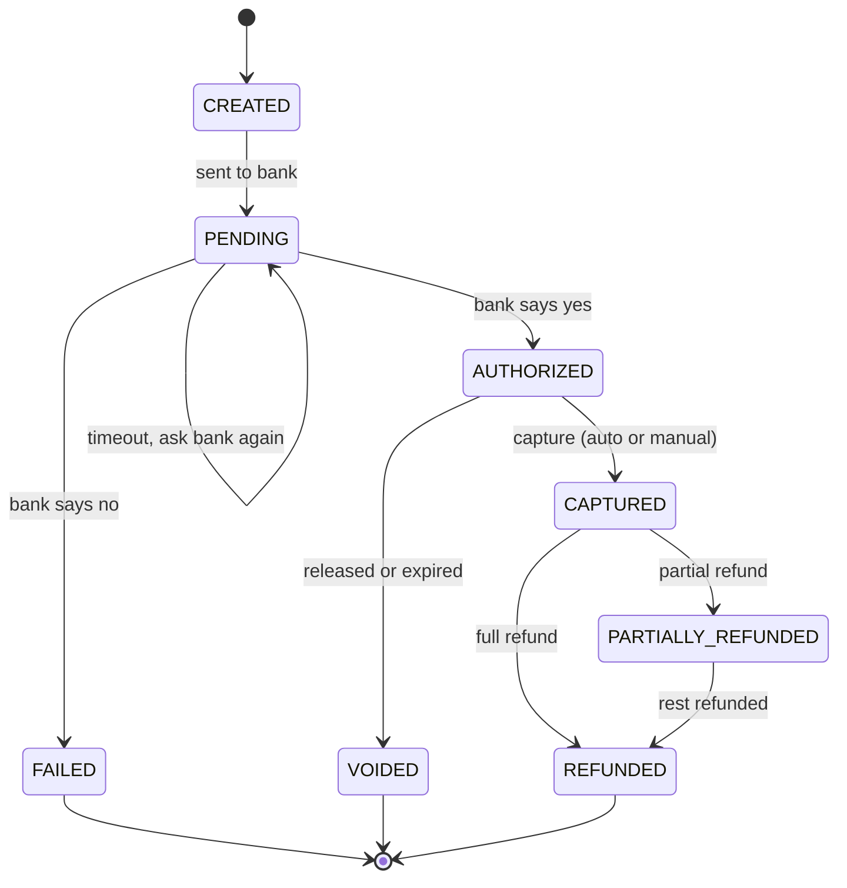
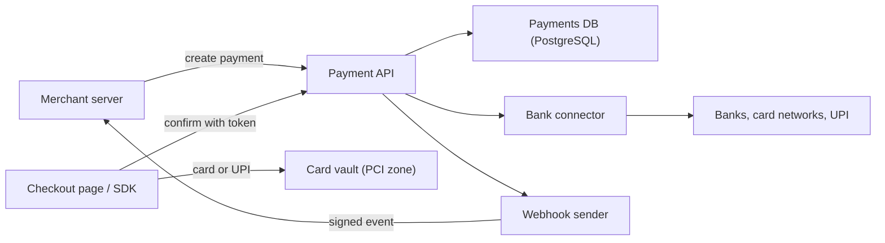
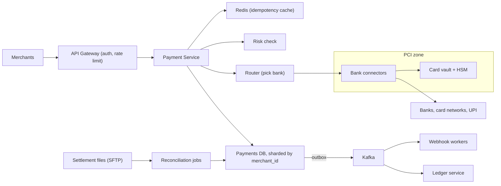
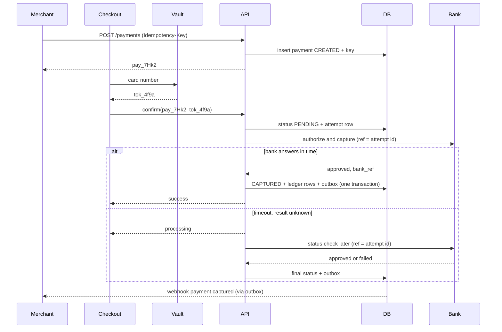
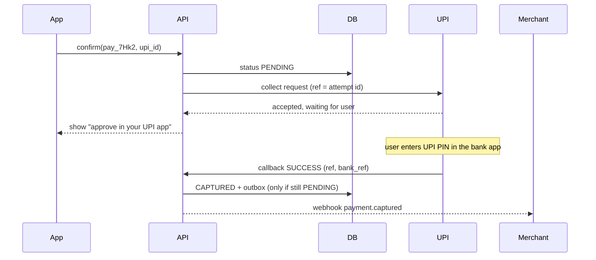

# Payment gateway (Razorpay / Stripe style)

[← System design basics](../system-design.md) · [← Main README](../../README.md)

**In one line:** Take card or UPI details safely and ask the bank for the money once. Then tell the merchant, and match every rupee with the bank later.

**Story:** You pay ₹500 at a small shop with a card machine.
The machine talks to your bank. Sometimes it shows "processing" for a long time and then fails.
The shopkeeper asks, "Did the money go?" Nobody is sure.
At night, the shop owner checks the bank statement and finds the ₹500 did arrive.
A payment gateway is that card machine plus that night check, for millions of shops at once.

---

## 1. How the interviewer asks it

Common wordings:

- "Design a payment gateway like Stripe or Razorpay."
- "Design the payment flow for an e-commerce checkout."
- "Design a system where a customer is never charged twice."
- "A payment call to the bank timed out. What do you do?"

No company-specific source was found for this question.
Candidates report that fintech loops in India (Razorpay, PhonePe) push hard on failure cases and trade-offs.

**What they are really testing:**

- Do you protect money first? No double charge, no lost payment, full audit trail.
- Do you handle the "unknown" result after a timeout, instead of just retrying?
- Do you know that the bank's settlement file is the final truth, and you must reconcile against it?

---

## 2. Questions to ask (with assumed answers)

| Question | Why it matters | What we assume |
|---|---|---|
| Are we the gateway, or a shop that uses a gateway? | Changes who talks to banks. | We are the gateway. We talk to banks, card networks and UPI. |
| Which payment methods? | Cards and UPI behave very differently. | Cards and UPI. Wallets and net banking later. |
| One-step or two-step payment? | Two-step means authorize first, capture later. | Both. Default is auto-capture. Hotels and cabs use two-step. |
| Refunds? | Adds a reverse flow. | Yes, full and partial. |
| Payouts to merchants (settlement)? | Big area on its own. | Only the ledger side. Bank payout details are out of scope. |
| How many payments? | Decides DB size and sharding. | 10 million a day, 10x peak on sale days. |
| How fast must checkout answer? | Card networks and UPI are slow. | A few seconds is fine. Correctness beats speed. |
| How do merchants learn the result? | API polling or push. | Webhooks (we call their URL), plus a status API. |
| Do we store card numbers? | Brings PCI DSS rules. | Only inside a small, locked card vault. Everyone else sees a token. |
| Multi-currency? | Changes the money model. | INR only for now. Store amounts in paise. |
| Fraud checks? | Can add latency. | A simple risk check before calling the bank. ML is out of scope. |

---

## 3. Assumptions

1. We are the gateway. Merchants call our API.
2. Cards and UPI. Refunds yes. Payouts and disputes out of scope.
3. 10M payments a day. Peak 10x on sale days.
4. Money is stored as whole paise in a `long`. Never a float.
5. Every API that moves money needs an idempotency key.
6. Card numbers live only in the card vault (PCI zone).
7. Bank settlement files arrive once a day.

---

## 4. Requirements

**Functional (what it does):**

- Merchant creates a payment (amount, currency, order id).
- Customer pays by card or UPI on our checkout page.
- We authorize (bank holds the money) and capture (bank moves the money).
- Merchant can refund, fully or partly.
- Merchant gets webhooks for every status change, and can call a status API.
- Daily reconciliation with bank settlement files.

**Non-functional (how well it does it):**

- **Never charge twice.** Retries must be safe.
- **Never lose a payment.** If the bank took money, we must know it in the end.
- **Full audit trail.** Every change is recorded. Nothing is deleted.
- High availability: 99.99% for the payment API. A down gateway means merchants lose sales.
- Strong consistency for one payment's state. Reports and dashboards can be a few minutes late.
- Security: PCI DSS for card data, signed webhooks, TLS (encrypted connections) everywhere.

---

## 5. Numbers

See [Capacity estimation](../system-design.md#capacity-estimation) for the method.

| What | Calculation | Result | Decision it drives |
|---|---|---|---|
| Payments, average | 10M ÷ 100,000 s | ~100/s | Small for one DB. |
| Payments, peak | 100 × 10 | ~1,000/s | We plan for 2,000/s. |
| DB writes per payment | payment row, attempt row, 2 ledger rows, outbox, status changes | ~8 | |
| DB writes at peak | 1,000 × 8 | ~8,000/s | Too close to one primary's limit. Plan to shard by `merchant_id`. |
| Webhooks | ~3 events per payment × 1,000/s | ~3,000/s peak | Need a queue. Slow merchants must not slow payments. |
| Storage | ~3 KB per payment (all rows) × 10M | ~30 GB/day, ~11 TB/year | Keep 1–2 years hot. Move older rows to cheap storage. Audit rules need years. |
| Bank call time | card auth 1–3 s, UPI up to 30+ s | | Calls must be async inside, with timeouts. |

**Key point:** the load is not huge. The hard part is correctness, not scale.

---

## 6. APIs

| API | What it does |
|---|---|
| `POST /v1/payments` | Create a payment. Needs `Idempotency-Key`. |
| `POST /v1/payments/{id}/confirm` | Customer's card token or UPI id. Starts the bank call. |
| `POST /v1/payments/{id}/capture` | Two-step only. Move the held money. |
| `POST /v1/payments/{id}/refunds` | Full or partial refund. Needs `Idempotency-Key`. |
| `GET /v1/payments/{id}` | Current status. |
| `POST {merchant_url}` | Our webhook to the merchant. Signed. |

Create a payment (merchant server to us):

```http
POST /v1/payments
Authorization: Bearer sk_live_...
Idempotency-Key: ord_9821-pay-1

{ "amount": 49900, "currency": "INR", "merchant_order_id": "ord_9821", "capture": "auto" }
```

```json
{ "id": "pay_7Hk2", "status": "CREATED", "amount": 49900, "currency": "INR" }
```

- `amount` is in paise. 49900 = ₹499.00.
- The same `Idempotency-Key` with the same body returns the same `pay_7Hk2`.
- The same key with a different body returns `409 Conflict`. That is a client bug.

Webhook (us to merchant):

```http
POST https://shop.example.com/hooks/payments
X-Signature: t=1731744000,v1=5f2b...e9
{ "event_id": "evt_551", "type": "payment.captured", "payment_id": "pay_7Hk2", "amount": 49900 }
```

---

## 7. Data model

**Database:** PostgreSQL (or MySQL). We need transactions, unique constraints and row locks. Money data is small but must be exact.

| Table | Main columns | Notes |
|---|---|---|
| `payments` | `payment_id`, `merchant_id`, `merchant_order_id`, `amount_paise`, `currency`, `status`, `version`, `created_at` | One row per payment. `status` follows the state machine. |
| `idempotency_keys` | `merchant_id`, `key`, `request_hash`, `response`, `created_at` | `PRIMARY KEY (merchant_id, key)`. |
| `payment_attempts` | `attempt_id`, `payment_id`, `bank`, `bank_ref`, `status`, `request_at`, `response_at` | One row per call to a bank. A payment can have many attempts. |
| `payment_events` | `payment_id`, `from_status`, `to_status`, `reason`, `at` | Append only. The audit trail. |
| `ledger_entries` | `entry_id`, `txn_id`, `account`, `debit_paise`, `credit_paise`, `at` | Double entry. See [Bank ledger and wallet](bank-ledger-wallet.md). |
| `refunds` | `refund_id`, `payment_id`, `amount_paise`, `status`, `bank_ref` | Sum of refunds ≤ captured amount. |
| `outbox` | `event_id`, `payment_id`, `type`, `payload`, `sent` | Webhooks and Kafka events. See [Transactional outbox](../microservices.md#transactional-outbox-pattern). |
| `card_tokens` (vault only) | `token`, `encrypted_pan`, `expiry`, `key_id` | Lives in a separate DB, inside the PCI zone. |

**Payment state machine.** A payment can only move along these arrows. Any other change is rejected.



- **Authorize** means the bank puts a hold on the money. **Capture** means the bank actually moves it.
- UPI has no separate hold in the normal flow. It goes from PENDING straight to CAPTURED.
- We change status with a check, so two workers cannot both move it:

```sql
UPDATE payments SET status = 'AUTHORIZED', version = version + 1
WHERE payment_id = 'pay_7Hk2' AND status = 'PENDING';  -- 0 rows = someone already moved it
```

**PCI basics (card security):**

- *PCI DSS* is the card industry's security rulebook. Any system that sees a full card number is "in scope" and gets audited.
- We keep the scope tiny. Only the **card vault** sees the full card number (*PAN*, primary account number).
- The vault encrypts the PAN and returns a **token** like `tok_4f9a`. All other services store only the token and the last 4 digits.
- The CVV (3 digits on the back) is **never stored**, not even encrypted. It is used once and dropped.
- The checkout page sends card data straight to the vault, not through the merchant's server. So the merchant stays out of PCI scope.

---

## 8. Architecture, version 1 (simple)



- **Payment API:** owns the state machine and idempotency. One service, one DB.
- **Card vault:** turns a card number into a token. Small and locked down.
- **Bank connector:** one adapter per bank or network. It speaks their format and handles their timeouts.
- **Webhook sender:** reads the outbox and calls merchant URLs with retries.

This works for a few hundred payments per second.

---

## 9. Architecture, version 2 (at scale)



**What changed and why:**

- **API Gateway:** checks merchant API keys and rate limits each merchant. See [Rate limiting](../system-design.md#rate-limiting-algorithms).
- **Redis idempotency cache:** a fast check for repeat keys. The DB unique key is still the final guard.
- **Sharded DB by `merchant_id`:** writes grew past one primary. One merchant's payments stay on one shard. See [Partitioning and sharding](../system-design.md#partitioning-and-sharding).
- **Router:** picks the bank with the best success rate right now. If HDFC is failing, send to ICICI. Circuit breaker per bank. See [Circuit breaker](../microservices.md#circuit-breaker).
- **HSM** (hardware security module, a locked box that holds encryption keys): the vault's keys never leave it.
- **Kafka:** fans out events to webhooks, ledger and analytics. A slow merchant cannot block payments.
- **Reconciliation jobs:** read bank settlement files and match them with our rows.

---

## 10. Step-by-step flows

**Card payment, auto-capture, with a timeout case:**



**UPI payment (async result):**



- The UPI callback can come late, twice, or never. The handler is idempotent (checks the current status). A poller asks for status if no callback comes in time.

---

## 11. Deep dives

### (a) Idempotency keys, end to end

*Idempotency* means doing the same thing twice gives the same result as doing it once. See [Idempotency](../microservices.md#idempotency).

There are **three hops**. Each one needs its own guard.

| Hop | Key | Guard |
|---|---|---|
| Merchant → us | merchant's `Idempotency-Key` | `PRIMARY KEY (merchant_id, key)` |
| Us → bank | our `attempt_id` as the bank reference | Bank rejects a repeat reference. We also ask status before retrying. |
| Us → merchant (webhook) | our `event_id` | Merchant stores seen `event_id`s and skips repeats. |

How the first hop works:

1. Merchant sends `Idempotency-Key: ord_9821-pay-1`.
2. We insert into `idempotency_keys` with a hash of the body. Insert and payment row are in one transaction.
3. A retry with the same key hits the unique key. We return the saved response.
4. Same key, different body hash → `409 Conflict`.
5. Two requests at the same moment? Only one insert wins. The other waits a little and reads the saved result.
6. Keep keys at least 24 hours. Stripe documents the same 24-hour minimum, and it replays the first response ([Stripe docs](https://docs.stripe.com/api/idempotent_requests)).

```sql
INSERT INTO idempotency_keys (merchant_id, key, request_hash, created_at)
VALUES (:m, :k, :hash, now())
ON CONFLICT (merchant_id, key) DO NOTHING;   -- 0 rows inserted = this is a retry
```

**Exactly-once is not possible over a network.** We do *at-least-once* sending plus idempotent handling. The effect is "once".

### (b) Timeouts and unknown states

This is the question that separates good answers from weak ones.

The bank call timed out after 30 seconds. Three things may have happened:

- The request never reached the bank. No money moved.
- The bank charged the card, but the reply got lost.
- The bank is still working on it.

**We cannot tell which one.** So:

1. **Write before you call.** The payment is PENDING and the attempt row exists *before* the bank call. If our server crashes mid-call, the row is still there.
2. **Never retry blindly** with a new reference. That could charge twice.
3. **Ask, don't guess.** A *status poller* job finds PENDING attempts older than N seconds. It calls the bank's status API with our attempt id.
4. **Back off.** Poll at 10 s, 30 s, 1 min, 5 min... See [Retry with backoff and jitter](../microservices.md#retry-with-exponential-backoff-and-jitter).
5. **Tell the user the truth.** Show "Payment processing. We will confirm in a few minutes." Do not show "failed".
6. **Give up safely.** If still unknown after hours, reconciliation (next deep dive) decides. If money came but we marked it failed, we auto-refund.

Set each bank call's timeout from measured p99 latency (99% of calls finish faster), not a random number. See [Timeouts](../microservices.md#timeouts).

### (c) Reconciliation with bank settlement files

*Reconciliation* means matching our records with the bank's records, line by line.

Why: our DB says what we *think* happened. The bank's settlement file says what *really* happened to the money. The bank wins.

How it works, every day:

1. Bank drops a settlement file (CSV) on SFTP (a secure file server): `bank_ref, amount, status, date`.
2. Job loads it into a staging table.
3. Join with `payment_attempts` on `bank_ref`.
4. Put each row in a bucket:

| Our side | Bank side | Meaning | Action |
|---|---|---|---|
| CAPTURED | settled | All good | Mark reconciled |
| PENDING or FAILED | settled | Money came, we missed it | Mark captured and send webhook, or refund |
| CAPTURED | missing | We think money came, it did not | Raise alert, hold merchant payout |
| amount A | amount B | Amount mismatch | Manual review queue |

5. Totals must also match: sum of our captured amounts for the day = sum in the bank file, minus fees.
6. Unmatched rows go to an operations queue with a dashboard.

The merchant payout (sending money to the merchant's bank) uses only **reconciled** payments. This stops us paying out money we never got.

### (d) Webhooks to merchants

Webhooks are our "push" to the merchant. They fail often: merchant servers go down, return 500, or are slow.

- **At-least-once:** an event stays in the outbox until the merchant returns `2xx`.
- **Retries with backoff:** 1 min, 5 min, 30 min, 2 h, ... up to about 3 days. Then mark it failed and show it in the merchant dashboard.
- **Timeout per call:** 5–10 seconds. One slow merchant must not hold our worker threads. Use a separate pool per merchant or per shard. See [Bulkhead](../microservices.md#bulkhead).
- **Order is not guaranteed.** `payment.refunded` may arrive before `payment.captured`. Merchants should call `GET /payments/{id}` for the latest truth.
- **Signature:** we sign the body with a secret shared only with that merchant. The merchant checks it, so nobody can fake a "paid" webhook.

Merchant side check (HMAC means a hash made with a secret key):

```java
boolean isValid(String body, String header, String secret) throws Exception {
    // header looks like: t=1731744000,v1=5f2b...e9
    String ts = header.split(",")[0].substring(2);
    String sig = header.split(",")[1].substring(3);
    if (Math.abs(Instant.now().getEpochSecond() - Long.parseLong(ts)) > 300) {
        return false; // older than 5 min: maybe a replay attack
    }
    Mac mac = Mac.getInstance("HmacSHA256");
    mac.init(new SecretKeySpec(secret.getBytes(UTF_8), "HmacSHA256"));
    byte[] expected = mac.doFinal((ts + "." + body).getBytes(UTF_8)); // sign time + body
    return MessageDigest.isEqual(expected, HexFormat.of().parseHex(sig)); // constant-time compare
}
```

---

## 12. Follow-up questions interviewers ask

- **Our service crashed after the bank charged, before we saved "captured". What now?** We wrote PENDING before calling. The status poller finds it and asks the bank. Reconciliation catches anything left.
- **The user double-clicks "Pay". What happens?** The checkout sends the same idempotency key both times. The second call gets the first result.
- **A bank is down. What do you do?** Circuit breaker opens for that bank. The router sends new payments to another bank. Payments already PENDING at the down bank stay PENDING until we can ask.
- **How long do you keep idempotency keys?** At least 24 hours. Longer for flows that retry over days, like refunds.
- **Can Kafka exactly-once save us?** No. It covers Kafka-to-Kafka only. The bank call is outside Kafka. We still need idempotency keys and status checks.
- **Which database and why?** PostgreSQL. ACID transactions (all-or-nothing writes) and unique keys. Shard by `merchant_id` when writes grow. See [SQL vs NoSQL](../system-design.md#sql-vs-nosql).
- **How do you store card data?** We don't, outside the vault. Tokens everywhere else. CVV is never stored.
- **Refund larger than the payment?** Lock the payment row, sum existing refunds, reject if the total goes over captured amount. See [Optimistic vs pessimistic locking](../databases.md#optimistic-vs-pessimistic-locking).
- **How do merchants test?** A test mode with test keys and a fake bank. Same API, separate data.
- **What do you monitor?** Success rate per bank and per method, and p99 latency. Also PENDING payments older than 10 minutes, webhook failures and reconciliation mismatches.

---

## 13. What can go wrong

| Problem | What we do |
|---|---|
| Bank call times out | Keep PENDING. Status poller. Never retry with a new reference. |
| Bank says "failed" but money moved anyway | Reconciliation finds it. Auto-refund or mark captured. |
| Duplicate UPI callback | Status check in the `UPDATE ... WHERE status='PENDING'`. Second one changes 0 rows. |
| Merchant webhook endpoint down | Retries with backoff for days. Merchant can also poll the status API. |
| Webhook secret leaked | Merchant rotates the secret in the dashboard. We sign with both old and new for a short time. |
| Our DB primary dies | Promote a replica with synchronous replication (no lost commits). Payments in flight are PENDING and get resolved by the poller. |
| Kafka down | Events wait in the outbox table. Payments still work. |
| One huge merchant (sale day) | Per-merchant rate limit. Its shard may need its own DB. |
| Settlement file late or broken | Alert. Hold payouts for that bank. Rerun when the file comes. |

---

## 14. Trade-offs

| We chose | We get | We give up |
|---|---|---|
| SQL with transactions | Exact money logic, unique keys | Manual sharding later |
| Write PENDING before every bank call | Never lose a payment | One extra write per call |
| Status poller + reconciliation, not blind retries | No double charges | Some payments stay "processing" for minutes |
| Async webhooks with retries | Slow merchants can't hurt us | Merchants must handle duplicates and wrong order |
| Small PCI zone (vault + connectors) | Smaller audit, less risk | One more network hop per card payment |
| Smart routing across banks | Higher success rate | More connectors to build and keep |
| Shard by `merchant_id` | A merchant's reports hit one shard | A very large merchant can make one shard hot |

---

## 15. Say this in the interview

> "We are the gateway. We support cards and UPI, with refunds. 10 million payments a day is about 100 per second, and 1,000 at peak. So the hard part is correctness, not scale.
> Every payment follows a state machine: created, pending, authorized, captured, refunded or failed. We only move it with a conditional update.
> Merchants send an idempotency key. We store it with a unique constraint and replay the first response on retry. We send our attempt id to the bank as its reference.
> We write PENDING before calling the bank. If the call times out, we never retry blindly. A poller asks the bank for status.
> Every day we reconcile with the bank settlement file. The bank's file is the final truth.
> Merchants get signed webhooks from an outbox, with retries for days. Card numbers live only in a small PCI vault. Everyone else sees a token."

---

## 16. Mid vs senior vs staff

| Mid | Senior | Staff |
|---|---|---|
| Draws API, Payment Service, DB, bank call | Adds the state machine with conditional updates | Talks about routing across banks by live success rate |
| Mentions idempotency key on the API | Idempotency on all 3 hops: merchant, bank, webhook | Designs the reconciliation buckets and the payout hold |
| Says "retry on failure" | Handles timeout as UNKNOWN: write first, poll status, never retry blindly | Plans multi-region: which data must be synchronous, what happens to PENDING during failover |
| Uses SQL | Explains why SQL, and shards by `merchant_id` | Thinks about one huge merchant on a sale day, and per-merchant limits and isolation |
| Knows webhooks exist | Signed webhooks, retries with backoff, dedupe by `event_id` | Keeps PCI scope small on purpose, HSM for keys, key rotation |
| | Uses an outbox for events | Defines what to monitor and alert on: PENDING age, mismatch count, success rate per bank |
