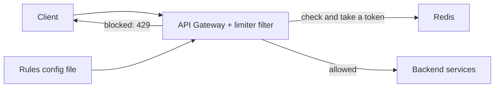
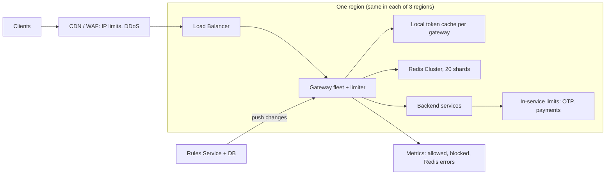
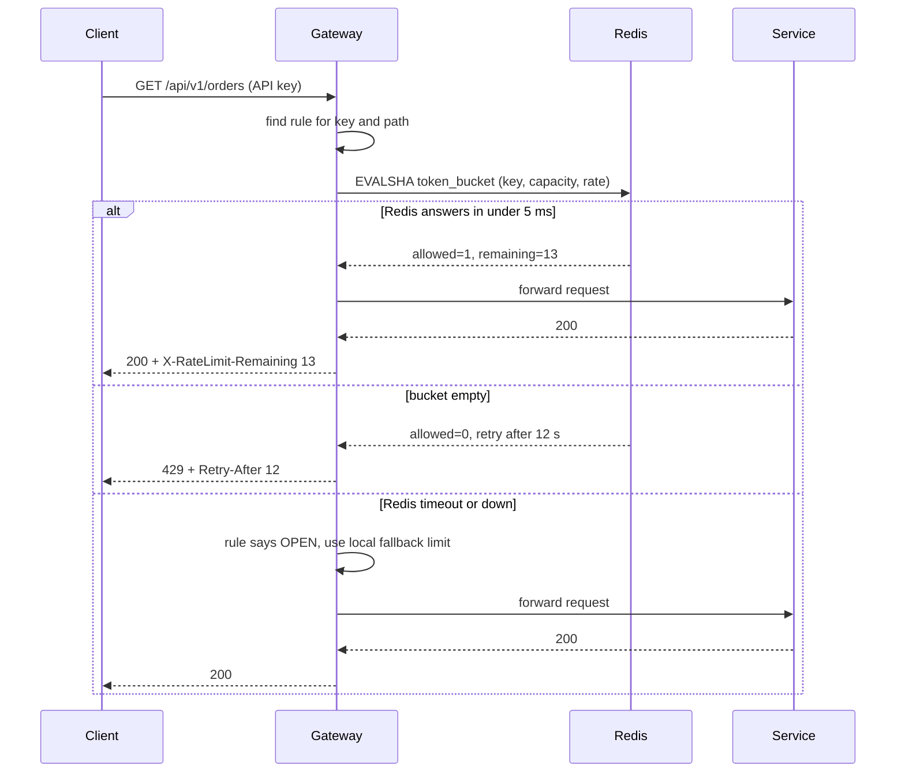

# Rate limiter

[← System design basics](../system-design.md) · [← Main README](../../README.md)

**In one line:** Count each client's requests in a shared place, and say "429, slow down" when they go over their limit.

**Story:** Your bank lets you take out only ₹25,000 a day from ATMs.
The bank has 10,000 ATMs. You can try a different ATM every time.
But every ATM asks the same central system: "How much has this card taken today?"
So the limit holds across all machines.
A distributed rate limiter works the same way: many API servers, one shared count per user.

---

## 1. How the interviewer asks it

Common wordings:

- "Design a rate limiter for our public API."
- "Design a distributed rate limiter: 100 requests per minute per user, across many servers."
- "How would you stop one customer from hurting others on a shared API?"

Where it is asked: prep sites report it at Amazon, Google, Uber, Stripe, Microsoft and Pinterest. 2025 Glassdoor reports list it at Atlassian. Indian product companies often ask it as low-level design ("write the class"). Big tech usually asks the distributed version.

**What they are really testing:**

- Do you know **more than one algorithm**, and can you pick one with a reason?
- Can you keep a **shared counter correct** when many servers update it at once (race conditions)?
- Do you think about **failure**: what happens when Redis is down?

Ask early: "Do you want the class design or the distributed system?" Here we do the distributed system. We also show the core logic.

---

## 2. Questions to ask (with assumed answers)

| Question | Why it matters | What we assume |
|---|---|---|
| Limit by what: user, API key, IP? | Decides the counter key | API key for paid APIs, user ID for the app, IP for anonymous |
| What limits? | Decides window size and algorithm | Free plan 100/min, paid plan 1,000/min |
| Allow short bursts? | Token bucket vs fixed window | Yes, small bursts are fine |
| Where does it run? | Gateway, service or library | At the API gateway, plus some limits inside services |
| How many requests overall? | Decides Redis size | ~1M requests/s across all gateways |
| How many clients? | Decides memory | ~100M users, ~10M active at once |
| Extra latency allowed? | Decides local vs remote check | Under 5 ms added for 99% of requests (p99) |
| Must it be exact? | Exact costs more | A few percent over the limit is OK |
| What happens to rejected calls? | Drop, queue or reject | Reject with HTTP 429 and `Retry-After` |
| One region or many? | Global counts are slow | 3 regions. Limits can be per region. |
| Can limits change without a deploy? | Config storage | Yes, rules in a config store |

---

## 3. Assumptions

1. Limit per API key or user ID. Rules live in config, not code.
2. Token bucket, so short bursts are allowed.
3. Counters live in a Redis cluster shared by all gateways.
4. ~1M checks per second. Each check adds under 5 ms.
5. Small overshoot is OK. Rejected calls get 429.
6. If Redis fails, normal APIs stay open. Login and payment APIs fail closed.

---

## 4. Requirements

**Functional (what it does):**

- Allow or reject each request based on rules (who, which API, how many per time).
- Return 429 with `Retry-After`, `X-RateLimit-Limit` and `X-RateLimit-Remaining` headers.
- Different limits per plan (free, paid) and per API.
- Change rules without a deploy.

**Non-functional (how well):**

- Very low latency: under 5 ms added at p99.
- Highly available. The limiter must never take the API down.
- Correct across many servers. A user cannot get 10x the limit by hitting 10 servers.
- Roughly accurate is OK (a few percent).

---

## 5. Numbers

| Step | Math | Result | Decision it drives |
|---|---|---|---|
| Checks per second | given | ~1M/s | Every request makes one Redis call |
| One Redis shard, Lua script | assume ~50,000 scripts/s per shard | | |
| Shards needed | 1M ÷ 50,000 | ~20 primaries + replicas | **One Redis is not enough. Use Redis Cluster.** |
| Memory per bucket | tokens + timestamp + key ≈ 100 bytes | | |
| Active buckets | 10M active clients × 100 bytes | ~1 GB | Memory is small. Throughput is the hard part. |
| Network time | Redis in the same zone | ~0.5–1 ms | Fits the 5 ms budget |
| Cross-region call | Mumbai to Virginia | ~200 ms | **No global Redis.** Count per region. |

The numbers tell us: memory is easy, request rate and latency decide the design.

---

## 6. APIs

The limiter is mostly internal. Two interfaces matter.

**1) The check (inside the gateway, as a filter):**

```java
public record Decision(boolean allowed, long remaining, long retryAfterSeconds) {}

public interface RateLimiter {
    Decision check(String clientKey, String ruleId); // e.g. ("key_ab12", "orders-api")
}
```

**2) What the client sees when blocked:**

```http
HTTP/1.1 429 Too Many Requests
Retry-After: 12
X-RateLimit-Limit: 100
X-RateLimit-Remaining: 0
```

- `Retry-After` is a standard HTTP header. The `X-RateLimit-*` headers are common, not a standard.

**3) Rules admin API:**

```http
PUT /admin/rate-limit-rules/orders-api
{ "match": { "path": "/api/v1/orders/**", "plan": "FREE" },
  "algorithm": "TOKEN_BUCKET", "capacity": 20, "refillPerSecond": 1.67,
  "onStoreFailure": "OPEN" }
```

- `capacity: 20` = burst size. `refillPerSecond: 1.67` ≈ 100 per minute.

---

## 7. Data model

**Rules** (small, change rarely): a SQL table or a config store. Gateways cache them in memory.

| Column | Example |
|---|---|
| `rule_id` | `orders-api-free` |
| `match_path`, `match_plan` | `/api/v1/orders/**`, `FREE` |
| `algorithm` | `TOKEN_BUCKET` |
| `capacity`, `refill_per_second` | `20`, `1.67` |
| `on_store_failure` | `OPEN` or `CLOSED` |

**Counters** (huge number of tiny, fast-changing values): Redis.

- Key: `rl:{orders-api-free}:key_ab12`
- Value: a hash `{ tokens: 14.2, ts: 1731740000123 }`
- Expires after the bucket would be full again. Idle clients use no memory.

**Why Redis:** in memory (sub-millisecond), atomic Lua scripts, built-in expiry, and Redis Cluster shards keys for us.
We do not need the counters to survive a crash. Losing them only resets limits for a moment.

---

## 8. Architecture, version 1 (simple)



- The gateway runs the limiter as a filter on every request. See [API gateway](../microservices.md#api-gateway-and-bff).
- Spring Cloud Gateway has this built in: the `RequestRateLimiter` filter with `RedisRateLimiter` uses a token bucket in Redis.
- This works for one region and a few thousand requests per second.

---

## 9. Architecture, version 2 (at scale)



**What changed and why:**

- **Edge / WAF (web application firewall) first.** Floods by IP are stopped before they reach us. That is DDoS protection, not fair use.
- **Redis Cluster.** 1M checks/s needs ~20 shards. Each client key lives on one shard (see [consistent hashing](../system-design.md#consistent-hashing)).
- **Local token cache.** For very busy keys, a gateway takes tokens from Redis in small batches (deep dive 11.2).
- **In-service limits.** Business limits ("3 OTPs per 10 minutes per phone") live in the service that knows the business.
- **Rules Service.** Rules change without a deploy. Gateways get pushes, or poll every 10 s.
- **One Redis per region.** No cross-region calls on the request path (deep dive 11.4).
- **Metrics.** We watch block rates per rule, and Redis errors.

---

## 10. Step-by-step flows

**Normal check, with the Redis failure path:**



---

## 11. Deep dives

### 11.1 Which algorithm

The basics page explains all five: [Rate limiting algorithms](../system-design.md#rate-limiting-algorithms). Here is how to choose.

| Need | Pick |
|---|---|
| Simple, and edge bursts are OK | Fixed window counter (`INCR` + `EXPIRE`) |
| Allow short bursts, steady average | **Token bucket** (our default) |
| Smooth, steady output to a fragile system | Leaky bucket (a queue drained at a fixed speed) |
| Exact count in the last 60 s, low volume | Sliding window log |
| Close to exact, cheap, huge scale | Sliding window counter |

**Token bucket, in numbers:**

- Capacity 20, refill 1.67 tokens per second (≈100 per minute).
- A user who was idle has 20 tokens. They can send 20 requests at once (a burst).
- After that, they get about 1 request every 0.6 seconds.
- We do not need a timer to add tokens. On each request we compute: `tokens = min(capacity, tokens + seconds_since_last × rate)`.

**Why we pick it:** only two small numbers per client. It allows bursts, and real apps send a few calls when a screen opens. It is easy to explain.

### 11.2 Shared counters in Redis, without races

**The race:** two gateways read "tokens = 1" at the same time. Both take it. Both allow. Now 2 requests passed with 1 token.
Read-then-write in two steps is always wrong here.

**Fix 1, fixed window:** `INCR` is atomic (Redis runs one command at a time).

- `INCR rl:key:minute` then `EXPIRE` 60 s if the result is 1.
- Trap: if the server crashes between `INCR` and `EXPIRE`, the key never expires. The user is blocked forever.
- So run both together in a `MULTI` transaction or a Lua script.

**Fix 2, token bucket:** a Lua script. Redis runs the whole script as one step, so there is no race.

```lua
-- KEYS[1] = bucket key, ARGV[1] = capacity, ARGV[2] = refill per second
local cap, rate = tonumber(ARGV[1]), tonumber(ARGV[2])
local t = redis.call('TIME')                              -- Redis clock, not gateway clocks
local now = t[1] * 1000 + math.floor(t[2] / 1000)         -- milliseconds
local b = redis.call('HMGET', KEYS[1], 'tokens', 'ts')
local tokens = tonumber(b[1]) or cap
local ts = tonumber(b[2]) or now
tokens = math.min(cap, tokens + (now - ts) / 1000 * rate) -- refill since last call
local allowed = 0
if tokens >= 1 then tokens = tokens - 1; allowed = 1 end
redis.call('HSET', KEYS[1], 'tokens', tokens, 'ts', now)
redis.call('PEXPIRE', KEYS[1], math.ceil(cap / rate * 1000)) -- idle buckets disappear
return { allowed, math.floor(tokens) }
```

- We use Redis `TIME`, so gateways with slightly wrong clocks do not matter.
- One key per client → the script runs on one Redis Cluster shard.

**Hot keys:** one big customer sends 50,000 requests/s. All of them hit one Redis shard.

- **Token batching:** each gateway takes 100 tokens at a time from Redis and spends them locally. 100x fewer Redis calls.
- Cost: a little overshoot. A gateway may hold unused tokens when the user stops. Fine for big limits.
- For small limits (5 per minute), always go to Redis.

### 11.3 Where the limiter sits

| Place | Good for | Not good for |
|---|---|---|
| **CDN / WAF (edge)** | IP floods, bots, DDoS | Per-user plans; it does not know the user |
| **API gateway** (our main choice) | Per API key / user / plan; one place for all services | Business rules ("3 OTPs per phone") |
| **Inside the service** | Business limits; costly actions | Repeating the same code in many services |
| **Client library / SDK** | Our own outgoing calls (we may call an SMS vendor only 500/s) | Protecting us from others; clients can ignore it |
| **Sidecar** (service mesh like Envoy) | Same rules for many services, any language | One more moving part to run |

Say it simply: "Edge for floods, gateway for fair use, service for business rules."

### 11.4 Fail open vs fail closed, and many regions

**Redis is slow or down. What now?**

| | Fail open (allow) | Fail closed (block) |
|---|---|---|
| Users | Keep working | Get errors |
| Backend | No protection for a while | Protected |
| Use for | Feeds, search, product pages | Login (password guessing), OTP, payments |

Make it safe:

- Put a **timeout** on the Redis call (for example 5 ms). See [Timeouts](../microservices.md#timeouts).
- Put a **circuit breaker** on Redis. After many errors, stop calling it for 30 s. See [Circuit breaker](../microservices.md#circuit-breaker).
- While open, use a **local fallback limit**: each of 50 gateways allows `limit ÷ 50` per user. Rough, but not zero protection.
- Alert on every fail-open event. The decision is per rule (`onStoreFailure`).

**Many regions:**

- A global Redis means a ~200 ms call across the world. Too slow.
- **Option A (simple, our choice):** each region has its own Redis and counts alone. A user is usually routed to one region, so this is nearly exact.
- **Option B:** split the limit. 3 regions → each region allows a third. Wrong for users who use only one region.
- **Option C (staff level):** count locally, and share counts between regions every few seconds. Small overshoot, no extra latency.

---

## 12. Follow-up questions interviewers ask

- **Two gateway nodes both let request 101 through?** Not with one atomic Lua script on one Redis shard. With token batching, a small overshoot is possible. We agreed that is OK.
- **Free vs paid plans?** The rule match includes the plan. The gateway reads the plan from the API key or token. Rules are pushed from the Rules Service.
- **How do you limit concurrent requests, not rate?** Keep a counter of in-flight requests. Add 1 at start, minus 1 at the end. Stripe runs a "concurrent requests" limiter like this. Store request IDs with a time, so crashed requests get cleaned up.
- **Client keeps retrying after 429?** `Retry-After` tells it when. Our SDKs use [backoff with jitter](../microservices.md#retry-with-exponential-backoff-and-jitter). Abusive keys get blocked for longer.
- **What about DDoS?** That is the edge's job (CDN/WAF). An app limiter in Redis cannot survive millions of fake IPs.
- **Throttle instead of reject?** Throttling means slowing down or queueing. Use it for background jobs. For user requests, a quick 429 is better than a slow timeout.
- **What do real companies run?** Stripe describes 4 limiters. They are request rate, concurrent requests, a fleet load shedder and a worker load shedder. They use token buckets in Redis ([Stripe blog](https://stripe.com/blog/rate-limiters)). Cloudflare uses an approximate sliding window counter across its network ([Cloudflare blog](https://blog.cloudflare.com/counting-things-a-lot-of-different-things/)).
- **What is load shedding?** When the whole system is overloaded, drop low-priority traffic first (analytics, prefetch). Keep checkout working. It protects the system, not one user's fairness.
- **How do you test it?** Unit test the bucket math with a fake clock. Load test with many gateways against one key. Check the overshoot is within the agreed limit.

---

## 13. What can go wrong

| Problem | What we do |
|---|---|
| Redis shard down | Replica takes over in seconds. Meanwhile, per-rule fail open or closed, with a local fallback limit. |
| Redis slow (high latency) | 5 ms timeout + circuit breaker. Never let the limiter add 100 ms to every call. |
| Hot key (one huge customer) | Token batching on the gateway. Or a dedicated limit tier for that customer. |
| `INCR` without `EXPIRE` | Use Lua or `MULTI`, so a crash cannot leave a key that never expires. |
| Gateway clocks differ | Use Redis `TIME` inside the script. |
| Bad rule pushed (limit = 0) | Validate rules. Roll out to one region first. Keep the last good version. |
| Each server counts alone (in memory only) | Users get N times the limit. That is why counters are shared in Redis. |
| Many users behind one office IP (NAT) | Prefer API key or user ID. Use IP limits only for anonymous traffic, with higher limits. |

---

## 14. Trade-offs

| We chose | We get | We give up |
|---|---|---|
| Token bucket | Bursts allowed, small state | Two numbers to tune per rule |
| Redis with Lua | Atomic, fast, shared by all gateways | One more system; a network call per request |
| Limiter at the gateway | One place for all services | Business limits still need code in services |
| Fail open for normal APIs | API stays up when Redis fails | No protection for a short time |
| Per-region counting | No cross-region latency | A user using 2 regions can get up to 2x |
| Token batching for hot keys | 100x fewer Redis calls | Small overshoot |
| Approximate, not exact | Cheap and fast | A few percent over the limit at times |

---

## 15. Say this in the interview

> "I put the main limiter in the API gateway, keyed by API key or user ID. Rules per plan live in config.
> I use a token bucket, because it allows short bursts and needs only two numbers per client.
> The buckets live in a Redis Cluster shared by all gateways. The check-and-take runs in one Lua script, so two gateways cannot both take the last token.
> At 1 million checks per second I need about 20 Redis shards. For very hot keys, gateways take tokens in batches.
> Blocked calls get 429 with Retry-After.
> If Redis fails, I fail open for normal APIs with a local fallback limit, and fail closed for login and OTP.
> For many regions, each region counts alone, because a global counter adds 200 ms."

---

## 16. Mid vs senior vs staff

| Mid | Senior | Staff |
|---|---|---|
| Explains 2+ algorithms and picks one | Explains the read-then-write race and fixes it with Lua | Token batching and local caches for hot keys, with the overshoot math |
| Puts counters in Redis | `INCR`/`EXPIRE` trap, Redis `TIME` for clock skew | Multi-region: per-region vs shared quota vs async sync |
| Returns 429 | Fail open vs fail closed, per rule, with timeouts | Load shedding and priority, beyond per-user limits |
| Puts it at the gateway | Gateway vs service vs client library vs edge | Rule rollout safety, metrics, and who owns the limits |
| | Numbers: shards needed, latency budget | Concurrent-request limits and fairness between tenants |
