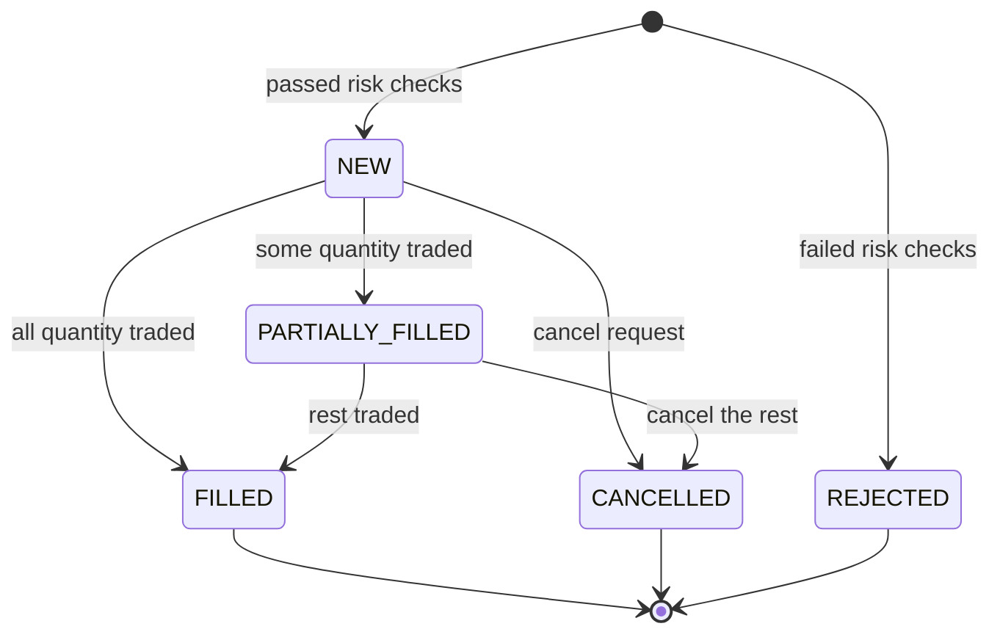
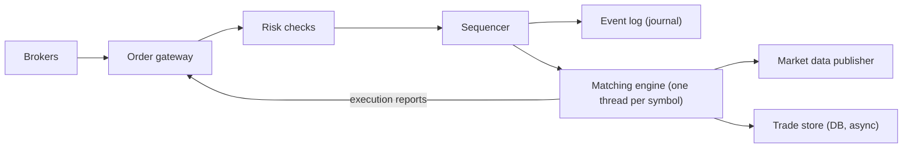
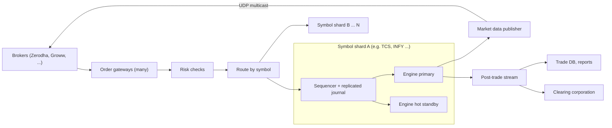
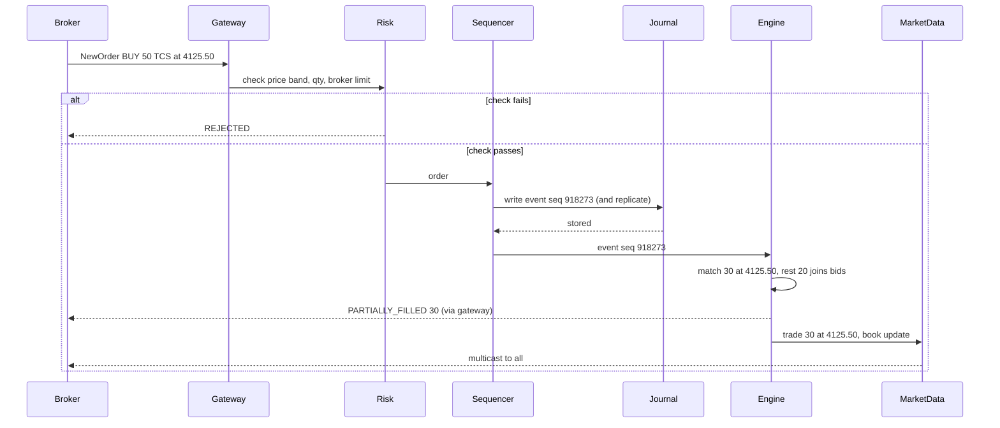
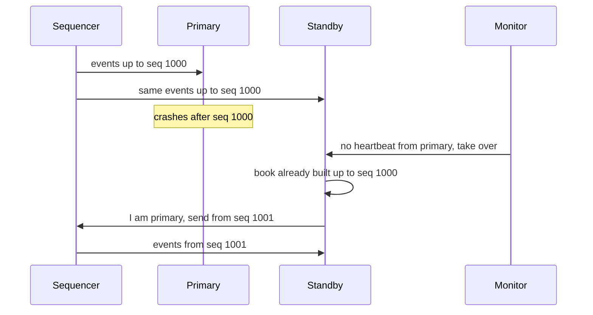
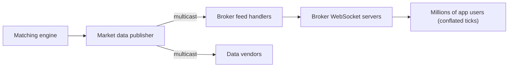

# Stock exchange (order matching)

[← System design basics](../system-design.md) · [← Main README](../../README.md)

**In one line:** Give every order a number and match buyers and sellers in memory, one thread per stock. Write every event to a log, so you can rebuild after a crash.

**Story:** Think of a vegetable mandi at 6 AM.
Sellers shout "tomatoes, ₹20 a kilo". Buyers shout "I'll pay ₹18".
The best buyer and the best seller meet first. If two sellers ask the same price, the one who came first sells first.
A clerk writes every deal in a register, in order. If the clerk faints, his helper reads the register and knows exactly who owns what.
A stock exchange is this mandi, but with millions of orders per second and a computer as the clerk.

---

## 1. How the interviewer asks it

Common wordings:

- "Design a stock exchange matching engine."
- "Design the order book for a trading platform."
- "Design order placement for an app like Zerodha or Robinhood."
- "How would you make the matching engine fair and recoverable after a crash?"

No company-specific source was found. It comes up in fintech and trading-firm loops.

**Important:** Zerodha, Groww and Robinhood are **brokers**, not exchanges.
A broker takes your order, checks your money, and sends the order to an exchange (NSE or BSE in India).
The **exchange** runs the order book and matches. Ask the interviewer which side they want.

**What they are really testing:**

- Do you know the order book and price-time priority?
- Do you see why one thread per stock gives fairness and the same result every time? And why a DB in the hot path is too slow?
- Can you recover the exact state after a crash (sequencer, write-ahead log, replay)?

---

## 2. Questions to ask (with assumed answers)

| Question | Why it matters | What we assume |
|---|---|---|
| Exchange or broker? | Very different systems. | The exchange. Brokers are our clients. |
| Which order types? | Each type adds matching rules. | Limit and market orders, plus cancel. Stop-loss and auctions out of scope. |
| Matching rule? | The core of fairness. | Price-time priority (best price first, then first come first served). |
| How many stocks (symbols)? | Sharding unit. | About 5,000 symbols. |
| How many orders? | Hot path speed. | 1 million orders/s at peak across all symbols. One hot symbol up to 50,000/s. |
| Latency target? | Decides "no DB in the hot path". | Under 1 ms inside the exchange. Real exchanges work in microseconds. |
| Who gets market data? | Fan-out design. | Brokers and data vendors connect directly. They fan out to retail users. |
| Risk checks? | Must happen before matching. | Basic checks at the exchange. Margin and balance checks at the broker. |
| Settlement? | Separate system. | Out of scope. A clearing corporation settles trades later (T+1 in India). |
| Trading hours? | Gives a daily reset window. | One session, about 6 hours. The book is cleared at day end. |

---

## 3. Assumptions

1. We build the exchange, not the broker.
2. Limit and market orders, and cancels.
3. Price-time priority.
4. 5,000 symbols. 1M orders/s total peak. Hot symbol 50,000/s.
5. Under 1 ms from order in to trade out.
6. Must be deterministic: same input order → same trades, every time.
7. Settlement and clearing are out of scope.

---

## 4. Requirements

**Functional:**

- Brokers send new orders, cancels and modifies.
- Match buy and sell orders by price-time priority.
- Send execution reports (fills) back to both brokers.
- Publish market data: trades and order book changes.
- Reject orders that fail risk checks.

**Non-functional:**

- **Fair:** orders are handled in the order they arrive. No one jumps the line.
- **Deterministic:** replaying the same input gives the same trades.
- **Low latency:** under 1 ms, and steady (no long pauses).
- **Never lose an accepted order or trade.**
- **High availability during trading hours:** fail over in seconds, with no lost or duplicate trades.
- Market data reaches all subscribers at the same time, as far as possible.

---

## 5. Numbers

| What | Calculation | Result | Decision it drives |
|---|---|---|---|
| Orders, peak | given | 1M/s total | No database can sit in this path. |
| Time per order | 1 s ÷ 50,000 (hot symbol) | 20 µs budget per order | Matching must be in memory, no network calls, no locks. |
| One thread's speed | LMAX reports ~6M orders/s on one Java thread | far above 50,000/s | One thread per symbol is enough. No need to split one symbol. |
| Symbols per engine | 5,000 symbols ÷ ~50 engines | ~100 symbols each | Shard by symbol. Spread hot symbols across engines. |
| Event log size | 1M/s × ~100 bytes | ~100 MB/s | Sequential disk writes handle this. Replicate it too. |
| Log per day | ~200,000/s average × 25,000 s × 100 bytes | ~500 GB/day | Archive each day's log. Rebuild trade history from it. |
| Order book memory | 100,000 open orders × 100 bytes per symbol | ~10 MB per symbol | All books fit in RAM easily. |

The LMAX number is from [Martin Fowler's article on LMAX](https://martinfowler.com/articles/lmax.html). It is their reported figure, not a promise for every system.

---

## 6. APIs

Real exchanges use binary protocols or FIX (a standard text protocol for trading) over leased lines. We show JSON for clarity.

| API | What it does |
|---|---|
| `NewOrder` | Place a limit or market order. |
| `CancelOrder` | Cancel the rest of an open order. |
| `ModifyOrder` | Change price or quantity. Loses time priority if price changes or quantity goes up. |
| `ExecutionReport` (out) | Sent to the broker: accepted, partly filled, filled, cancelled, rejected. |
| Market data feed (out) | Trades and book changes, each with a sequence number. |

New order (broker to exchange):

```json
{ "client_order_id": "zx-771-0091", "broker_id": "BRK12", "symbol": "TCS",
  "side": "BUY", "type": "LIMIT", "price": 412550, "qty": 50 }
```

- `price` is in paise. 412550 = ₹4,125.50. Prices are never floats.
- `client_order_id` is unique per broker. A repeat is rejected as a duplicate.

Execution report (exchange to broker):

```json
{ "order_id": "TCS-000918273", "client_order_id": "zx-771-0091", "status": "PARTIALLY_FILLED",
  "filled_qty": 30, "last_price": 412550, "seq": 918274 }
```

---

## 7. Data model

**Hot path: in memory, not in a database.**

| Structure | What it holds |
|---|---|
| Order book (per symbol) | Two sides: bids (buy) and asks (sell). Each side is a sorted map of price → queue of orders. |
| Order index (per symbol) | `order_id → order` hash map. Makes cancel fast. |
| Event log (journal) | Every input event in sequence order, on disk and replicated. The source of truth. |

**Order book picture for TCS:**

| Bids (buy) | | Asks (sell) | |
|---|---|---|---|
| Price | Orders in time order | Price | Orders in time order |
| ₹4,125.00 | 30, 20 | ₹4,125.50 | 30 |
| ₹4,124.50 | 100 | ₹4,126.00 | 10, 40 |

- Best bid = highest buy price. Best ask = lowest sell price.
- A trade happens when a buy price ≥ the best ask, or a sell price ≤ the best bid.

**Downstream: normal databases** (filled from the event log, not in the hot path):

| Table | Main columns |
|---|---|
| `trades` | `trade_id`, `symbol`, `buy_order_id`, `sell_order_id`, `price`, `qty`, `seq`, `at` |
| `orders` | `order_id`, `broker_id`, `symbol`, `side`, `price`, `qty`, `filled_qty`, `status` |

**Order state machine:**



---

## 8. Architecture, version 1 (simple)



- **Order gateway:** brokers connect here. Checks login, message format and per-broker rate limits.
- **Risk checks:** price within today's band, quantity within limits, broker within its limit.
- **Sequencer:** gives every event the next number (1, 2, 3...). This sets the official order.
- **Event log:** the sequencer writes each event here before matching. This is the *write-ahead log*.
- **Matching engine:** the order book in memory. One thread. No locks, no DB calls.
- **Market data publisher:** sends trades and book changes to everyone.
- **Trade store:** a normal database filled after the fact, for reports. Not in the hot path.

---

## 9. Architecture, version 2 (at scale)



**What changed and why:**

- **Shard by symbol:** each symbol lives on exactly one engine. Engines run in parallel. A hot symbol gets its own core.
- **Many gateways:** brokers connect to several. A gateway crash does not stop trading.
- **Replicated journal:** the sequencer writes each event to local disk and to the standby's machine before matching.
- **Hot standby engine:** reads the same sequenced events and builds the same book in memory. It does not send output. On failover it takes over in seconds.
- **UDP multicast for market data:** one packet goes to all subscribers at once. Fair and fast. Each packet has a sequence number, so receivers can spot gaps and ask for a resend.
- **Post-trade stream:** trades go to databases, reports and the clearing corporation. Slow systems live here, away from matching.

---

## 10. Step-by-step flows

**A buy order that matches partly:**



**Engine crash and failover:**



---

## 11. Deep dives

### (a) The order book and price-time priority

**Rule:** best price first. At the same price, the earliest order first.

Example. The ask side has:

- ₹101: 100 shares (order A, 9:15:01)
- ₹102: 200 shares (order B, 9:15:03)

A buy order arrives: 250 shares at ₹102.

1. Best ask is ₹101 ≤ ₹102. Trade 100 at ₹101 with A. A is filled.
2. Next best ask is ₹102 ≤ ₹102. Trade 150 at ₹102 with B. B has 50 left.
3. Buy order is fully filled. B stays on the book with 50.

The trade price is always the **resting** order's price (the one already in the book).

**Data structure:**

```java
// Bids: highest price first. Asks: lowest price first. Prices in paise.
NavigableMap<Long, ArrayDeque<Order>> bids = new TreeMap<>(Comparator.reverseOrder());
NavigableMap<Long, ArrayDeque<Order>> asks = new TreeMap<>();
Map<Long, Order> byId = new HashMap<>();   // for fast cancel

void matchBuy(Order buy) {
    while (buy.remaining > 0 && !asks.isEmpty()) {
        var best = asks.firstEntry();                     // lowest ask
        if (best.getKey() > buy.price) break;             // too expensive: stop
        Order sell = best.getValue().peekFirst();         // earliest order at this price
        long qty = Math.min(buy.remaining, sell.remaining);
        emitTrade(buy, sell, best.getKey(), qty);         // price = resting order's price
        buy.remaining -= qty;
        sell.remaining -= qty;
        if (sell.remaining == 0) {
            best.getValue().pollFirst();
            byId.remove(sell.id);
            if (best.getValue().isEmpty()) asks.pollFirstEntry();
        }
    }
    if (buy.remaining > 0) rest(bids, buy);               // leftover waits in the book
}
```

- `TreeMap` gives the best price in O(log n). The queue at each price keeps time order.
- **Cancel:** find the order in `byId`. Real engines use a linked list per price level so they can remove from the middle in O(1).
- A **market order** is the same loop with no price limit. Whatever is not filled is cancelled, not rested.
- Real engines use arrays and preallocated objects instead of `TreeMap` and `new`, to avoid garbage collection pauses. The idea is the same.

### (b) One thread per symbol, and the sequencer

**Why a single thread?**

- With many threads on one book, you need locks. Locks add waiting and make the result depend on thread timing.
- Two runs with the same input could give different trades. That is unfair and impossible to audit.
- One thread processes events one by one. No locks. The result depends only on the input order. That is **deterministic**.
- One thread is fast enough. The work per order is tiny and all in memory. LMAX reports about 6M orders/s on one Java thread.

**Why a sequencer?**

- Many gateways receive orders at the same time. Someone must decide the official order.
- The sequencer gives each event a number: 918273, 918274... That number *is* time priority.
- Everything downstream (engine, standby, market data) sees events in that exact order.

**How the engine gets events:** a ring buffer (a fixed-size circular array shared between threads, like the LMAX Disruptor). The sequencer writes, the engine thread reads. No locks, very low delay.

**Scaling:** you never split one symbol across threads. You add more symbols per machine, or more machines. Put very busy symbols on their own core.

### (c) Event sourcing, write-ahead log and recovery

*Event sourcing* means we store the list of events (orders, cancels), not just the current state. The state (the order book) can be rebuilt by replaying the events.

1. Sequencer numbers the event.
2. It writes the event to the **journal** (the write-ahead log) on local disk.
3. It sends the same event to the standby machine.
4. Only after both have it does the engine process it. So no accepted order is lost.
5. The engine's output (trades) can always be rebuilt from the input log, because the engine is deterministic.

**Snapshots:** replaying a whole day can take time. Every few minutes, save the full book to disk with its sequence number. Recovery = load snapshot + replay events after it.

**Why no database in the hot path?**

- A DB write over the network takes about a millisecond. Our budget per order is about 20 microseconds.
- A local, append-only log is a sequential disk write. That is fast.
- Databases are still used, but downstream, filled from the log for reports and history.

**Duplicate outputs after failover:** each output carries its sequence number. Brokers and downstream systems ignore a seq they already have.

### (d) Risk checks and market data fan-out

**Risk checks (before the sequencer):**

- **Price band:** reject a price far from the last trade (for example, more than 10% away). This catches "fat finger" mistakes.
- **Quantity limit:** reject absurd sizes.
- **Broker limits:** a broker cannot send more than its allowed exposure or message rate.
- **Duplicate check:** same `client_order_id` from the same broker → reject.
- These checks must be fast and in memory too. They run on the gateway side, so the engine stays simple.
- **The broker does the customer checks.** Does the user have enough money or margin? Does she own the shares she is selling? That is Zerodha's or Groww's job, before the order reaches the exchange.

**Market data fan-out:**

- Every trade and book change becomes a market data message with a sequence number.
- The exchange sends it by **UDP multicast** to brokers and data vendors. One send reaches all, at the same moment. That is fair.
- UDP can drop packets. Receivers watch sequence numbers. On a gap, they ask a recovery server for the missing ones, or take a fresh snapshot.
- **Retail users are not on the exchange feed.** The broker receives the feed and fans out to millions of app users over WebSockets. See [Long polling vs WebSockets vs SSE](../system-design.md#long-polling-vs-websockets-vs-server-sent-events).
- The broker can *conflate* (send only the latest price every 200 ms or so). A phone screen does not need every tick.



---

## 12. Follow-up questions interviewers ask

- **The matching engine crashes. What now?** The hot standby has the same book, built from the same events. It takes over from the next sequence number. Nothing is lost because the journal had every event before matching.
- **How do you make it fair?** The sequencer stamps every order with a number. The engine handles them in that order. Market data goes out by multicast, so everyone gets it at once.
- **One symbol is very hot. Can you split it?** No. Splitting breaks price-time priority. Give it its own core and machine. One thread is fast enough.
- **Why not use Kafka or a database?** Both add milliseconds. Our budget is microseconds. We use a local journal and in-memory state. Kafka is fine for the post-trade stream.
- **Java has garbage collection pauses. Is Java OK?** Yes, LMAX did it in Java. Preallocate objects, reuse them, avoid creating garbage in the hot path. Some teams pick C++ or Rust too.
- **How does cancel work fast?** A hash map from `order_id` to the order. Remove it from its price level in O(1) with a linked list.
- **What if the sequencer dies?** It also has a standby that reads the same journal. It continues from the last written number. Gateways resend anything not acknowledged. Duplicate check by `client_order_id` stops double orders.
- **How does Zerodha fit in?** Zerodha is a broker. It checks your margin, then sends the order to NSE or BSE. The exchange matches. The clearing corporation settles the money and shares later.
- **What about circuit breakers on prices?** If a stock or index moves too far, trading in it is halted for a while. The engine supports a "halted" state per symbol.
- **How do you test it?** Replay a full real day's log into a new build. Compare the trades. They must match exactly, because the engine is deterministic.

---

## 13. What can go wrong

| Problem | What we do |
|---|---|
| Engine process crashes | Hot standby takes over from the next sequence number. |
| Whole data centre fails | A standby site receives the replicated journal. Failover takes longer. Trading may pause briefly. |
| Disk is slow, journal writes lag | Monitor write latency. Use fast SSDs and a separate disk for the journal. |
| GC pause stalls matching | Preallocated objects, no garbage in the hot path, tuned low-pause GC. |
| Market data packets dropped | Sequence numbers, gap detection, recovery server and snapshots. |
| A broker floods orders | Per-broker rate limit at the gateway. See [Rate limiting](../system-design.md#rate-limiting-algorithms). |
| Fat-finger order (wrong price) | Price band check rejects it. |
| Same order sent twice after a reconnect | Reject repeat `client_order_id`. |
| Clock differences between machines | Fairness comes from sequence numbers, not wall-clock time. |

---

## 14. Trade-offs

| We chose | We get | We give up |
|---|---|---|
| In-memory order book | Microsecond matching | Must rebuild from the log after a crash |
| One thread per symbol | No locks, deterministic, fair | One symbol cannot use more than one core |
| Sequencer + journal before matching | No lost orders, exact replay | One extra step on every order |
| Hot standby replaying the same events | Fast failover | Double the hardware |
| Shard by symbol | Easy parallelism | Orders that touch many symbols (baskets) need care |
| UDP multicast for market data | Fair, one send to all | Receivers must handle gaps |
| Databases only post-trade | Fast hot path | Reports are a little behind |

---

## 15. Say this in the interview

> "I am designing the exchange, not the broker. Zerodha-style brokers check the customer's money and send orders to us.
> Each symbol has an order book in memory, with bids and asks. Each side maps a price to a queue of orders. Matching uses price-time priority.
> A peak of 1 million orders per second means no database in the hot path. Each symbol is handled by one thread, so there are no locks and the result is deterministic.
> A sequencer numbers every incoming event and writes it to a replicated journal before matching. That journal is the source of truth.
> A hot standby reads the same events and keeps the same book. If the primary dies, the standby continues from the next sequence number.
> Risk checks like price bands run before the sequencer. Market data goes out by multicast with sequence numbers. Brokers fan it out to users over WebSockets. Trades flow downstream to databases and clearing."

---

## 16. Mid vs senior vs staff

| Mid | Senior | Staff |
|---|---|---|
| Order book with buy and sell sides, basic matching | Price-time priority, correct data structures, fast cancel | Explains order types, modify rules (loses priority), halts and price bands |
| Stores orders in a DB | No DB in the hot path, with the latency math | Discusses GC, preallocation, ring buffers, CPU pinning |
| Uses threads and locks | One thread per symbol, deterministic by design | Sequencer design, its failover, and gateway resend rules |
| Mentions "replicas" | Event log before matching, snapshots, replay | Hot standby, gap-free failover, duplicate output handling by seq |
| Pushes prices to users | Multicast feed with sequence numbers | Separates exchange feed from broker fan-out, conflation, fairness |
| | Knows broker vs exchange | Testing by replaying production logs and comparing outputs |
