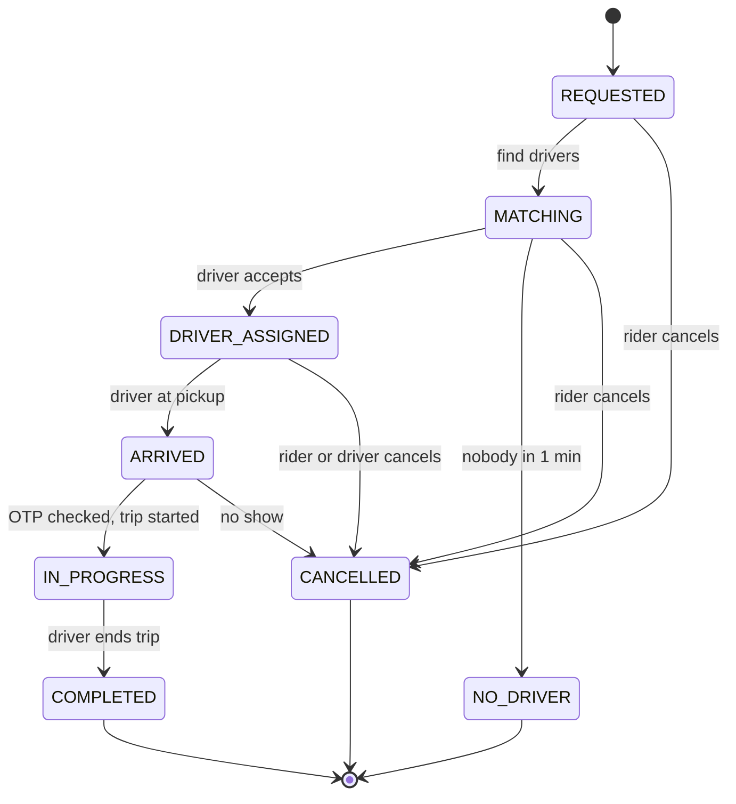
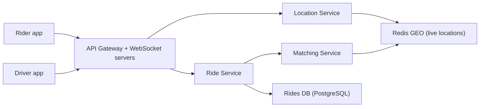
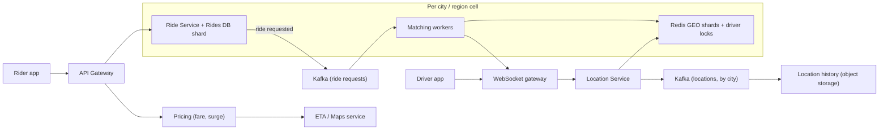
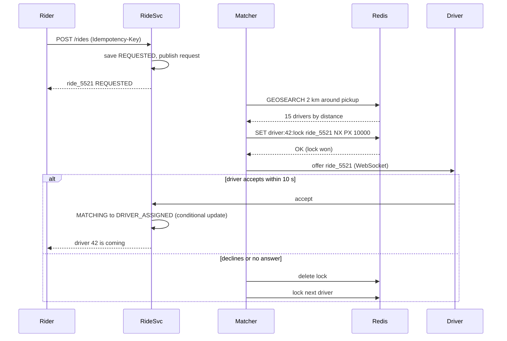
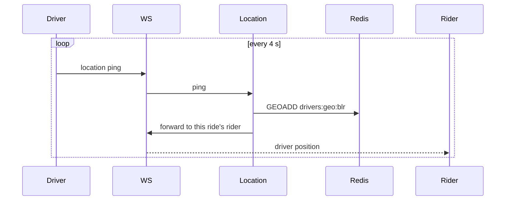

# Uber / Ola (ride hailing), also food delivery like Swiggy

[← System design basics](../system-design.md) · [← Main README](../../README.md)

**In one line:** Keep every online driver's location in memory and find the nearest free ones fast. Give each driver only one ride at a time.

**Story:** At a busy railway station, a man with a whistle manages the auto-rickshaw line.
He can see which autos are free and close to the gate.
A passenger walks up. He waves the nearest free auto over. That auto is now "taken" and he won't wave it again.
If the driver says no, he waves the next one.
A ride app is this man, but for a whole city, with autos that move every few seconds.

---

## 1. How the interviewer asks it

Common wordings:

- "Design Uber / Ola."
- "Design the driver matching (dispatch) system."
- "Design a food delivery app like Swiggy or Zomato."
- "Design an event-driven architecture for Swiggy orders."

Reported at Uber (candidate reports on Blind and Glassdoor), Meta (as a Product Architecture example) and Swiggy (order event flow). These are candidate reports, not official lists.

**What they are really testing:**

- Can you handle a very high rate of location writes without a normal database?
- Can you search "drivers near me" fast (geohash, quadtree, H3)?
- Can you make sure one driver never gets two rides at once, even with crashes and timeouts?

---

## 2. Questions to ask (with assumed answers)

| Question | Why it matters | What we assume |
|---|---|---|
| Which features? | Keeps scope small. | Rider: fare estimate, request, track driver. Driver: go online, accept/decline, update trip. |
| What is out of scope? | Say it out loud. | Ratings, pool rides, scheduled rides, payment details. |
| How many drivers online at peak? | Drives location write rate. | 1 million drivers online. |
| How often does a driver send location? | Same. | Every 4 seconds. |
| How many rides a day? | Drives trip DB size. | 10 million rides a day. |
| How fast must matching be? | Sets timeouts. | Under 1 minute: a driver or "no driver found". |
| Can a driver get two offers at once? | Core consistency rule. | No. One offer at a time per driver. |
| How does the rider see the car move? | Push vs poll. | Live updates every few seconds over a WebSocket. |
| One country or many? | Sharding by region. | Many cities. Each ride stays inside one city. |
| Surge pricing? | Adds a pricing service. | Yes, simple version. |
| Food delivery too? | Adds restaurants and prep time. | Covered as a "what changes" section in deep dives. |

---

## 3. Assumptions

1. 1M drivers online at peak. Location every 4 s.
2. 10M rides a day. Peak 5x in evening rush and rain.
3. Match in under 1 minute. Offer to one driver at a time, 10 s to accept.
4. A driver can never have two active offers or trips.
5. Live locations are in memory only. Old values expire.
6. Rides are inside one city. Shard by city/region.
7. ETA comes from a maps/routing service. We do not build maps.

---

## 4. Requirements

**Functional:**

- Rider sees nearby cars and a fare estimate.
- Rider requests a ride. We find a driver and send an offer.
- Driver accepts or declines. On decline or timeout, try the next driver.
- Rider sees the driver moving, live.
- Trip moves through states: requested, matched, arrived, started, completed or cancelled.

**Non-functional:**

- **Location writes:** handle hundreds of thousands per second.
- **Nearby search:** under 100 ms.
- **Strong consistency for assignment:** never two rides for one driver.
- **Matching:** under 1 minute end to end.
- **High availability:** if matching is down, the city has no rides. Losing a few location pings is fine.
- Trips and payments must be durable. Location pings need not be.

---

## 5. Numbers

| What | Calculation | Result | Decision it drives |
|---|---|---|---|
| Location writes | 1M drivers ÷ 4 s | ~250,000/s | No SQL DB can take this. Keep locations in memory. |
| Location size | ~50 bytes × 1M drivers | ~50 MB | The whole live map fits in RAM on one machine. We shard for write rate and safety, not size. |
| Rides, average | 10M ÷ 100,000 s | ~100/s | Small. Trip DB is plain PostgreSQL. |
| Rides, peak | 100 × 5 | ~500/s | Matching load is small too. |
| Nearby searches | riders opening the app, ~10× rides | ~5,000/s peak | Read from the in-memory index. |
| Location history | 250,000 × 50 bytes | ~12 MB/s, ~1 TB/day | Don't keep it in the hot path. Stream to cheap storage for trip paths and disputes. |

**Key point:** the hard number is 250,000 location writes per second. Everything else is small.

---

## 6. APIs

| API | Who | What it does |
|---|---|---|
| `POST /v1/fare-estimates` | Rider | Price for pickup → drop. Returns an estimate id valid for a few minutes. |
| `POST /v1/rides` | Rider | Request a ride. Needs `Idempotency-Key`. |
| `GET /v1/rides/{id}` | Rider, driver | Ride status. |
| `POST /v1/rides/{id}/cancel` | Rider, driver | Cancel. |
| `POST /v1/drivers/me/location` | Driver | Location ping (or sent over the WebSocket). |
| `POST /v1/offers/{id}/accept` and `/decline` | Driver | Answer an offer. |
| `PATCH /v1/rides/{id}` | Driver | `ARRIVED`, `STARTED`, `COMPLETED`. |
| WebSocket `/v1/stream` | Both | Server pushes offers, driver location, status changes. |

Request a ride:

```http
POST /v1/rides
Idempotency-Key: 1f7a0c2e-9b6d-4e21-a8f3-5c1d0e7b2a90

{ "fare_estimate_id": "fe_771", "pickup": { "lat": 12.9716, "lng": 77.5946 },
  "drop": { "lat": 12.9352, "lng": 77.6245 }, "type": "AUTO" }
```

```json
{ "ride_id": "ride_5521", "status": "REQUESTED" }
```

Driver location ping (over the WebSocket, every 4 s):

```json
{ "lat": 12.9721, "lng": 77.5933, "heading": 90, "speed_kmph": 18, "ts": 1731744000 }
```

---

## 7. Data model

Two kinds of data, two kinds of storage.

**Hot, short-lived data → Redis (in memory):**

| Key | Value | Notes |
|---|---|---|
| `drivers:geo:{city}` | Redis GEO set: driver_id → lat/lng | `GEOADD` on every ping. `GEOSEARCH` for nearby. |
| `driver:{id}:state` | `FREE` / `OFFERED` / `ON_TRIP`, last ping time | Expires if no ping for 30 s. Driver is then treated as offline. |
| `driver:{id}:lock` | `ride_id` | Set with `NX` and a 10 s TTL (time to live: it deletes itself). The lease (see deep dive b). |

**Durable data → PostgreSQL, sharded by city:**

| Table | Main columns |
|---|---|
| `rides` | `ride_id`, `city_id`, `rider_id`, `driver_id`, `status`, `pickup`, `drop`, `fare_paise`, `surge`, `version`, `created_at` |
| `ride_events` | `ride_id`, `from_status`, `to_status`, `at` (append-only history) |
| `offers` | `offer_id`, `ride_id`, `driver_id`, `status`, `sent_at`, `answered_at` |
| `drivers` | `driver_id`, `city_id`, `vehicle_type`, `rating`, `status` |

**Location history → Kafka → cheap storage** (object storage or Cassandra). Used for trip path, fare disputes and ML. Not read during matching.

**Trip state machine:**



Every change is a conditional update: `UPDATE rides SET status='ARRIVED' WHERE ride_id=? AND status='DRIVER_ASSIGNED'`. Duplicate or late events change 0 rows.

---

## 8. Architecture, version 1 (simple)



- **WebSocket servers:** keep a live connection to each app. Pings come in, offers and updates go out. See [Long polling vs WebSockets vs SSE](../system-design.md#long-polling-vs-websockets-vs-server-sent-events).
- **Location Service:** writes each ping to Redis GEO. Nothing else.
- **Ride Service:** owns the trip state machine and the Rides DB.
- **Matching Service:** finds nearby free drivers, locks one, sends the offer.

This works for one or two cities.

---

## 9. Architecture, version 2 (at scale)



**What changed and why:**

- **Separate WebSocket gateway:** 1M driver connections need their own fleet. Each server holds ~50,000 connections. A registry (Redis) maps `driver_id → server`.
- **Shard by city/region:** a ride never crosses cities. Each city gets its own Redis, matchers and DB shard. Big cities (Mumbai, Bengaluru) are split into region cells. See [Partitioning and sharding](../system-design.md#partitioning-and-sharding).
- **Kafka for ride requests:** a spike after a cricket match or rain fills the queue, not the matchers. Matchers scale out. A crash does not lose requests (offset not committed). See [Kafka partitions and consumer groups](../kafka.md#kafka-partitions-and-consumer-groups).
- **Kafka for locations:** copies pings to history storage and to pricing (supply counts per area).
- **Pricing and ETA services:** separate, cached by area.

---

## 10. Step-by-step flows

**Request a ride, with decline/timeout:**



**Live tracking during the trip:**



---

## 11. Deep dives

### (a) Location updates and nearby search

**Why not SQL?** 250,000 writes/s, each overwriting the last value. And a query like `WHERE lat BETWEEN ... AND lng BETWEEN ...` is slow even with indexes. Old values are useless after 4 seconds anyway.

**Idea: split the map into cells.** See [Geohash and quadtree](../system-design.md#geohash-and-quadtree-location-search).

- **Geohash:** turns lat/lng into a short string. Nearby points share a prefix. A 6-character geohash is a cell of about 1.2 km × 0.6 km.
- **Quadtree:** splits a square into 4 until each box has few drivers. Good for uneven density (city centre vs outskirts).
- **H3:** Uber's hexagon grid with 16 resolutions and 64-bit cell ids. Every neighbour of a hexagon is the same distance away, so search rings are cleaner ([Uber blog](https://www.uber.com/blog/h3/)).

**Simple choice for the interview: Redis GEO.**

- Redis GEO stores points in a sorted set, scored by a geohash. Updates and searches are fast, in memory.
- `GEOADD drivers:geo:blr 77.5933 12.9721 driver:42` on each ping.
- `GEOSEARCH drivers:geo:blr FROMLONLAT 77.5946 12.9716 BYRADIUS 2 km ASC COUNT 20` to find the nearest 20.
- Filter out drivers whose `state` is not `FREE`, or whose last ping is older than 30 s.

**Edge problem:** a driver 50 m away may be in the next cell. Always search the rider's cell **plus its 8 neighbours** (or an H3 ring). `GEOSEARCH` by radius does this for you.

**Reduce the write rate:** the app sends less often when the driver is parked or offline, and more often near a pickup.

**Redis node dies?** The live map rebuilds itself within one ping cycle (4 s), because drivers keep sending. Use a replica to cut even that gap.

### (b) Matching without double assignment

Problem: two matchers (or two riders) pick the same nearest driver at the same moment. Both send an offer. The driver accepts one; the other rider waits for nothing. Worse, both get "assigned".

**Fix: a short lease (lock with expiry) per driver.**

```
SET driver:42:lock ride_5521 NX PX 10000
```

- `NX` = set only if the key does not exist. Only one matcher wins.
- `PX 10000` = the lock disappears after 10 s. If the matcher crashes, the driver is free again soon. No stuck drivers.
- The winner sends the offer. Losers move to the next driver on their list.
- On accept, the Ride Service does a **conditional update in the DB** as the final guard:

```sql
UPDATE rides SET status = 'DRIVER_ASSIGNED', driver_id = 42, version = version + 1
WHERE ride_id = 'ride_5521' AND status = 'MATCHING';
-- and in the same transaction, check the driver has no other active ride
```

- The Redis lock stops double **offers**. The DB check stops double **assignment**. Two layers.
- Offer one driver at a time, nearest first. Send to 2–3 at once only if match rates are low, and accept the first "yes".
- After a decline or timeout, add that driver to the ride's "skip" list.

**Timer for the 10 s offer:** the lock's TTL is the timer. For crash safety, a delayed message (or a workflow engine like Temporal) wakes the matcher to move on.

### (c) Trip state machine and pushing updates to apps

- The Ride Service is the only writer of ride status. Everyone else sends commands or events.
- Each change writes `rides` + `ride_events` + an outbox row in one transaction. See [Transactional outbox](../microservices.md#transactional-outbox-pattern).
- The outbox goes to Kafka, keyed by `ride_id`, so events for one ride stay in order. See [Kafka message ordering](../kafka.md#kafka-message-ordering).
- A push service reads events and sends them over the app's WebSocket. It finds the right server from the `user_id → server` registry.
- **If the WebSocket is down** (phone in a tunnel), send a mobile push notification for key events (driver arrived). The app also polls `GET /rides/{id}` when it reconnects.
- **Driver app loses network mid-trip:** the trip stays IN_PROGRESS. The app buffers pings and sends them later. Fare uses the buffered path.

### (d) ETA, surge and food delivery (simple level)

**ETA (estimated time of arrival):**

- A routing service runs shortest path on a road graph, with live traffic speeds per road segment.
- For "nearest drivers", straight-line distance is a fine first filter. Then ask ETA for the top 10 only.
- Cache ETAs between cell pairs for a minute.

**Surge pricing:**

- Every minute, per cell: count open requests (demand) and free drivers (supply).
- If demand ÷ supply goes above a threshold, multiply the fare: 1.2x, 1.5x...
- Store the multiplier in Redis per cell. The fare estimate locks the price for a few minutes, so it does not change while the rider decides.
- Surge does two jobs: fewer riders request, and more drivers come to that area.

**Food delivery (Swiggy / Zomato): what changes:**

- Three parties, not two: customer, restaurant, delivery partner.
- The order flow is an event chain: placed → restaurant accepted → food ready → picked up → delivered. Each step is an event on Kafka.
- **Assign just in time:** don't send the rider at order time. Use the restaurant's prep time. Assign so the rider arrives when food is ready.
- **Batching:** one rider can carry 2 orders from the same or nearby restaurants going the same way.
- The location and matching parts stay the same: geo index, lease lock, offer timeout.

---

## 12. Follow-up questions interviewers ask

- **A driver is 50 m away but in the next geohash cell?** Search the cell and its 8 neighbours, or use a radius search.
- **The matching service crashes mid-offer?** The ride request is still in Kafka (offset not committed). The driver lock expires in 10 s. Another matcher picks it up.
- **How do you reduce 250,000 writes per second?** Adaptive ping rate on the phone. Drop pings that moved less than 10 m. Shard Redis by city.
- **Redis with locations dies?** Fail over to a replica. Even without one, drivers resend within 4 s, so the map rebuilds itself.
- **Shard by city: what about Mumbai being huge?** Split big cities into region cells. Uber's early dispatch was sharded by city, and they moved to finer geo sharding as it grew ([High Scalability summary](https://highscalability.com/how-uber-scales-their-real-time-market-platform/)).
- **Rider and driver both cancel at the same time?** Conditional update. The first one wins. The second gets "already cancelled".
- **How does the rider see cars on the map before booking?** Show approximate positions from the geo index, refreshed every few seconds. They don't need to be exact.
- **What about a surge in requests after a concert?** The Kafka queue absorbs it. Matchers scale out. Surge pricing cuts demand and pulls in drivers.
- **How do you make sure a driver gets paid exactly once?** Trip completion writes an outbox event. Payment uses `ride_id` as the idempotency key. See [Payment gateway](payment-gateway.md).

---

## 13. What can go wrong

| Problem | What we do |
|---|---|
| Two riders get the same driver | Redis `SET NX` lease plus conditional DB update. |
| Matcher crashes after locking a driver | Lock TTL (10 s) frees the driver. Request stays in Kafka. |
| Driver's phone goes offline | No ping for 30 s → state expires → not offered rides. Active trip continues, app catches up later. |
| WebSocket server dies | Apps reconnect to another server. Registry is updated. They fetch the latest ride state. |
| Location Redis dies | Replica takes over. Map refills within one ping cycle. |
| Spike after rain or a match | Kafka queue, more matchers, surge pricing. |
| Duplicate "accept" tap | Conditional update. The second one changes 0 rows. |
| Maps/ETA service slow | Timeout, fall back to straight-line distance. See [Timeouts](../microservices.md#timeouts). |
| City shard DB down | Only that city is hit. Promote a standby. Other cities keep working. |

---

## 14. Trade-offs

| We chose | We get | We give up |
|---|---|---|
| Live locations only in memory (Redis) | 250,000 writes/s, fast search | A few seconds of pings lost on a crash |
| Redis GEO, not a custom quadtree or H3 | Simple, well known | Less control over cell shape and density |
| Shard by city/region | Rides stay local, a failure hits one city | Big cities need finer splits. Trips near borders are tricky |
| One offer at a time | No wasted driver time, simple | Slower match if many drivers decline |
| Redis lease + DB conditional update | No double assignment, no stuck drivers | Two systems to keep in step |
| WebSocket for live updates | Low delay, server can push | Many open connections to run |
| Kafka queue for requests | Survives spikes and crashes | A little extra latency |

---

## 15. Say this in the interview

> "Riders request rides, drivers accept, and the rider tracks the driver live. Ratings, pool and payments are out of scope.
> The hard number is location writes: 1 million drivers every 4 seconds is 250,000 writes per second. So live locations stay in memory, in Redis GEO, sharded by city. Old pings expire.
> To find drivers, I search a radius around the pickup, including neighbour cells, then filter free drivers.
> To avoid double assignment, the matcher locks the driver in Redis with SET NX and a 10-second TTL. Then it sends one offer. On accept, a conditional update in the Rides DB is the final guard. On decline or timeout, the lock expires and we try the next driver.
> The ride follows a state machine in PostgreSQL. Status changes go through an outbox to Kafka, and a push service sends them over WebSockets.
> Ride requests go through Kafka so spikes and crashes don't lose them. Surge pricing compares demand and supply per cell."

---

## 16. Mid vs senior vs staff

| Mid | Senior | Staff |
|---|---|---|
| Rider, driver, ride service, DB, a "location service" | Does the write math and moves locations to memory | Adaptive ping rates, region cells for big cities, cost of 1M WebSocket connections |
| Mentions geohash | Explains cell edges and neighbour search, Redis GEO commands | Compares geohash, quadtree and H3 for density and surge areas |
| Picks the nearest driver | Lease lock with TTL plus conditional DB update | Offer strategy (one vs many at once), timers that survive crashes |
| Trip has a status | Full state machine, conditional updates, outbox events | Failure of a whole city shard, and how to fail over without double rides |
| Uses polling | WebSockets with push fallback | Food delivery: just-in-time assignment and batching |
| | Surge and ETA at a simple level | Measures match rate, time to match and cancel rate, and tunes from them |
