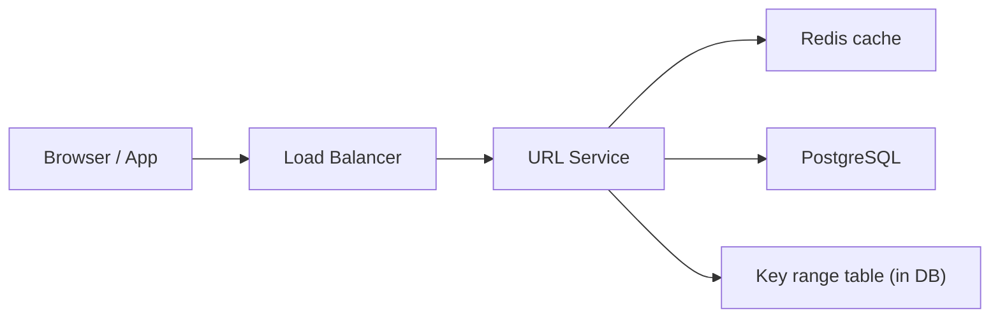
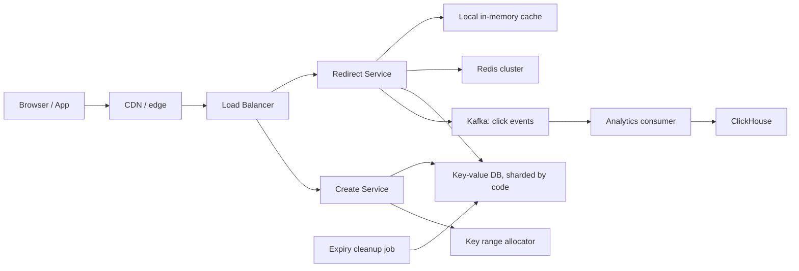
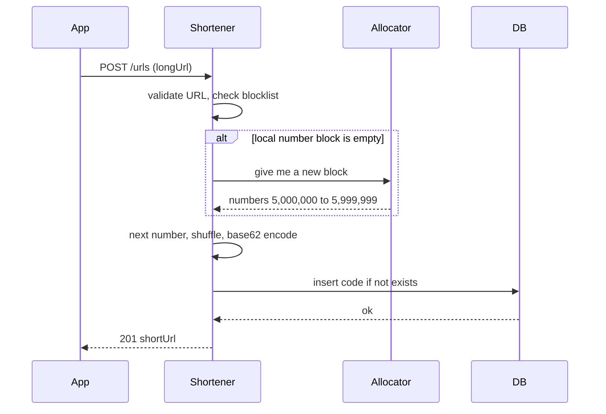
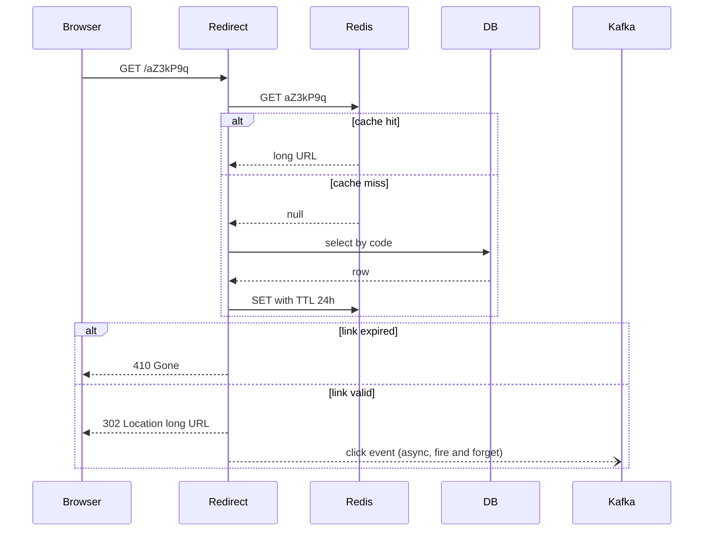

# URL shortener (TinyURL)

[← System design basics](../system-design.md) · [← Main README](../../README.md)

**In one line:** Give every long link a short code, and send anyone who opens the code to the long link, fast.

**Story:** At a railway cloakroom you hand over a big, heavy bag.
The clerk gives you a small token: "A-417".
Later you show the token and get your bag back in seconds.
A URL shortener is that clerk: the long URL is the bag, the short code is the token.
The hard parts are the same too. Never give two people the same token. Find the bag fast when the queue is long.

---

## 1. How the interviewer asks it

Common wordings:

- "Design a URL shortener like TinyURL or Bitly."
- "Design a service that turns long links into short links and counts clicks."
- "Design a content-sharing service that gives each item a unique short URL."

Where it is asked: candidates report it at Google (it is on Exponent's list of Google prompts). A 2025 Glassdoor report from Microsoft describes a "content-sharing service with unique URLs". It is often a warm-up or a mid-level question.

**What they are really testing:**

- Can you make **unique short codes** on many servers without a clash?
- Can you design a **read-heavy** system: caching, hot links, and a fast redirect?
- Do you keep slow work (analytics) **off the redirect path**?

---

## 2. Questions to ask (with assumed answers)

| Question | Why it matters | What we assume |
|---|---|---|
| How many new links per day? | Decides write load and storage | 100 million a day |
| How many clicks per link? | Decides read load and caching | 100 reads for every 1 write |
| Can users pick their own code (custom alias)? | Needs a "taken or free" check | Yes, optional |
| Do links expire? | Needs cleanup and an expiry check | Optional expiry. Default is never. |
| Do we need click analytics? | 301 vs 302, and an event pipeline | Yes: click count per day, country, device |
| How short must the code be? | Decides code length and the ID method | 7 characters is fine |
| Same long URL twice: same code? | Needs a lookup by long URL | No. A new code each time. Simpler. |
| Can a link be edited or deleted? | Cache must be cleared | Delete yes, edit no |
| Must codes be hard to guess? | Plain counters are guessable | Yes, codes should not be in order |
| Logged-in users only? | Abuse, spam links | Anyone can create, with rate limits |
| One region or global? | Latency and replication | Global users, one main write region |

Say it out loud: "I will focus on create and redirect. Analytics is basic. Editing links, QR codes and billing are out of scope."

---

## 3. Assumptions

1. 100M new links a day. Reads are 100x writes.
2. Codes are 7 characters from `[a-z A-Z 0-9]` (base62).
3. Custom alias is optional. Expiry is optional.
4. Redirect must be fast: under 20 ms at our server for 99% of requests (p99).
5. Links are kept for 5 years.
6. Basic analytics, a few minutes late is fine.

---

## 4. Requirements

**Functional (what it does):**

- Create a short link from a long URL. Optional custom alias and expiry date.
- Open a short link → redirect to the long URL.
- Show click counts for a link.
- Delete a link.

**Non-functional (how well):**

- **Never give the same code to two links.**
- Redirect is very fast and very available (99.99%). A broken redirect is a broken link on someone's poster.
- Create can be a bit slower (under 200 ms).
- Analytics can be late by a few minutes (*eventual consistency*, see [strong vs eventual](../system-design.md#database-consistency-strong-vs-eventual)).

---

## 5. Numbers

Method: [Capacity estimation](../system-design.md#capacity-estimation). We use 1 day ≈ 100,000 seconds.

| Step | Math | Result | Decision it drives |
|---|---|---|---|
| Writes | 100M ÷ 100,000 s | ~1,000/s, ~2,000/s at peak | One DB primary can take this |
| Reads | 1,000 × 100 | ~100,000/s, ~200,000/s at peak | DB alone cannot. **We need a cache.** |
| Links in 5 years | 100M × 365 × 5 | ~180 billion | Too many rows for one DB. **Shard it.** |
| Storage | 180B × ~500 bytes | ~90 TB | Key-value store or sharded SQL |
| Codes with 7 chars | 62^7 | ~3.5 trillion | Enough: we use only ~5% in 5 years |
| Codes with 6 chars | 62^6 | ~57 billion | Not enough for 180B. **So 7 chars.** |
| Hot set | top 10M links × 500 bytes | ~5 GB | Fits in Redis memory easily |

**Read servers:** one Redirect Service instance can do about 5,000 simple requests/s (a guess, confirm with a load test).
200,000 ÷ 5,000 = 40 instances, plus spare ones across zones.

---

## 6. APIs

| API | What it does |
|---|---|
| `POST /api/v1/urls` | Create a short link |
| `GET /{code}` | Redirect to the long URL |
| `GET /api/v1/urls/{code}/stats` | Click counts |
| `DELETE /api/v1/urls/{code}` | Delete a link (owner only) |

Create:

```http
POST /api/v1/urls
{ "longUrl": "https://www.example.com/products/very/long/path?id=42",
  "customAlias": "diwali-sale",
  "expiresAt": "2026-12-31T23:59:59Z" }
```

```json
{ "code": "diwali-sale", "shortUrl": "https://sho.rt/diwali-sale", "expiresAt": "2026-12-31T23:59:59Z" }
```

- `409 Conflict` if the custom alias is taken.
- `400` if the long URL is not a valid `http`/`https` URL.

Redirect:

```http
GET /aZ3kP9q

HTTP/1.1 302 Found
Location: https://www.example.com/products/very/long/path?id=42
Cache-Control: private, max-age=0
```

- `404` if the code does not exist. `410 Gone` if it expired.
- Why 302 and not 301? See deep dive 11.3.

---

## 7. Data model

**Main table `urls`** (one row per short link):

| Column | Example | Note |
|---|---|---|
| `code` (primary key) | `aZ3kP9q` | Lookup key for every redirect |
| `long_url` | `https://...` | Up to ~2 KB |
| `user_id` | `u_881` | Null for anonymous |
| `is_custom` | `true` | Custom alias or generated |
| `created_at` | timestamp | |
| `expires_at` | timestamp or null | |

**Click events** go to a separate analytics store (see v2): `code`, `clicked_at`, `country`, `device`, `referrer`.

**Which database and why:**

- The main query is "get row by `code`". There are no joins. This is a perfect **key-value** access pattern.
- **Start (v1):** PostgreSQL. `code` is the primary key. Easy, and the unique constraint handles custom aliases.
- **At 90 TB (v2):** a key-value store like DynamoDB or Cassandra, partitioned by `code`. Or PostgreSQL sharded by `code`. See [SQL vs NoSQL](../system-design.md#sql-vs-nosql) and [Partitioning and sharding](../system-design.md#partitioning-and-sharding).
- **Uniqueness in a key-value store:** use "insert only if not exists" (DynamoDB conditional write, Cassandra `IF NOT EXISTS`).
- **Analytics:** a column store like ClickHouse. It is built for "count clicks grouped by day and country" over billions of rows.

---

## 8. Architecture, version 1 (simple)



- **URL Service:** a stateless Spring Boot app (no user data in memory). It does both create and redirect.
- **Redis cache:** `code → long_url`. Cache-aside: read Redis first, on a miss read the DB and fill Redis. See [Caching](../system-design.md#caching).
- **Key range table:** hands out blocks of numbers to each server for code generation (deep dive 11.1).
- This works up to a few thousand reads per second.

---

## 9. Architecture, version 2 (at scale)



**What changed and why:**

- **Split Redirect and Create services.** Reads are 100x writes. We scale them apart.
- **Local cache + Redis cluster.** A small in-memory cache (like Caffeine) in each Redirect instance holds the hottest links. Redis holds the hot set (~5 GB).
- **CDN / edge.** For very hot links, the edge answers without reaching us. See [CDN](../system-design.md#cdn).
- **Key-value DB, sharded by code.** 90 TB does not fit one machine. Sharding by `code` means every redirect hits one shard.
- **Kafka for clicks.** The redirect only sends a small event. It never writes to the DB on the click path. See [Message queues](../system-design.md#message-queues-and-pubsub).
- **Key range allocator.** A small service (or ZooKeeper) gives each Create instance a block of 1M numbers.
- **Expiry cleanup job.** Deletes expired rows in the background.

---

## 10. Step-by-step flows

**Create a link:**



**Redirect (with cache miss and expired link):**



---

## 11. Deep dives

### 11.1 Making the short code

We need 7 characters that never repeat, made by many servers at the same time.

| Option | How it works | Good | Bad |
|---|---|---|---|
| **Hash the URL** | MD5 of the long URL, take the first 7 base62 chars | No coordination | Collisions. Must check the DB and retry. Gets worse as the table fills. |
| **Counter + base62** | A unique number → convert to base62 | Never collides. Short. | Needs a shared counter. Plain counters are guessable. |
| **Pre-generated keys** | A Key Service makes random codes ahead of time, stores them as "unused" | Fast create, random codes | One more service and DB. Must mark keys used safely. |

**Our choice: counter + base62, with number ranges.**

1. A **key range table** has one row: `next_start`.
2. A Create instance asks for a block: `UPDATE key_range SET next_start = next_start + 1000000 RETURNING next_start`. This is atomic.
3. The instance hands out numbers from its block, in memory. No network call per link.
4. If the instance crashes, the rest of its block is lost. That is fine: we have 3.5 trillion codes.
5. **Not guessable:** before encoding, we mix the number with a fixed secret shuffle (a reversible bit mix). Number 5,000,001 and 5,000,002 give codes that look unrelated. Still no clash, because the mix is one-to-one.

This is the "ticket server" idea. See [Unique ID generation](../system-design.md#unique-id-generation).

```java
public final class Base62 {
    private static final String CHARS =
        "0123456789abcdefghijklmnopqrstuvwxyzABCDEFGHIJKLMNOPQRSTUVWXYZ";

    public static String encode(long n) {
        var sb = new StringBuilder();
        do {
            sb.append(CHARS.charAt((int) (n % 62))); // last digit in base 62
            n /= 62;
        } while (n > 0);
        while (sb.length() < 7) sb.append('0');       // pad to 7 chars
        return sb.reverse().toString();
    }
}
```

**If they push on hashing:** "Hashing is fine if I check for a collision on insert. On a clash, I add a salt and hash again. But collisions grow as the table fills, so a counter is simpler."

### 11.2 Fast reads and hot links

Reads are 100x writes. The redirect is the product.

- **Layer 1, CDN / edge:** can cache the redirect for a short time (for example 60 s). Takes the biggest spikes.
- **Layer 2, local cache in each instance:** holds the top few thousand links. No network call.
- **Layer 3, Redis cluster:** holds the hot set. About 1 ms per lookup.
- **Layer 4, the DB:** only on a miss.

**Hot link (a cricket star tweets a link):**

- 1M clicks in a few minutes, all on one code. One Redis node would get all of them (a *hot key*).
- The local cache and the CDN absorb this. Redis and the DB barely notice.

**Codes that do not exist (bots trying random codes):**

- Every miss goes to the DB. That is wasted work.
- Cache "not found" for a short time (*negative caching*, for example 5 minutes).
- Or keep a [Bloom filter](../system-design.md#bloom-filter) of all codes. "Definitely not present" means skip the DB.

**Cache TTL:** 24 hours, refreshed on read. On delete, we delete the Redis key too. The local cache uses a short TTL (60 s), so a deleted link stops working within a minute.

### 11.3 301 vs 302, and analytics

| | 301 Moved Permanently | 302 Found (temporary) |
|---|---|---|
| Browser caches it? | Yes, often for a long time | No (we also send `Cache-Control: private, max-age=0`) |
| Next click reaches us? | Often no | Yes, every time |
| Analytics | Undercounts clicks | Every click counted |
| Our server load | Lower | Higher |
| Can we change or expire the link? | Hard: browsers remember | Easy |

**Our choice: 302**, because we need click counts and expiry.
If a customer does not want analytics, a 301 saves load.

**Keep analytics off the redirect path:**

1. Redirect Service sends a click event to Kafka, async. It does not wait.
2. If Kafka is slow, we drop the event (or buffer it in memory). We never slow the redirect.
3. An analytics consumer reads events in batches and writes to ClickHouse.
4. Stats API reads ClickHouse. Counts are a few minutes late. That was our assumption.

If the CDN answers some clicks, its access logs also go into the same pipeline.

### 11.4 Custom aliases and expiry

**Custom alias:**

- Insert with "only if not exists" (unique key on `code`). If it fails → `409 Conflict`.
- Never "check, then insert" in two steps. Two users can both see "free" at the same time.
- **Clash with generated codes:** a user takes `aZ3kP9q`, and later our counter makes the same code.
  - Simple fix: generated codes are exactly 7 characters. Custom aliases must be 8 or more, or contain a `-`.
  - Safety net: generated inserts also use "only if not exists". On a clash, take the next number.
- Block reserved words (`api`, `admin`, `login`) and bad words.

**Expiry:**

- On read: if `expires_at < now`, return `410 Gone`. This is *lazy* expiry.
- Redis TTL is never longer than the link's own expiry.
- A cleanup job deletes old rows every night. DynamoDB and Cassandra can also delete rows by TTL.
- **Do not reuse expired codes.** Old links live on posters and in chats. A reused code would send people to someone else's page.

---

## 12. Follow-up questions interviewers ask

- **Two servers make the same code?** Not with ranges. Each server owns a separate block of numbers. The unique key in the DB is a second safety net.
- **The range allocator dies?** Servers still have numbers left in their blocks. Run the allocator with a standby. A block of 1M lasts a server many minutes.
- **Same long URL, same code?** We said no. If needed: add an index on a hash of `long_url` per user and return the old code.
- **How do you stop spam and phishing links?** Rate limit create by user and IP (see [rate-limiter.md](rate-limiter.md)). Check URLs against a blocklist (for example Google Safe Browsing). Allow takedown of codes.
- **Why not UUIDs?** 128 bits is about 22 base62 characters. Too long for a short link.
- **Multi-region?** Redirect Service and a read replica in each region. Creates go to one home region. Or give each region its own number range, so regions can create alone.
- **How do you delete a link everywhere?** Delete the DB row and the Redis key. Local caches and the CDN expire in 60 s. For urgent takedowns, purge the CDN by URL.
- **How big is Bitly in real life?** Bitly says it creates about 256M links and QR codes a month. This is a vendor claim ([bitly.com](https://bitly.com/pages/home)). That is ~8M a day. Our 100M a day is a big interview number on purpose.

---

## 13. What can go wrong

| Problem | What we do |
|---|---|
| Redis is down | Redirect reads the DB directly. Slower, so the local cache matters more. Add DB read replicas. |
| A DB shard is down | Links on that shard fail. Each shard has a replica that takes over (see [replication](../system-design.md#database-replication-read-replicas)). |
| Kafka is down | Redirects still work. We lose some click events. Analytics shows a small gap. |
| A celebrity link gets 1M clicks a minute | CDN + local cache. The hot key never reaches Redis many times. |
| Bots scan random codes | Rate limit by IP, negative cache, Bloom filter. Random-looking codes make scanning useless. |
| Create instance crashes mid-block | Those numbers are never used. No harm. |
| Someone shortens a malware link | Blocklist check on create, scan in the background, takedown API. |
| Clock or config mistake gives two servers the same block | Unique key on insert catches it. Alert on any clash. |

---

## 14. Trade-offs

| We chose | We get | We give up |
|---|---|---|
| Counter ranges + base62 | No collisions, short codes | A small allocator service; some numbers wasted on crash |
| Secret shuffle of the number | Codes are not guessable | A little more code |
| 302 redirect | Every click counted, links can expire | More traffic to our servers |
| Async click events | Redirect stays fast | Analytics a few minutes late; a few events lost in failures |
| Key-value DB sharded by code | Each redirect hits one shard; scales to 90 TB | "All links of one user" needs a secondary index |
| New code for the same long URL | Simple, no extra lookup | A few duplicate rows |
| Never reuse codes | Old links never point to the wrong page | We use a little more code space |

---

## 15. Say this in the interview

> "This is a read-heavy system. 100M new links a day is about 1,000 writes per second, and 100,000 redirects per second.
> I use 7-character base62 codes, which gives 3.5 trillion codes. That is enough for 5 years.
> To make codes unique, each Create server takes a block of 1 million numbers from an allocator. It shuffles each number and encodes it in base62. No collisions, and codes are not guessable.
> For redirects, I use a CDN, a local cache and a Redis cluster. Behind them is a key-value store sharded by code.
> I return 302, so every click reaches us. The click is sent to Kafka asynchronously, and ClickHouse builds the stats.
> Custom aliases use an insert-if-not-exists, and return 409 if taken. Expired links return 410, and we never reuse codes."

---

## 16. Mid vs senior vs staff

| Mid | Senior | Staff |
|---|---|---|
| Working create and redirect APIs and a table | Picks a code method and defends it (ranges vs hash vs key pool) | Discusses guessable codes, abuse, phishing and takedowns |
| Base62 and 7-char math | Cache layers, hot keys, negative caching | Multi-region: number ranges per region, failover of the allocator |
| Adds a cache | 301 vs 302 and its effect on analytics | Cost: CDN caching vs click accuracy, storage growth over 5 years |
| Mentions sharding | Async click pipeline, never write on the redirect path | Data retention, privacy of click data (IP, location) |
| | Custom alias race and expiry | Leads the talk, picks the deep dives without being asked |
