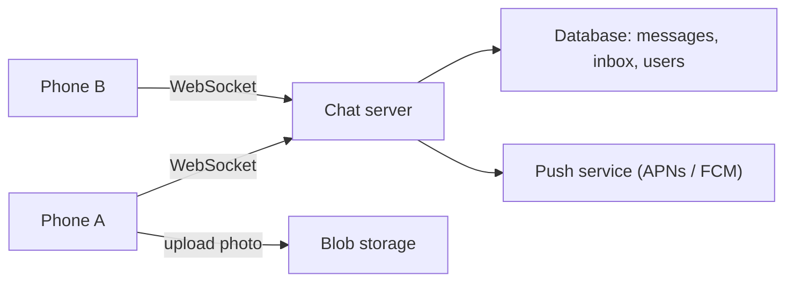
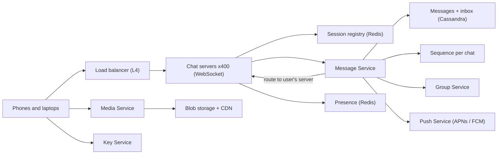
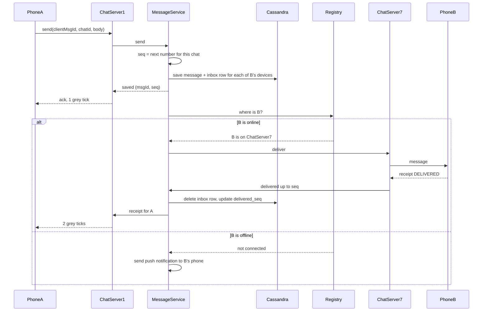
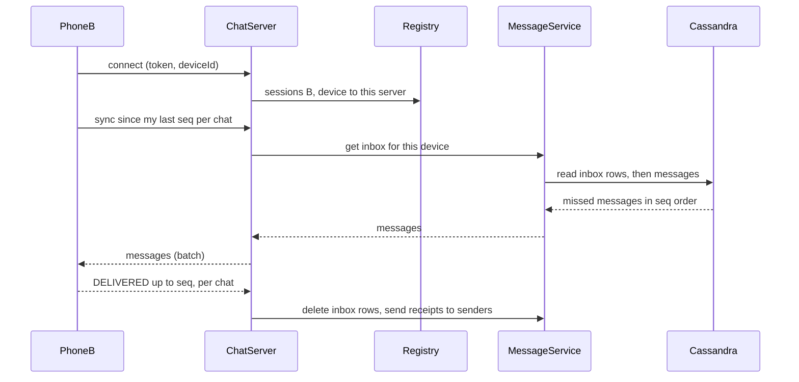
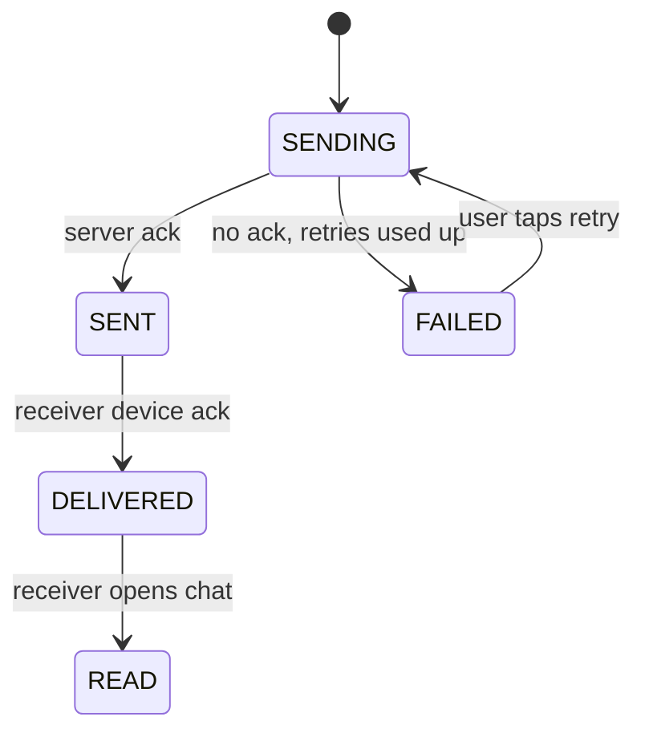

# WhatsApp (chat)

[← System design basics](../system-design.md) · [← Main README](../../README.md)

**In one line:** Keep one open connection per phone. Save every message before you deliver it. Number the messages in each chat so they stay in order.

**Story:** Think of a society's security guard with an intercom.
He knows which flat each person is in right now (that is the *session registry*).
When a parcel comes for someone who is out, he keeps it in the cabin and calls them (offline inbox + push notification).
When they pick it up, he writes "delivered" in the register. When they open it, the sender gets a call: "read".
A chat system is this guard, for 500 million people at once.

---

## 1. How the interviewer asks it

- "Design WhatsApp."
- "Design a chat app with 1:1 and group chats, and read receipts."
- "Design Messenger / Slack / Discord."
- "Design a chat system and scale it to Uber's size."

Prep sites report WhatsApp and Messenger as common Meta questions. A Glassdoor report from Uber describes a 60-minute chat-system round. These are candidate reports, not official lists.

**What they are really testing:**

- Real-time push: why WebSockets, and how server 1 reaches a user who is connected to server 7.
- Delivery you can trust: no lost messages, no duplicates, correct order, and offline users.
- Fan-out for groups and many devices, without melting the system.

---

## 2. Questions to ask (with assumed answers)

| Question | Why it matters | What we assume |
|---|---|---|
| 1:1 only, or groups too? | Groups need fan-out | Both. Groups up to 1,000 members. |
| How many users? | Drives the number of servers | 500M daily active users (DAU), 200M online at peak |
| How many messages? | Drives storage and throughput | 20 messages per user per day |
| Offline delivery? | Needs a durable inbox | Yes. Keep undelivered messages for 30 days. |
| Do we keep chat history on the server? | Changes storage a lot | Only until all devices get it (WhatsApp style). Phone keeps history. |
| Delivery and read receipts? | Extra events per message | Yes: sent, delivered, read ticks |
| Online status and last seen? | Presence traffic can be huge | Yes, but only shown to people who look at the chat |
| Photos and videos? | Big files need their own path | Yes, through blob storage, up to 100 MB |
| Many devices per user (phone + laptop)? | Each device needs its own copy | Yes, up to 4 linked devices |
| End-to-end encryption? | Server cannot read messages | Yes, at a simple level |
| Latency target? | Picks push vs polling | Under 500 ms when both users are online |

---

## 3. Assumptions

1. 500M DAU, 200M online at peak.
2. 20 messages per user per day. Average message ~200 bytes after encryption.
3. Groups up to 1,000 members.
4. Server keeps a message only until every device gets it, max 30 days.
5. Clients keep a WebSocket open while the app is active.
6. Media goes to blob storage. The message carries only a link and a key.

---

## 4. Requirements

**Functional (what it does):**

- Send and receive 1:1 and group messages in real time.
- Deliver messages to offline users when they come back.
- Show ticks: sent (1 grey tick), delivered (2 grey ticks), read (2 blue ticks).
- Show online / last seen.
- Send photos, videos and documents.
- Work on several devices for one user.

**Non-functional (how well):**

- **Never lose a message** once the sender sees 1 tick.
- **No duplicates** on screen, even when the network retries.
- **Order** is correct inside each chat.
- **Low latency:** under 500 ms between two online users.
- **High availability:** chat must work even when some servers die.
- **Privacy:** the server cannot read message content.

---

## 5. Numbers

Shortcut: 1 day ≈ 100,000 seconds. See [Capacity estimation](../system-design.md#capacity-estimation).

**Step 1: Messages per second**

- 500M × 20 = 10B messages a day.
- 10B ÷ 100,000 = **100,000 messages/second**. Peak (3×) ≈ **300,000/s**.
- Each message also makes 2 receipts (delivered, read). So ~1M events/s at peak.
- **Decision:** one database cannot take this. We need a write-heavy, sharded store like Cassandra.

**Step 2: Open connections**

- 200M users online at peak.
- One well-tuned chat server can hold about 500,000 to 1M connections.
- 200M ÷ 500,000 = **400 chat servers**, plus spare for failures.
- **Decision:** we need a registry that says "user X is on server Y".

**Step 3: Heartbeats**

- Each client pings every 30 seconds.
- 200M ÷ 30 ≈ **7M pings/second**.
- **Decision:** handle pings inside the chat server's memory. Do not write each ping to Redis or a DB.

**Step 4: Storage**

- 10B × 200 bytes = **2 TB a day**.
- Most messages are delivered within seconds and then deleted. Even if we keep all for 30 days: 60 TB, ×3 copies = 180 TB.
- **Decision:** fine for a Cassandra cluster. Use a TTL (auto-delete time) of 30 days.

**Step 5: Media**

- Say 5% of messages are media, ~200 KB on average.
- 500M × 200 KB = **100 TB a day**.
- **Decision:** never send media through the chat servers. Upload to blob storage directly.

---

## 6. APIs

Messages go over a **WebSocket** (one long-lived, two-way connection). Normal HTTP is used for login, media and history.

| API | Type | What it does |
|---|---|---|
| `wss://chat.example.com/v1/connect` | WebSocket | Open the connection (auth token in the handshake) |
| `send` | WS frame, client → server | Send a message |
| `ack` | WS frame, server → client | "Saved" (1 tick), with the server ID and sequence |
| `message` | WS frame, server → client | A new message for you |
| `receipt` | WS frame, both ways | delivered / read |
| `GET /v1/sync?since=...` | HTTP | Get missed messages after reconnect |
| `POST /v1/media/upload-url` | HTTP | Get a pre-signed URL (short-lived upload link) for a file |
| `GET /v1/keys/{userId}` | HTTP | Get a user's public keys for encryption |

**Send (client → server):**

```json
{ "type": "send", "clientMsgId": "c-5f2a91", "chatId": "chat_u12_u98",
  "body": "<encrypted bytes, base64>", "sentAt": "2026-11-15T10:20:00Z" }
```

**Ack (server → client), shows 1 tick:**

```json
{ "type": "ack", "clientMsgId": "c-5f2a91", "msgId": "m_88213", "seq": 1042 }
```

**Receipt (both ways):**

```json
{ "type": "receipt", "chatId": "chat_u12_u98", "status": "READ", "upToSeq": 1042 }
```

- `clientMsgId` is made by the phone. If the phone retries, the server sees the same ID and does not save twice.
- `seq` is the order number inside the chat. The server gives it, not the phone.
- `upToSeq` means "I have read everything up to 1042". One receipt covers many messages.

---

## 7. Data model

| Store | Key | Main fields | Why this store |
|---|---|---|---|
| `messages` (Cassandra) | partition `chat_id`, sort `seq` | `msg_id`, `sender_id`, `client_msg_id`, `body`, `media_ref`, `created_at`, TTL 30 days | Huge write rate, read by chat in order |
| `inbox` (Cassandra) | partition `device_id`, sort `(chat_id, seq)` | pointer to the message | "What has this device not received yet?" Row is deleted after the device acks. |
| `chat_members` (SQL or Cassandra) | `chat_id` | `user_id`, role | Group membership |
| `receipts` (Cassandra) | `(chat_id, user_id)` | `delivered_seq`, `read_seq` | One "watermark" per person per chat, not one row per message |
| Session registry (Redis) | `sessions:{userId}` | `{deviceId → chatServerId}` | Fast lookup, changes often |
| Presence (Redis) | `presence:{userId}` | `online` with TTL, `last_seen` | Short-lived data |
| Keys (SQL) | `device_id` | public keys | Encryption key directory |
| Media (blob storage) | `media_id` | encrypted file | Big files |

**Notes:**

- **Partition by `chat_id`.** One chat's messages sit together and in order. Reading a chat is one partition read.
- **Huge groups make huge partitions.** Add a time bucket: partition `(chat_id, month)`.
- **Receipts as watermarks.** "User 98 has read up to seq 1042" is one row. We do not store 1,042 rows.
- See [SQL vs NoSQL](../system-design.md#sql-vs-nosql) and [Partitioning and sharding](../system-design.md#partitioning-and-sharding).

---

## 8. Architecture, version 1 (simple)

One chat server, one database. Good for a few thousand users.



- The chat server keeps a map in memory: `userId → open connection`.
- To send A → B: save to DB, look up B in the map, write to B's connection.
- If B is not connected: keep the message in the inbox and send a phone notification.
- **Why it breaks:** one server cannot hold 200M connections. With many servers, the in-memory map is no longer enough. Server 1 does not know that B is on server 7.

See [Long polling vs WebSockets vs SSE](../system-design.md#long-polling-vs-websockets-vs-server-sent-events) for why we use WebSockets.

---

## 9. Architecture, version 2 (at scale)



**What changed and why:**

- **Many chat servers:** each holds up to ~500K connections. They are "dumb pipes": they hold sockets and pass frames.
- **L4 load balancer:** works at the TCP level, so long WebSocket connections are cheap to pass through. See [Load balancing](../system-design.md#load-balancing).
- **Session registry:** `userId → which server`. Any service can now find any user.
- **Message Service:** gives the sequence number, saves the message, fans out, and routes it.
- **Cassandra:** spreads 300,000 writes/s across many nodes.
- **Push Service:** wakes up offline phones through Apple (APNs) and Google (FCM) push.
- **Media Service + blob + CDN:** big files skip the chat path. See [Blob storage](../system-design.md#blob-storage-files-images-videos).
- **Key Service:** stores public keys for end-to-end encryption.

---

## 10. Step-by-step flows

### Flow 1: A sends a message to B (with ticks)



When B opens the chat, B's phone sends `READ upToSeq=1042`. The same path takes it back to A, and A sees blue ticks.

### Flow 2: B comes back online and syncs



---

## 11. Deep dives

### Deep dive 1: Connection servers and the session registry

**Why WebSocket?** The server must push messages to the phone. Polling every second from 200M phones is 200M requests/s, mostly empty. A WebSocket stays open, and either side can send at any time.

**How server 1 reaches a user on server 7:**

1. When B connects to server 7, server 7 writes `sessions:B = {phone: cs-7}` in Redis.
2. When a message for B arrives, Message Service reads `sessions:B`.
3. It sends the message to `cs-7` over an internal call (gRPC).
4. `cs-7` finds B's socket in its memory and writes the frame.
5. When B disconnects, `cs-7` removes the entry.

**Other options interviewers like to hear:**

| Option | How | Good | Bad |
|---|---|---|---|
| Registry + direct call (our pick) | Look up server, call it | Simple, one hop | Registry must be fast and correct |
| Redis pub/sub per user | Server subscribes to channel `user:B` | No registry lookup | Pub/sub drops messages if no one listens (at-most-once) |
| Consistent hashing of users to servers | User B always connects to server `hash(B)` | No registry at all | Rebalancing on server add/remove moves many users |

Pub/sub dropping a message is fine in our design. The inbox in Cassandra is the source of truth. A missed push is picked up on the next sync.

**Dead connections and heartbeats:**

- Mobile networks drop connections silently. TCP may not notice for minutes.
- The app sends a small ping every ~30 s. No ping for 60 s → the server closes the socket and removes the session.

**Presence and last seen:**

- On connect: set `presence:B = online` with a TTL of 60 s.
- Refresh the TTL every few minutes from the chat server, not on every ping. (Remember: 7M pings/s.)
- On disconnect: delete the key and save `last_seen = now`.
- Only send presence updates to people who have B's chat open right now. They subscribe when they open the chat. We do not tell all of B's 500 contacts each time B's network flickers.

**Server crash:** 500K phones lose their socket. They reconnect with random delay (jitter), so the other servers are not hit all at once. Nothing is lost, because messages are in the inbox. See [Retry with exponential backoff and jitter](../microservices.md#retry-with-exponential-backoff-and-jitter).

### Deep dive 2: Delivery, ticks, offline sync and ordering

**Rule 1: Save first, then deliver.** The sender gets 1 tick only after the message and inbox rows are saved. If anything crashes after that, the message still reaches B on the next sync.

**The 3 ticks:**

| Tick | Meaning | Who triggers it |
|---|---|---|
| 1 grey | Server saved it | Message Service after the DB write |
| 2 grey | Reached B's device | B's phone sends `DELIVERED` |
| 2 blue | B opened the chat | B's phone sends `READ` |



**At-least-once + dedupe = exactly once on screen:**

- The network can drop the ack. Then the phone sends the same message again.
- The server keeps `client_msg_id` per chat. A repeat returns the first `msgId` and `seq`. No new row.
- The receiver may also get a message twice (push and sync both send it). The phone ignores a `msgId` it already has.
- See [Idempotency](../microservices.md#idempotency).

**Ordering per chat:**

- We do not trust phone clocks. A phone can be 5 minutes wrong.
- Message Service gives a sequence number per chat: 1041, 1042, 1043...
- How: a counter per chat (Redis `INCR seq:{chatId}`, or a Cassandra lightweight transaction). We only need order inside a chat, not across all chats. This keeps it cheap.
- The phone shows messages sorted by `seq`.
- **Gap check:** the phone has 1041 and gets 1043. It knows 1042 is missing and asks the server for it.

**Offline users and sync:**

- If B is offline, the inbox row stays. Push Service sends a phone notification ("New message from A").
- When B connects, B asks for everything after its last known `seq` in each chat.
- After B acks, we delete the inbox rows. Messages expire after 30 days if a device never comes back.

### Deep dive 3: Group chat fan-out and many devices

A group with 500 members. A sends one message.

1. Save the message **once** in `messages` (partition = group chat ID).
2. Get the member list from Group Service (cached).
3. For each member's device, write a small inbox row (a pointer, not the full message).
4. For each online device, look up its chat server and deliver. Batch by server: if 40 members are on `cs-7`, send one call with 40 user IDs.
5. Offline devices get a push notification.

**Numbers:** a 1,000-member group with 4 devices each = 4,000 inbox rows per message. That is fine for a few messages per second. A busy group with 50 messages/s is 200,000 rows/s, which is too many.

**Big groups and channels (100K+ members):**

- Switch to fan-out on read. Do not write an inbox row per member.
- Each member's phone keeps "last seq I have" for that channel. It pulls new messages when it opens the app or gets a light "something new" signal.
- This is the same idea as the celebrity problem in the [News feed](news-feed.md).

**Group receipts:** blue ticks show only when *all* members have read. We keep `read_seq` per member and compute the minimum. "Message info" lists who read it.

**Many devices:** each device has its own inbox and its own `delivered` state. A message is "delivered" for the sender when at least one device of B has it.

### Deep dive 4: End-to-end encryption and media (simple level)

**End-to-end encryption (E2EE)** means only the two phones can read the message. The server passes locked boxes it cannot open.

1. Each device makes a key pair. The **private key** never leaves the phone. The **public key** goes to the Key Service.
2. A wants to message B. A fetches B's public keys (one per device).
3. A's phone uses them to agree on a shared secret with B's phone and encrypts the message.
4. The server stores and forwards only encrypted bytes.
5. The keys change after messages (the Signal protocol's "double ratchet"). An old stolen key cannot open new messages.
6. Groups: each sender shares a "sender key" with members once. Then it encrypts each message once, not 500 times.

**What E2EE changes for our design:**

- The server cannot search, scan or index message text.
- A new device cannot read old history from the server. History moves phone to phone, or from an encrypted backup.

**Media upload:**

1. A's phone encrypts the photo with a fresh random key.
2. A asks Media Service for a pre-signed upload URL and uploads straight to blob storage.
3. A sends a normal chat message: `{ mediaId, key, sha256 hash, thumbnail }`. This message is end-to-end encrypted.
4. B downloads the file (through a CDN), checks the hash and decrypts it.
5. Forwarding the same file reuses the same `mediaId`. No new upload.

---

## 12. Follow-up questions interviewers ask

- **A chat server crashes with 500K connections. What happens?** Phones reconnect to other servers with jitter. The registry gets new entries. Undelivered messages are in the inbox, so nothing is lost.
- **Why not HTTP polling?** 200M phones polling every second is 200M requests/s, mostly empty. Slow and costly. Long polling is a fallback for bad networks.
- **Why not one Kafka topic per user?** Kafka is not built for a billion topics. Use the registry for routing. Kafka can still carry events like receipts or analytics, keyed by `chat_id`.
- **How do you order messages across devices?** By the server's per-chat `seq`, never by the phone clock.
- **How do you show "typing..."?** A small WebSocket frame sent only to people with the chat open. Never saved. Fine to lose.
- **How do you store last seen for 500M users?** Save only on disconnect, not on every ping. Read it when someone opens the chat.
- **A user is offline for 2 weeks.** On reconnect, the phone pulls the inbox page by page. Messages older than 30 days are gone.
- **How does the sender's server learn about the read receipt?** Same path as a message: receipt → Message Service → registry → sender's chat server.
- **How do you handle a group with 100K members?** Fan-out on read for big groups. Members pull by `seq`.
- **How do you deploy a new chat server version without dropping 500K users?** Drain slowly: stop new connections, ask clients to reconnect in small batches.

---

## 13. What can go wrong

| Problem | What we do |
|---|---|
| Chat server dies | Clients reconnect with jitter. Inbox keeps all messages. |
| Registry (Redis) has a stale entry | Delivery to the old server fails. We treat B as offline and send a push. B syncs on reconnect. |
| Ack to the sender is lost | Sender retries with the same `clientMsgId`. Server returns the first result. |
| Message delivered twice to B | Phone de-duplicates by `msgId`. |
| Messages arrive out of order | Phone sorts by `seq`. Gaps trigger a pull. |
| Hot group partition in Cassandra | Time buckets in the partition key. Cache recent messages of busy groups. |
| Reconnect storm after a network outage | Random reconnect delay. Rate-limit connects per server. |
| Push provider (APNs / FCM) is slow | Push is only a hint. The message waits safely in the inbox. |
| A region goes down | Phones reconnect to another region. Cassandra copies data across regions. |

---

## 14. Trade-offs

| We chose | We get | We give up |
|---|---|---|
| WebSocket | Real-time push, low latency | Stateful servers. Harder deploys and load balancing. |
| Registry + direct call | Simple routing, one hop | Registry must stay correct. Stale entries need a fallback. |
| Save first, then deliver | No lost messages | A few ms extra before the first tick |
| At-least-once + dedupe | Simple and safe | Phone must de-duplicate |
| Sequence per chat, not global | Cheap. Scales with chats. | No order across different chats (nobody needs it) |
| Delete after delivery (30-day max) | Small storage, better privacy | No server-side history for new devices |
| E2E encryption | Server cannot read messages | No server search, no spam scan on content |
| Fan-out on write for small groups, read for big ones | Fast delivery in normal groups | Two code paths |

---

## 15. Say this in the interview

> "Each phone keeps a WebSocket open to one of about 400 chat servers. A session registry in Redis maps each user to their server.
> When A sends a message, Message Service gives it a sequence number for that chat. It saves the message and an inbox row for each of B's devices in Cassandra, then acks A. That is the first tick.
> Then it looks up B in the registry and forwards the message to B's chat server. B's phone acks, we delete the inbox row, and A gets the second tick. Read receipts come back the same way, as 'read up to seq N'.
> If B is offline, the inbox row stays and we send a push notification. When B reconnects, it syncs everything after its last seq.
> Retries use a client message ID, so there are no duplicates. Order comes from the per-chat sequence, not phone clocks.
> Groups fan out to each member's device. Very big groups switch to pull. Media goes to blob storage, and messages are end-to-end encrypted."

---

## 16. Mid vs senior vs staff

| Mid | Senior | Staff |
|---|---|---|
| Uses WebSockets and a database for messages | Explains how server 1 reaches a user on server 7 (registry, pub/sub, or hashing) | Plans for chat server crashes, reconnect storms and safe deploys |
| Shows sent and delivered | Save first, client message ID for dedupe, per-chat sequence | Explains why pub/sub can drop messages and why the inbox makes that safe |
| Handles offline with "store and send later" | Offline inbox, push notifications, sync by seq | Multi-device inboxes, history with E2EE, backups |
| Mentions groups | Group fan-out with numbers, receipts as watermarks | Switches big groups to fan-out on read, hot partition fixes |
| Mentions presence | Presence with TTL, last seen saved only on disconnect | Limits presence traffic to people who are watching |
| | Simple E2EE and media flow | Multi-region, cost per connection, what to monitor (delivery lag, connect rate) |

**Real-world notes:**

- In 2012, WhatsApp pushed one FreeBSD server past 2 million TCP connections, using Erlang and kernel tuning. ([WhatsApp blog](https://blog.whatsapp.com/1-million-is-so-2011))
- Discord moved its messages from Cassandra (177 nodes) to ScyllaDB (72 nodes) in 2022–23. They also merged identical reads that arrive at the same time, to protect hot partitions. ([Discord blog](https://discord.com/blog/how-discord-stores-trillions-of-messages))
- A good walkthrough of this problem: [Hello Interview: WhatsApp](https://www.hellointerview.com/learn/system-design/problem-breakdowns/whatsapp).
