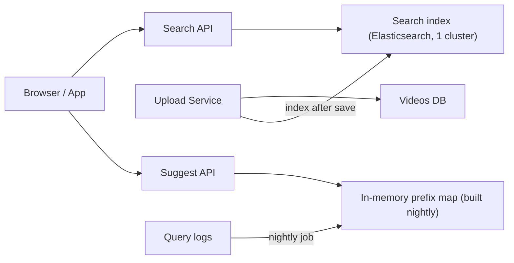
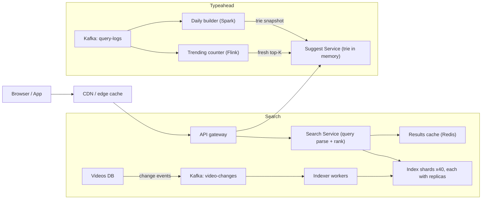
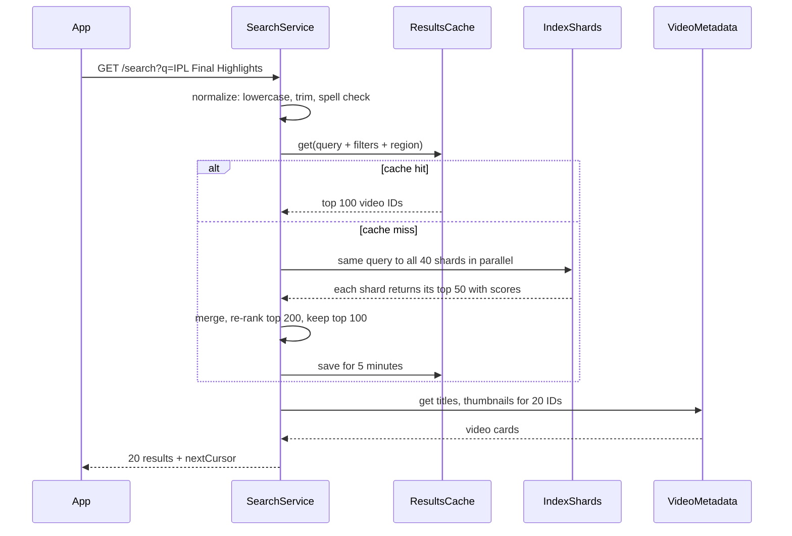
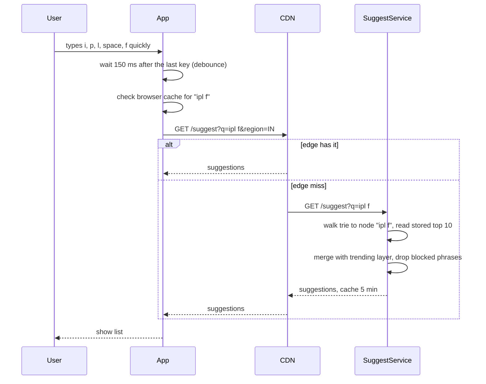

# YouTube search and typeahead (autocomplete)

[← System design basics](../system-design.md) · [← Main README](../../README.md)

**In one line:** Do the hard work before the user asks. Build an inverted index for search and a prefix → top suggestions table for typeahead. Each request is then only a few memory lookups.

**Story:** You walk to the chai stall at 4 pm. You say "ek cutting...". Before you finish, the chaiwala says "...and a Parle-G?"
He did not think at that moment. He already knows what most people order at 4 pm. That is typeahead: answers ready for every start of a sentence.
Now you ask the librarian for "books on cricket history". She does not walk past every shelf. She opens the catalog card for "cricket" and goes to those shelves. That is search with an *inverted index*.

---

## 1. How the interviewer asks it

- "Design search autocomplete for Google / YouTube."
- "Design typeahead: show the top 5 suggestions as the user types."
- "Design search for YouTube videos."
- "Design LinkedIn people-search typeahead." (from a prep-site question bank)

We found no strong company-specific source. Prep sites list it often. Expect it at search-heavy teams (Google, LinkedIn style).

**What they are really testing:**

- Do you avoid `LIKE 'abc%'` on the main database, and precompute instead?
- Can you split a big index across machines and still answer in ~100–200 ms?
- Can you keep suggestions fresh (trending queries) without rebuilding everything every minute?

---

## 2. Questions to ask (with assumed answers)

| Question | Why it matters | What we assume |
|---|---|---|
| Search, typeahead, or both? | Two different designs | Both. Search first, then typeahead. |
| What do we search? | Sets the index fields | Video title, description, tags, channel name, captions |
| How many searches? | Drives every number | 3B searches a day |
| How many videos? | Index size | 1B videos, 5M new ones a day |
| How fast must a new video be searchable? | Batch or streaming indexing | Within a few minutes |
| Latency target? | Drives caching and sharding | Search under 200 ms (p99), suggestions under 100 ms |
| Suggestions from what? | Data source | Popular past queries, not video titles |
| Personalized? | Breaks caching | Not in v1. Language and country only. |
| How fresh are suggestions? | Batch or streaming | Daily rebuild + trending within ~10 minutes |
| Typos, many languages? | Bigger scope | One trie per language. Typo fixing in search only. |
| Bad or unsafe suggestions? | Trust and safety | Must be filtered |

---

## 3. Assumptions

1. 3B searches a day. Each search sends ~6 typeahead requests.
2. 1B videos. 5M new videos a day.
3. Search p99 under 200 ms. Typeahead p99 under 100 ms.
4. Suggestions = top 10 popular past queries for the typed prefix, per language and country.
5. New videos searchable within minutes. New trending queries within ~10 minutes.
6. Ranking is simple: text match + popularity + freshness. ML ranking is a later step.

---

## 4. Requirements

**Functional (what it does):**

- **Search:** user types a query and gets a ranked list of videos, page by page.
- **Filters:** upload date, duration, type (video, channel, playlist).
- **Typeahead:** as the user types, show up to 10 suggestions.
- Trending queries show up in suggestions quickly.
- Blocked or offensive suggestions never show.

**Non-functional (how well):**

- **Fast:** search p99 < 200 ms, typeahead p99 < 100 ms.
- **Highly available:** if search is down, the whole site feels broken.
- **Eventual consistency is fine:** a new video can appear in search a few minutes later.
- **Scale:** ~100K searches/s and ~600K typeahead requests/s at peak.

---

## 5. Numbers

Shortcut: 1 day ≈ 100,000 seconds. See [Capacity estimation](../system-design.md#capacity-estimation).

**Step 1: Search traffic**

- 3B ÷ 100,000 = **30,000 searches/second**. Peak (3×) ≈ **100,000/s**.
- A small set of queries ("arijit singh", "ipl highlights") is a big share of traffic.
- **Decision:** a results cache in front of the index will catch a large part of this.

**Step 2: Typeahead traffic**

- ~6 requests per search after debounce → 30,000 × 6 = **180,000/s**. Peak ≈ **600,000/s**.
- **Decision:** this is 6× the search traffic. We need client debounce, browser cache and edge (CDN) cache.

**Step 3: Search index size**

- 1B videos × ~1 KB of text (title, tags, description, part of captions) = **1 TB of text**.
- The index plus stored fields is about the same size again: ~2 TB.
- At ~50 GB per shard: **~40 shards**.
- **Decision:** the index does not fit on one machine. Every query fans out to all 40 shards in parallel. Each shard has replicas for more read capacity.

**Step 4: Indexing rate**

- 5M new videos ÷ 100,000 = **50 videos/second**, plus edits and view-count updates.
- **Decision:** a small, steady stream. A Kafka-fed indexer is enough.

**Step 5: Typeahead data size**

- Keep the top 10M queries per language. Average query ~20 characters.
- About 50M distinct prefixes. Each holds 10 suggestion IDs (~4 bytes each) plus overhead ≈ ~100 bytes.
- 50M × 100 bytes ≈ **5 GB**.
- **Decision:** it fits in the memory of one server. So we copy the whole thing to every Suggest server. No sharding needed at first.

---

## 6. APIs

| API | What it does |
|---|---|
| `GET /v1/search?q=...&filters=...&cursor=...&limit=20` | Search videos |
| `GET /v1/suggest?q=...&lang=en&region=IN` | Top suggestions for a prefix |

**Search:**

```http
GET /v1/search?q=ipl%20final%20highlights&filters=uploaded:week&limit=20
```

```json
{
  "results": [
    { "videoId": "v_9Qx2", "title": "IPL 2026 Final - Full Highlights",
      "channel": "Cricket Today", "views": 18200000, "duration": "PT14M2S",
      "thumbnail": "https://cdn.example.com/t/v_9Qx2_320.jpg" }
  ],
  "nextCursor": "eyJxIjoiaXBsIiwib2Zmc2V0IjoyMH0",
  "correctedQuery": null
}
```

**Suggest:**

```http
GET /v1/suggest?q=ipl%20fi&lang=en&region=IN
Cache-Control: public, max-age=300
```

```json
{ "prefix": "ipl fi", "suggestions": ["ipl final highlights", "ipl final 2026", "ipl fixtures"] }
```

- `suggest` has no user data in v1. So the same answer works for everyone in a region, and a CDN can cache it.
- `correctedQuery` is set when we fix a typo ("did you mean...").
- Search pages are usually shallow (people rarely go past page 3). A cursor with an offset inside is fine here.

---

## 7. Data model

| Store | Key | Main fields | Why |
|---|---|---|---|
| `videos` (SQL, sharded) | `video_id` | title, description, tags, channel, status, upload time | Source of truth for video data |
| Search index (Elasticsearch-like) | doc = `video_id` | text fields + `views`, `like_ratio`, `upload_time`, `language`, `duration` | Text search with ranking |
| Results cache (Redis) | `hash(normalized query + filters + region)` | top 100 video IDs, TTL 5–10 min | Popular queries skip the index |
| Query logs (Kafka → data lake) | time | query, region, language, clicked video | Input for suggestions and ranking |
| Suggestion trie (in memory) | prefix | top 10 `(query, score)` | Typeahead answers |
| Trie snapshot (blob storage) | version | full serialized trie | Servers load it on start or on update |
| Blocklist (SQL) | phrase | reason | Unsafe suggestions to drop |

**Search document example:**

```json
{ "video_id": "v_9Qx2", "title": "IPL 2026 Final - Full Highlights",
  "tags": ["ipl", "cricket", "final"], "channel": "Cricket Today",
  "captions": "what a catch ...", "language": "en", "upload_time": "2026-05-31",
  "views": 18200000, "like_ratio": 0.97, "duration_sec": 842 }
```

The index is **not** the source of truth. If we lose it, we rebuild from the `videos` table. See [Inverted index](../system-design.md#inverted-index-how-search-works).

---

## 8. Architecture, version 1 (simple)



- **Search:** the Search API sends the query to one Elasticsearch cluster. It returns the top 20 by BM25 (a text relevance score) plus view count.
- **Typeahead:** a nightly job counts yesterday's queries. It builds a map `prefix → top 10 queries`. The Suggest API serves it from memory.
- **Why it breaks:** synchronous indexing slows uploads. One cluster cannot take 100K queries/s. Nightly suggestions miss news ("earthquake today"). 600K suggest requests/s hit our servers directly.

---

## 9. Architecture, version 2 (at scale)



**What changed and why:**

- **CDN / edge cache:** caches suggestions for short prefixes ("i", "ip", "ipl") near users. Most typeahead requests never reach us. See [CDN](../system-design.md#cdn).
- **Async indexing through Kafka:** uploads do not wait for the index. New videos are searchable in ~1 minute. See [Message queues](../system-design.md#message-queues-and-pubsub).
- **40 shards with replicas:** each shard searches a small part, in parallel. Replicas add read capacity. See [Partitioning and sharding](../system-design.md#partitioning-and-sharding).
- **Results cache:** popular queries are answered from Redis in ~1 ms. See [Caching](../system-design.md#caching).
- **Daily builder + trending counter:** a full, clean trie once a day, plus a small fresh layer for news.
- **Trie in memory on every Suggest server:** 5 GB fits in RAM. Any server can answer any prefix.

---

## 10. Step-by-step flows

### Flow 1: A search request



### Flow 2: Typing "ipl f" in the search box



---

## 11. Deep dives

### Deep dive 1: The indexing pipeline and sharding the index

**From upload to searchable:**


1. The upload saves the video row in the DB.
2. *CDC* (change data capture: reading the DB's change log) puts an event in Kafka. We never "write to DB and to index" from the app, because one of the two can fail. See [Transactional outbox](../microservices.md#transactional-outbox-pattern).
3. Indexer workers add extra text: auto-generated captions, detected language, channel name.
4. Text is split into words, lowercased and stemmed ("highlights" → "highlight").
5. The document goes to its shard. Elasticsearch makes it searchable after a short refresh (~1 s by default).
6. View counts change all the time. We do not reindex on every view. A job pushes new counts every hour or so.

**How to split the index:**

| | Document sharding (our pick) | Term sharding |
|---|---|---|
| Rule | Each shard holds all words for its own set of videos | Each shard holds full lists for some words |
| A query hits | All shards (scatter-gather) | Only shards for the query's words |
| Good | Even load, easy to add videos, a failed shard loses only some results | Fewer shards per query |
| Bad | Every query goes to every shard | Hot words ("song") make hot shards. Multi-word queries must join lists across machines. |

- **Shard by `hash(video_id)`** so videos spread evenly.
- **Replicas** of each shard handle more queries and survive machine failure.
- **Tail latency:** the query is as slow as the slowest of 40 shards. We set a per-shard timeout (~80 ms). If one shard is late, we send the same request to another replica (a *hedged request*). Or we return results without that shard.

### Deep dive 2: Ranking, and how search stays under 200 ms

**Ranking signals (simple):**

| Signal | Example |
|---|---|
| Text match | BM25 score. A match in the title counts more than in the description or captions. |
| Popularity | Views, watch time |
| Quality | Like ratio, how often people click and keep watching |
| Freshness | Newer videos get a boost for news-like queries ("ipl final" in May) |
| User context | Language and country. Later: watch history. |

**Two-stage ranking:**

1. **Retrieve (cheap):** each shard finds matches and scores them with BM25 + a precomputed quality score. It returns its top 50.
2. **Re-rank (costly):** Search Service merges 40 × 50 = 2,000 results. It re-scores only the top 200 with a richer formula or an ML model.
3. Return the top 20, and cache the top 100.

A heavy model on 1B videos is impossible in 200 ms. On 200 videos it is easy.

**Why it is so fast — the latency budget:**

| Step | Time |
|---|---|
| Network to our data center | ~20–40 ms |
| Parse + normalize query, check results cache | ~5 ms |
| Fan out to 40 shards (in parallel), each searches ~50 GB | ~30–60 ms |
| Merge + re-rank 200 | ~20 ms |
| Fetch 20 video cards (cached) | ~10 ms |
| **Total** | **~100–150 ms** |

The tricks behind those numbers:

- **Precomputed index.** We never scan videos. We look up words.
- **Parallel shards.** 40 machines each search 1/40 of the data at the same time.
- **Index in memory.** Hot parts of the index sit in RAM (OS page cache) or fast SSD.
- **Early stop.** Posting lists (the list of videos for a word) are sorted by quality. A shard can stop once it has 50 good matches.
- **Results cache.** Popular queries skip the shards completely.
- **Cheap first, costly last.** Only 200 videos see the costly ranker.

### Deep dive 3: Typeahead data structure and updates

**A trie** is a tree of letters. Each path from the root spells a prefix: `i` → `ip` → `ipl`.

The key idea: **store the top 10 answers at every node.** We do not search the subtree at request time.

```java
class TrieNode {
    Map<Character, TrieNode> children = new HashMap<>();
    List<Suggestion> top10 = List.of(); // precomputed at build time
}

record Suggestion(String query, long score) {}

List<Suggestion> suggest(TrieNode root, String prefix) {
    TrieNode node = root;
    for (char c : prefix.toLowerCase().toCharArray()) {
        node = node.children.get(c);
        if (node == null) return List.of(); // nobody searched this
    }
    return node.top10; // O(prefix length), no sorting at request time
}
```

- Lookup time depends only on the prefix length (~10 steps). Not on the number of queries.
- **Simpler option:** a plain map `prefix → top10` in memory or Redis. Same speed, more memory, easier to explain. Both are fine.

**Building it (batch, daily):**

1. Query logs go to Kafka, then to a data lake.
2. A Spark job counts each query over the last ~30 days. Recent days count more (*time decay*).
3. Filters: drop blocked phrases. Drop queries searched by very few distinct users. This also protects privacy (no one's phone number becomes a suggestion).
4. Build the trie. Push the top 10 of each subtree up to every node.
5. Save a snapshot to blob storage. Suggest servers load it in the background and swap it in at once. No downtime.

**Trending layer (streaming, every few minutes):**

- A Flink job counts queries in 5- to 10-minute windows.
- For huge streams, it uses a *count-min sketch*: a small table that estimates counts with little memory. A heap keeps the top K.
- Queries that jump fast ("earthquake delhi") go into a small "fresh" map on each Suggest server.
- At request time: merge the daily top 10 with fresh items for the same prefix, by score.

**When one server is not enough:**

- Split by language and country first (an English-India trie, a Hindi trie...).
- If one trie is still too big, shard by prefix. Do not split by first letter only: "s" is much bigger than "x". Split by ranges of 2–3 letters, sized by traffic.

### Deep dive 4: Cutting typeahead load (and why it feels instant)

600K requests/s is a lot for "show 10 words". Most of it never needs to reach our servers.

| Layer | What it does | Saves |
|---|---|---|
| **Debounce** in the app | Send a request only after the user pauses ~150 ms | Fast typists send 1 request, not 6 |
| **Cancel old requests** | A new keystroke cancels the request in flight | No wasted work, no stale list flashing |
| **Browser cache** | Same prefix again (after backspace) → use the saved answer | Repeat requests |
| **Local filter** | Have the list for "ipl"? Show the matches for "ipl f" from it while the real answer loads | Feels instant |
| **CDN edge cache** | Short prefixes are the same for everyone in a region. Cache them for ~5 min. | Most traffic, because short prefixes are the most common |
| **In-memory trie** | Server answer in ~1 ms | Server time |

So the user sees suggestions in ~50 ms. The server sees only a small part of the keystrokes.

**Personalization breaks the CDN cache.** If needed, keep the global list cacheable. Mix in the user's own recent searches on the device.

---

## 12. Follow-up questions interviewers ask

- **Why not `SELECT ... WHERE title LIKE 'ipl%'`?** It scans many rows. It has no ranking. It cannot take 600K requests/s. It also loads the main DB.
- **A query starts trending right now. How fast does it show?** The Flink job sees it in the next 5–10 minute window and pushes it to the fresh layer. The daily build makes it permanent.
- **How do you block offensive suggestions?** Filter at build time and again at serve time (the blocklist can change during the day). Also require a minimum number of distinct users.
- **One trie shard ("s") is too hot.** Split by 2–3 letter prefixes and add replicas for the hot ranges. The CDN also absorbs most short prefixes.
- **How do you handle typos ("arjit sing")?** In search: fuzzy match (allow 1–2 letter edits) and "did you mean" from query logs. In typeahead: usually out of scope.
- **How big is the trie?** Keep only the top ~10M queries per language and the top 10 per node. About 5 GB.
- **A new video was uploaded. When can people find it?** CDC → Kafka → indexer → refresh. About a minute.
- **One index shard is slow.** Per-shard timeout, hedged request to a replica, or return partial results.
- **How do you know ranking got better?** A/B tests. Measure clicks on results, watch time from search, and how often users search again right away.
- **Search vs typeahead: which is more traffic?** Typeahead, about 6×. That is why it gets debounce and CDN caching.

---

## 13. What can go wrong

| Problem | What we do |
|---|---|
| Index lags behind the DB | Monitor Kafka consumer lag. Index is eventually consistent; a delay of minutes is fine. |
| Index corrupted or lost | Rebuild from the videos DB into a new index. Switch an alias (a pointer name) to it. |
| A shard is slow or down | Replicas, hedged requests, partial results. |
| A bad trie snapshot (empty or broken) | Check counts before swap. Keep the last good version and roll back. |
| Trending layer shows something harmful | Serve-time blocklist. Humans can add phrases fast. |
| Celebrity news: cache miss storm on one new query | One request fills the cache; others wait for it (request coalescing). |
| CDN serves old suggestions | Short TTL (5 min). Fine for typeahead. |
| Spam: bots search a phrase to push it into suggestions | Count distinct users, not raw searches. Rate-limit per user and IP. See [Rate limiting](../system-design.md#rate-limiting-algorithms). |

---

## 14. Trade-offs

| We chose | We get | We give up |
|---|---|---|
| Document sharding | Even load, simple adds | Every query hits every shard |
| Async indexing (CDC + Kafka) | Fast uploads, no lost updates | New videos appear after ~1 minute |
| Two-stage ranking | Good results in 200 ms | Retrieval may miss a few good videos |
| Results cache with 5–10 min TTL | Popular queries in ~1 ms | Slightly stale results |
| Top 10 stored at every trie node | O(prefix length) lookup | More memory, slower builds |
| Daily build + trending layer | Clean data and fresh news | Two pipelines to run |
| Non-personalized suggestions | CDN caching works | Less tailored suggestions |
| Whole trie on each server | No routing, any server answers | Every server needs ~5 GB RAM per language |

---

## 15. Say this in the interview

> "There are two parts. For search, videos go into an inverted index. Uploads go to the DB, CDC sends a change to Kafka, and indexer workers write it to the right shard. It is searchable in about a minute.
> The index is about 2 TB, so I split it by video ID into about 40 shards with replicas. A query goes to all shards in parallel. Each returns its top 50, and I re-rank the top 200 with text match, views, quality and freshness. Popular queries come from a results cache. That keeps us at 100–150 ms.
> For typeahead, I precompute the top 10 suggestions for every prefix in a trie. A lookup is just walking a few letters. I build it daily from query logs with Spark, and a Flink job adds trending queries every few minutes.
> Typeahead gets about 6 times more requests than search. So the app debounces, the browser caches, and the CDN caches short prefixes. Blocked phrases are filtered at build time and at serve time."

---

## 16. Mid vs senior vs staff

| Mid | Senior | Staff |
|---|---|---|
| Uses Elasticsearch, avoids `LIKE` | Explains the inverted index, sharding and scatter-gather | Compares document vs term sharding; handles tail latency with hedged requests |
| Indexes on upload | Async indexing with CDC and Kafka | Rebuild and reindex plans, index aliases, schema changes |
| Sorts by views | Two-stage ranking with clear signals | Ranking experiments, metrics, feedback loop from clicks |
| Uses a trie | Stores top 10 at each node; daily build from logs | Trending layer with count-min sketch; privacy and abuse filters |
| Adds a cache | Results cache + CDN + debounce, with numbers | Latency budget per step; cost of 600K suggest requests/s |
| | Blocklist for suggestions | Per-language tries, sharding by traffic-sized prefix ranges, rollout of new snapshots |

**Real-world notes:**

- LinkedIn open-sourced Cleo, its typeahead library. LinkedIn reported that its network typeahead answered in about 20 ms on average, across 150M+ members (2012). ([LinkedIn engineering](https://engineering.linkedin.com/open-source/cleo-open-source-technology-behind-linkedins-typeahead-search))
- LinkedIn later merged typeahead into its search federation layer. Their post reports QPS dropping from about 16K to 8K after the change. ([LinkedIn engineering, 2018](https://engineering.linkedin.com/blog/2018/03/search-federation-architecture-at-linkedin))
