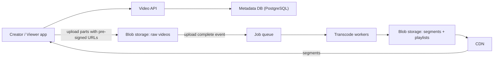
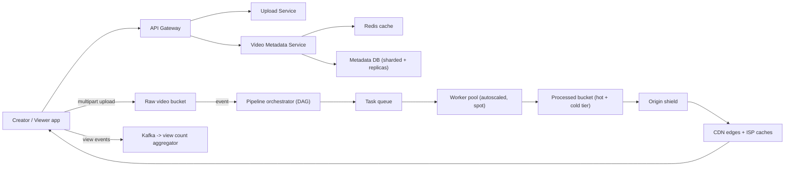
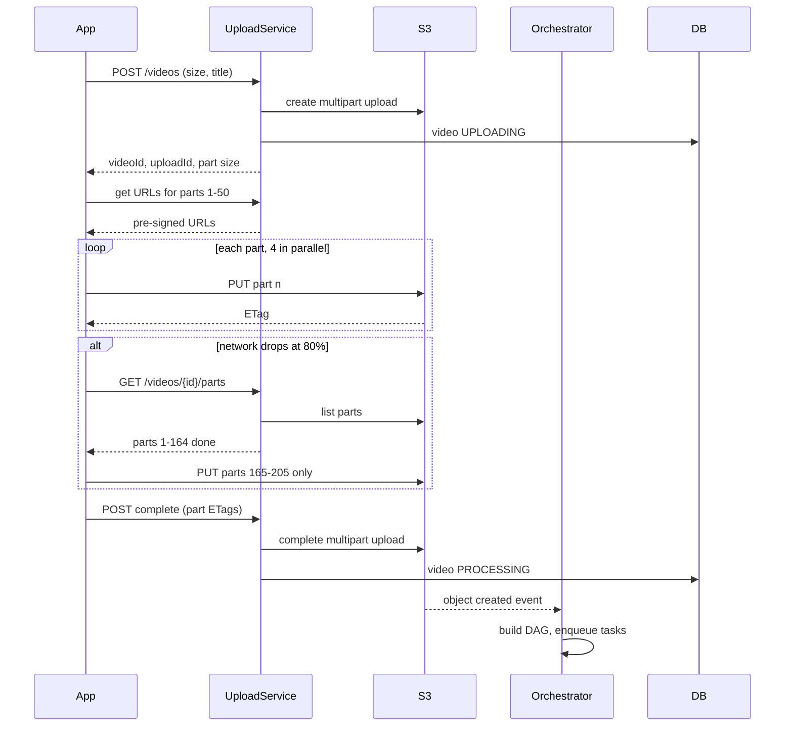
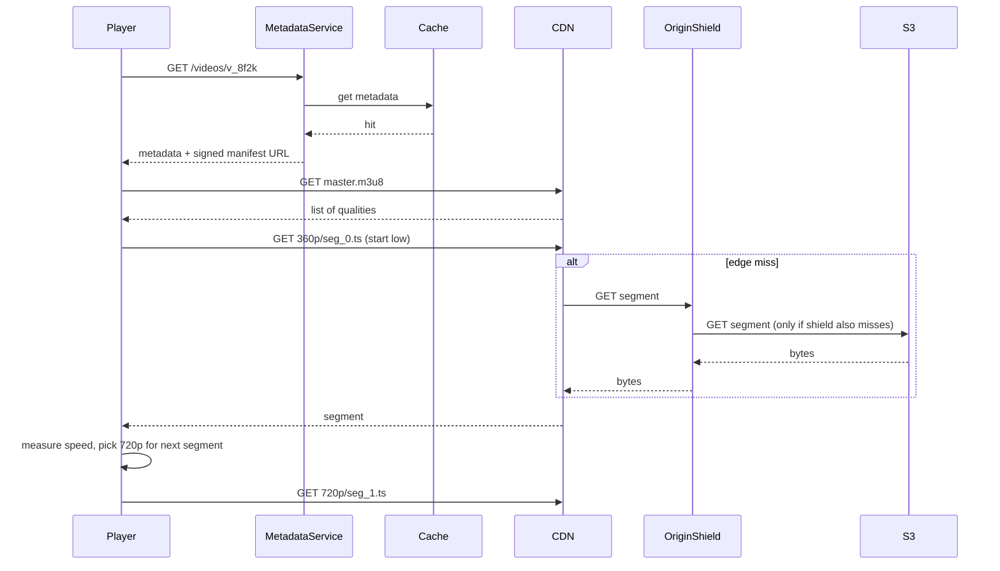
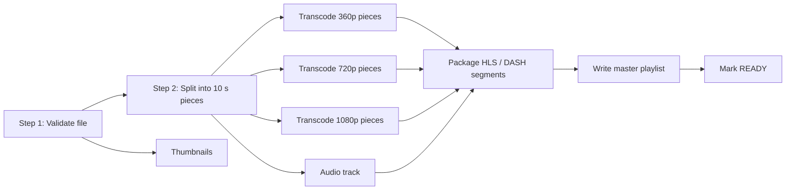
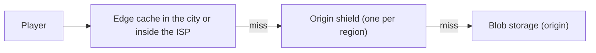
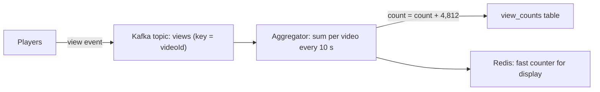

# YouTube / Netflix (upload and watch)

[← System design basics](../system-design.md) · [← Main README](../../README.md)

**In one line:** Upload straight to blob storage, convert to many qualities in the background, and serve small chunks from a CDN.

**Story:** In the old days, a film was shot once in Mumbai.
The studio made many copies of the reel and sent them to cinema halls in every city.
People in Patna watched at the Patna hall, not in Mumbai.
Small towns got a smaller copy on a cheaper print.
YouTube does the same: one upload, many qualities, copies kept close to the viewers.

---

## 1. How the interviewer asks it

- "Design YouTube." (Upload and watch.)
- "Design Netflix." (Mostly watch. The studio uploads the catalog.)
- "Design a video distribution service."
- "Users upload videos up to 10 GB and others watch them on phones and TVs. Design it."

Prep sites report video and CDN-style designs at Google, Amazon and Netflix. These are candidate reports, not official lists.
Netflix rounds lean toward their own domain (streaming, CDN).

**What they are really testing:**

- Do you keep big bytes away from your app servers (pre-signed upload, CDN download)?
- Do you know video is not "ready" right after upload (an async processing pipeline)?
- Can you say *what* the CDN caches and how the player picks a quality (adaptive bitrate)?

---

## 2. Questions to ask (with assumed answers)

| Question | Why it matters | What we assume |
|---|---|---|
| Upload, watch, or both? | Netflix is watch-only; YouTube is both | Both |
| How big can a video be? | Big files need chunked, resumable upload | Up to 10 GB, average ~1 GB |
| How many uploads and views a day? | Drives storage, compute and bandwidth | 1M uploads/day, 100M views/day |
| Which devices and networks? | Slow mobile networks need many qualities | Phones, web, TVs; many on 4G |
| How fast must a video be watchable after upload? | Decides how we order the processing work | Low quality in minutes, HD can come later |
| Search, comments, recommendations? | Big extra systems | Out of scope; say it out loud |
| Public, private or paid videos? | Decides if CDN links must be signed | Public and private; private uses signed URLs |
| Live streaming too? | Live is a different design | No. See [Hotstar live streaming](hotstar-live-streaming.md) |
| Do view counts need to be exact and live? | Counting at scale is its own problem | A few seconds late and roughly right is fine |
| Global users? | CDN placement, multi-region storage | Yes, global, with a big share in India |

---

## 3. Assumptions

1. 1M uploads a day, average 1 GB, max 10 GB.
2. 100M views a day, average watch 10 minutes.
3. Output qualities: 240p, 360p, 480p, 720p, 1080p (a "bitrate ladder").
4. Video must play on slow networks without stopping.
5. Search, comments and recommendations are out of scope.
6. View counts can be a few seconds late.
7. We use cloud building blocks: S3-like blob storage, a queue, a CDN.

---

## 4. Requirements

**Functional (what it does):**

- A creator uploads a video, with title and description.
- The upload survives network drops (resume, do not restart).
- The system converts the video into many qualities and makes it playable.
- A viewer opens a video and it plays smoothly on any device.
- The creator sees the status: uploading, processing, ready, failed.
- Each video shows a view count.

**Non-functional (how well):**

- **Playback starts fast:** first frame in under ~2 seconds.
- **Few stalls:** quality drops before playback stops.
- **Upload never loses data** once we said "uploaded".
- **Very high availability for watching** (99.99%). Upload and processing can be a bit less.
- **Cost matters:** storage and bandwidth are the biggest bills.

---

## 5. Numbers

Method: [Capacity estimation](../system-design.md#capacity-estimation). We use 1 day ≈ 100,000 seconds.

**Upload side:**

| Step | Math | Result | Decision it drives |
|---|---|---|---|
| Uploads per second | 1M ÷ 100,000 | ~10/s, peak ~30/s | Low request rate. Bytes are the problem. |
| Raw bytes per day | 1M × 1 GB | ~1 PB/day | Must go to blob storage, not a DB |
| Upload bandwidth | 1 PB ÷ 100,000 s | ~10 GB/s (~80 Gbps) | App servers must not carry bytes. Use pre-signed URLs. |
| Stored after transcode | ~2–3× raw (original + 5 qualities) | ~2–3 PB/day, ~1 EB/year | Cold storage for old, unwatched videos |

**Processing side (rough guess):**

- 1M videos × 10 minutes average = 10M minutes of video a day.
- Assume 1 minute of video needs ~10 CPU-minutes for all qualities.
- 10M × 10 = 100M CPU-minutes a day ÷ 1,440 minutes ≈ **70,000 CPU cores busy all day**.
- **So:** a big worker fleet that scales on queue length. Cheap spot machines are fine because tasks can retry.

**Watch side:**

| Step | Math | Result | Decision it drives |
|---|---|---|---|
| Views per second | 100M ÷ 100,000 | ~1,000/s, peak ~3,000/s | Metadata reads: cache + read replicas |
| Concurrent viewers | 1,000 starts/s × 600 s watch | ~600,000 at a time | |
| Watch bandwidth | 600,000 × ~2 Mbps | ~1.2 Tbps average, ~3–4 Tbps peak | Only a CDN can serve this |
| Segment requests | 600,000 viewers ÷ one 4 s segment each | ~150,000 req/s | CDN, not our servers |
| View count updates | ~1,000–3,000/s, hot videos get most | One DB row per video gets hammered | Count in a stream, write in batches |

**Metadata:** 1M new videos × ~1 KB = ~1 GB a day, ~365 GB a year.
One SQL database fits this for a while. We shard later by `video_id`.

---

## 6. APIs

| API | What it does |
|---|---|
| `POST /videos` | Start an upload. Returns `videoId`, `uploadId`, part size. |
| `POST /videos/{id}/parts?from=1&to=50` | Get pre-signed URLs for a batch of parts. |
| `GET /videos/{id}/parts` | Which parts are already uploaded (for resume). |
| `POST /videos/{id}/complete` | Client says "all parts done". Starts processing. |
| `GET /videos/{id}` | Metadata, status and the manifest URL to play. |
| `POST /events/views` | Player sends "view started" and watch-time events (batched). |

Start an upload:

```http
POST /videos
{ "title": "Goa trip 2026", "sizeBytes": 2147483648, "contentType": "video/mp4" }
```

```json
{ "videoId": "v_8f2k", "uploadId": "mpu_91ab", "partSizeBytes": 10485760, "totalParts": 205 }
```

Watch a video:

```http
GET /videos/v_8f2k
```

```json
{ "videoId": "v_8f2k", "title": "Goa trip 2026", "status": "READY", "durationSec": 612,
  "manifestUrl": "https://cdn.example.com/v_8f2k/master.m3u8?token=...&exp=1763300000",
  "views": 10423 }
```

- The `userId` comes from the login token, never from the body.
- The `manifestUrl` points to the CDN, not to our servers.
- For private videos, the URL has a short-lived signed token.

---

## 7. Data model

| Table | Main columns | Notes |
|---|---|---|
| `videos` | `video_id`, `owner_id`, `title`, `status`, `duration_sec`, `raw_key`, `manifest_key`, `visibility`, `created_at` | Status: UPLOADING → PROCESSING → READY / FAILED |
| `renditions` | `video_id`, `quality` (360p...), `codec`, `bitrate`, `playlist_key` | One row per quality |
| `upload_sessions` | `video_id`, `upload_id`, `part_size`, `total_parts`, `expires_at` | S3 itself tracks which parts arrived |
| `transcode_tasks` | `task_id`, `video_id`, `segment_no`, `quality`, `status`, `attempts` | One row per small piece of work |
| `view_counts` | `video_id`, `count`, `updated_at` | Updated in batches, not per view |

**Which storage and why:**

- **Video bytes** (raw file, segments, playlists): blob storage like S3. See [Blob storage](../system-design.md#blob-storage-files-images-videos).
- **Metadata:** PostgreSQL or MySQL. Small rows, clear relations, status changes need a safe update.
- **Read path:** Redis cache in front, because one viral video is read millions of times. See [Caching](../system-design.md#caching).
- **Growth:** shard `videos` by `video_id`. Most reads ask for one video by id.
- **Never store video bytes in the DB.** Backups and replication would crawl.

---

## 8. Architecture, version 1 (simple)



- **Video API:** creates upload sessions, hands out pre-signed URLs, serves metadata.
- **Blob storage (raw):** gets the original file directly from the app.
- **Job queue + workers:** convert the video into 5 qualities and HLS chunks. Then mark it READY.
- **CDN:** caches segments and playlists near viewers.

This works for a small site. One worker per video is slow for long videos. Counting views with `UPDATE ... SET count = count + 1` breaks on a viral video.

---

## 9. Architecture, version 2 (at scale)



**What changed and why:**

- **Upload Service** only signs URLs and tracks sessions. Bytes go straight to the bucket.
- **Orchestrator + task queue:** one video becomes hundreds of small tasks (segment × quality). Many workers run them in parallel.
- **Worker pool on spot machines:** cheap, and a lost task just retries.
- **Hot and cold tiers:** old videos nobody watches move to cheaper storage.
- **Origin shield:** one middle cache layer. Edges ask the shield, not the bucket. The bucket sees few requests.
- **ISP caches:** for the most popular titles, cache boxes sit inside the ISP network (the Netflix Open Connect idea).
- **Metadata cache + sharded DB:** metadata reads are 1,000s per second and very skewed.
- **Kafka + aggregator for views:** count in memory, write totals in batches.

---

## 10. Step-by-step flows

### Upload with resume



### Watch



---

## 11. Deep dives

### 11.1 Resumable upload with pre-signed URLs

Problem: a 2 GB upload on mobile data will drop. Starting again from zero makes users quit.

**How it works:**

1. The server starts a multipart upload in S3 and gets an `uploadId`.
2. The file is split into 10 MB parts. A 2 GB file = ~205 parts.
3. The server gives pre-signed URLs in batches (say 50 at a time). A pre-signed URL is a temporary link that allows one upload.
4. The app uploads 3–4 parts in parallel. S3 returns an `ETag` (a checksum id) for each part.
5. On a drop, the app asks "which parts do you have?" The server calls S3 "list parts". The app sends only the missing ones.
6. At the end, the app sends the list of ETags. S3 joins the parts into one file.

```java
// Start a multipart upload, then sign one URL per part (AWS SDK v2)
String key = "raw/" + videoId;
String uploadId = s3.createMultipartUpload(r -> r.bucket("raw-videos").key(key)).uploadId();

List<String> urls = IntStream.rangeClosed(fromPart, toPart)
    .mapToObj(n -> presigner.presignUploadPart(p -> p
            .signatureDuration(Duration.ofHours(1))      // short life: a leaked URL expires soon
            .uploadPartRequest(u -> u.bucket("raw-videos").key(key)
                    .uploadId(uploadId).partNumber(n)))   // each URL allows only this one part
        .url().toString())
    .toList();
```

**Things to say:**

- App servers never touch the bytes. They only sign URLs. So 80 Gbps of uploads cost us almost nothing in servers.
- Abandoned uploads still cost money. A bucket lifecycle rule deletes unfinished multipart uploads after a few days.
- After "complete", check the file before processing: size, type, and that it is really a video.
- S3 limits: parts of 5 MB to 5 GB, up to 10,000 parts. 10 MB parts cover files up to ~100 GB.

### 11.2 Transcoding pipeline (a DAG of small jobs)

*Transcoding* means converting the video into other sizes and formats.
A DAG (directed acyclic graph) is a list of steps where some steps wait for others, and some run in parallel.



**Why split?**

- A 10-minute video cut into 10-second pieces = 60 pieces.
- 60 pieces × 5 qualities = 300 small tasks.
- With 300 free workers, the whole video is done in about the time of one task. One worker alone would take hours.
- Cut only at *keyframes* (full pictures in the video stream), so each piece can be decoded alone.

**How the pieces run:**

- The orchestrator (Temporal, AWS Step Functions, or our own service with the `transcode_tasks` table) knows which step waits for which.
- Each task goes on a queue. Workers pull tasks, so slow workers just take fewer.
- **Idempotent tasks:** the output key is fixed, like `v_8f2k/720p/piece_17.ts`. Running a task twice writes the same file. Safe to retry. See [Idempotency](../microservices.md#idempotency).
- **Retries:** a failed task retries 3 times with backoff. Then it goes to a dead-letter queue (a queue for failed jobs) and the video is marked FAILED.
- **Quick first play:** run 360p first with high priority. Mark the video playable. HD qualities arrive a bit later.
- **Scale workers on queue length**, not CPU. A long queue means we are behind.

### 11.3 Adaptive bitrate, CDN and edge caching

The player basics are in [Video streaming basics](../system-design.md#video-streaming-basics-hls-and-adaptive-bitrate).
Here we say what the CDN caches and how.

**What gets cached:**

| File | Changes? | Cache time |
|---|---|---|
| Segment (`720p/seg_17.ts`) | Never | Very long (1 year). The name never changes. |
| Quality playlist (`720p/index.m3u8`) | No, for a finished video | Long |
| Master playlist (`master.m3u8`) | Only if we add a new quality | Hours, or use a versioned name |
| Metadata API (`GET /videos/{id}`) | Yes (views, title) | Not at the CDN; Redis for a few seconds |

**Layers of cache:**



- **Edge:** close to the user, maybe inside the user's ISP.
- **Origin shield:** a middle cache. Without it, 1,000 edges missing the same segment would hit storage 1,000 times. With it, storage sees 1 request.
- **Popular videos are pushed ahead of time** to edges at night, when the network is quiet. The long tail (rarely watched videos) is pulled on first request.
- **Real world:** Netflix runs its own CDN, called Open Connect. It places cache boxes (Open Connect Appliances) inside ISP networks and at internet exchange points, free for the ISP. It works with over a thousand ISPs this way ([Netflix Open Connect](https://openconnect.netflix.com/en/)).
- See also [CDN](../system-design.md#cdn).

**Fast start (time to first frame):**

- Start with a low quality (360p) and a small first segment.
- Return the manifest URL inside the metadata response. That saves one round trip.
- The player then moves up in quality after it measures the speed.

### 11.4 View counts at scale

**Wrong way:** `UPDATE view_counts SET count = count + 1 WHERE video_id = ?` for every view.
A viral video gets 50,000 views a second. Every request waits for the same row lock. The DB falls over.

**Right way: count in a stream, write in batches.**



1. The player sends a "view" event after, for example, 30 seconds of watching. Events are batched in the app.
2. Kafka partitions by `video_id`. All events of one video go to one aggregator. See [Kafka partitions and consumer groups](../kafka.md#kafka-partitions-and-consumer-groups).
3. The aggregator keeps a map in memory: `video_id → count` for 10 seconds.
4. Every 10 seconds it writes one update per video: `count = count + 4,812`.
5. 50,000 writes a second become 1 write every 10 seconds for that video.

**Things to say:**

- Displayed counts are a few seconds late. That is fine for views.
- Kafka may deliver an event twice. A few duplicates are OK for a display number.
- A nightly batch job recounts from raw events. It removes bots and fake views. This "official" number fixes the live number.
- For money (ad payouts), use only the batch-checked number, never the live one.

---

## 12. Follow-up questions interviewers ask

- **A transcode worker dies halfway. What happens?** The task was not marked done, so it becomes visible again on the queue. Another worker runs it. Output keys are fixed, so a rerun is safe.
- **The upload drops at 80%. Does the user start again?** No. The app asks which parts exist, then uploads only the missing ones.
- **A video goes viral in one country. What breaks?** Usually nothing. The CDN serves it. The origin shield keeps storage calm. We can pre-warm edges in that country.
- **Storage cost is huge. How do you cut it?** Keep fewer qualities for videos nobody watches. Move old, unwatched videos to cold storage. Use better codecs (AV1, VP9) for popular videos, where the saving is worth the CPU.
- **How do you make playback start faster?** Start at low quality with a small first segment. Send the manifest URL with the metadata.
- **How do you keep private videos private?** Short-lived signed URLs or signed cookies on the CDN. The bucket is never public.
- **Same video uploaded twice?** Hash the file after upload. If the hash already exists, reuse the processed output.
- **How do you stop copyright uploads?** Add a "fingerprint check" step in the DAG. It compares the video against known content before publishing.
- **How do you delete a video?** Mark it deleted in metadata so the API stops giving URLs. Then delete files in a background job. Edges expire the cached copies.
- **What changes for live streaming?** No full transcode ahead of time, much smaller segments, and huge sudden spikes. See [Hotstar live streaming](hotstar-live-streaming.md).

---

## 13. What can go wrong

| Problem | What we do |
|---|---|
| Upload drops halfway | Multipart upload. Resume with only the missing parts. |
| Client never calls "complete" | Lifecycle rule removes unfinished uploads after a few days. A job marks old UPLOADING rows as FAILED. |
| Bad or fake video file | Validate step at the start of the DAG. Mark FAILED with a clear reason. |
| Worker crashes or spot machine is taken away | Task returns to the queue and retries. Idempotent output keys. |
| A task fails every time | After 3 retries, send to a dead-letter queue. Alert. Mark the video FAILED. |
| Transcode backlog grows (big upload spike) | Autoscale workers on queue length. Run 360p first so videos become playable sooner. |
| CDN edge fails | DNS sends users to the next edge. Player retries the segment from another CDN host. |
| Origin storage is slow | Origin shield absorbs most misses. Popular content is pre-pushed. |
| Metadata DB down | Reads served from cache and replicas. Uploads can wait; watching keeps working. |
| View count DB slow | Aggregator buffers in memory and Kafka holds events. Counts catch up later. |

---

## 14. Trade-offs

| We chose | We get | We give up |
|---|---|---|
| Direct upload to blob storage | Servers never carry 80 Gbps of bytes | More client logic (parts, resume) |
| Split video into pieces for transcoding | Fast processing, easy retries | Orchestrator to build and run |
| 5 qualities per video | Smooth play on any network | 2–3× storage |
| 360p first, HD later | Video playable in minutes | HD looks "not ready" for a while |
| CDN with long cache times (fixed segment names) | Very high hit ratio, low cost | Changing a video means new file names |
| Own edge caches in ISPs (Netflix style) | Cheaper and faster at huge scale | Big hardware and partner work; only worth it at Netflix size |
| Stream-based view counts | DB survives viral videos | Counts are a few seconds late and slightly off |
| SQL for metadata | Simple, safe status updates | Manual sharding later |

---

## 15. Say this in the interview

> "I will cover upload, processing and watching. Search and recommendations are out of scope.
> 1M uploads a day is about 1 PB of raw video a day. So bytes go straight to S3 with pre-signed multipart upload. The app resumes with only the missing parts.
> An upload event starts a pipeline. I split the video into 10-second pieces and transcode each piece into 5 qualities in parallel. Tasks are idempotent and retried from a queue.
> Then I package HLS segments and a master playlist. The CDN caches segments with long TTLs, behind an origin shield. Popular videos are pushed to edges ahead of time.
> The player starts at 360p and moves up based on its speed. That is adaptive bitrate.
> Metadata lives in PostgreSQL with a Redis cache. View counts go through Kafka and an aggregator, and are written in batches."

---

## 16. Mid vs senior vs staff

| Mid | Senior | Staff |
|---|---|---|
| Upload to S3, transcode with workers, serve from CDN | Pre-signed multipart upload with resume; never through app servers | Cost model: storage tiers, codec choice per popularity, CDN vs own edge boxes |
| Knows HLS and multiple qualities | Explains the DAG: split, parallel transcode, package, idempotent retries | Priorities in the pipeline (360p first, big creators, backlog plans) |
| Says "use a CDN" | Says what is cached, TTLs, origin shield, push vs pull | ISP edge caches (Open Connect style), multi-CDN, regional failover |
| Metadata in a DB | Cache for hot videos, shard by `video_id` | Abuse and copyright step, deletes and legal takedowns across caches |
| Counter column for views | Stream aggregation and batch writes | Exact vs approximate counts, fraud filtering, reconciliation for payouts |
