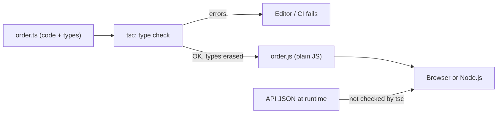
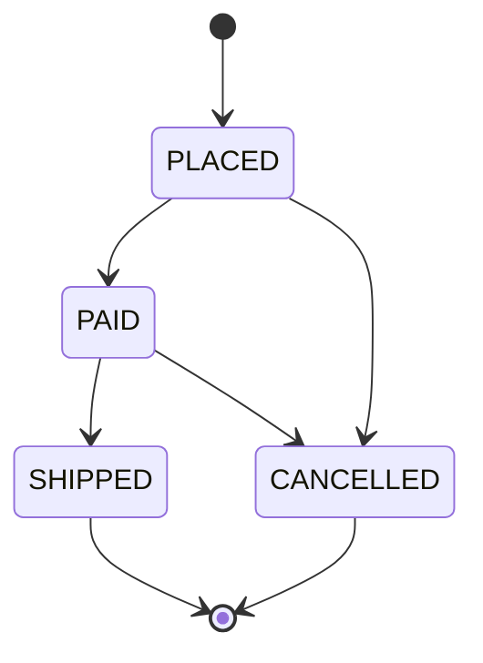
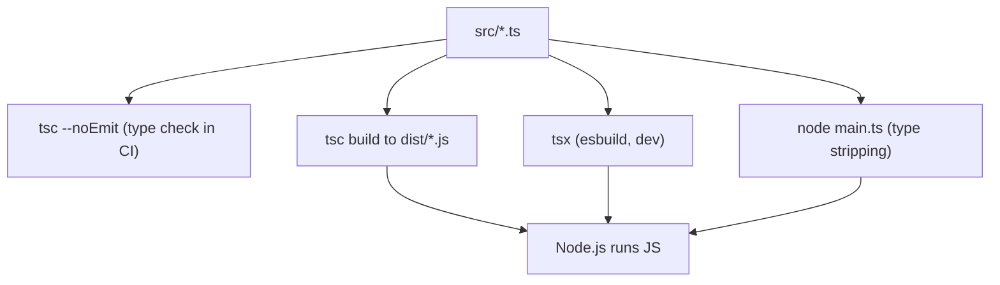

# TypeScript in depth

[← Back to README](../README.md) · [JavaScript](javascript.md) · [React](react.md) · [Next.js](nextjs.md) · [Node.js](nodejs.md)

TypeScript is JavaScript with types. This page explains it for interviews, with many comparisons to Java.
For how JavaScript itself runs (event loop, closures, `this`, promises), see [javascript.md](javascript.md). For hooks and rendering, see [react.md](react.md).
All examples were checked with TypeScript 7.0 in `strict` mode.

**Contents**

- [Why TypeScript (and what it does not do)](#why-typescript-and-what-it-does-not-do)
- [Basic and structural typing](#basic-and-structural-typing)
- [Types vs interfaces](#types-vs-interfaces)
- [Unions, narrowing and discriminated unions](#unions-narrowing-and-discriminated-unions)
- [any, unknown, never and void](#any-unknown-never-and-void)
- [Generics](#generics)
- [Utility types](#utility-types)
- [Mapped and conditional types, infer, template literal types](#mapped-and-conditional-types-infer-template-literal-types)
- [Enums vs union literals and as const](#enums-vs-union-literals-and-as-const)
- [satisfies, type assertions and non-null assertion](#satisfies-type-assertions-and-non-null-assertion)
- [Classes, access modifiers and decorators](#classes-access-modifiers-and-decorators)
- [Typing React and APIs](#typing-react-and-apis)
- [tsconfig that matters](#tsconfig-that-matters)
- [TypeScript in Node.js](#typescript-in-nodejs)
- [TypeScript 5.x to 7: what changed](#typescript-5x-to-7-what-changed)
- [TypeScript coding tasks (with answers)](#typescript-coding-tasks-with-answers)
- [Interview questions](#interview-questions)

---

## Why TypeScript (and what it does not do)

**In one line:** TypeScript checks your types when you build, then removes them, so the code that runs is plain JavaScript.

**Story:** Think of a spell checker in a word processor.
It underlines mistakes while you type. It saves you from sending a bad letter.
But the printed letter has no red lines. The spell checker is gone.
And it cannot check a letter that *someone else* sends to you.
TypeScript is the spell checker. The API response from another server is the letter someone else sends.

**How it works:**
1. You write `.ts` or `.tsx` files with types.
2. The compiler (`tsc`) checks the types. Errors show in the editor and in CI.
3. The types are *erased* (removed). The output is normal JavaScript.
4. The browser or Node.js runs that JavaScript. It knows nothing about your types.

**Diagram:**



**What it gives you:** bugs found before running (typos, wrong arguments, missing `null` checks). Editor autocomplete and safe rename. Types as documentation.

**What it does NOT do:**
- No runtime checks. If the backend sends `total: "12.50"` (a string), TypeScript will not notice.
- No runtime type info. You cannot do `x instanceof Order` when `Order` is a type or interface.

**Compare with Java:** Java keeps class types at runtime. You can use reflection and `instanceof` on classes. Only generics are erased. In TypeScript, *all* types are erased.

**Example:** The type says `Order`, but nobody checks the real data.

```ts
type Order = { id: string; total: number };

async function loadOrder(id: string): Promise<Order> {
  const res = await fetch(`/api/orders/${id}`);
  return res.json(); // json() returns any. TS trusts it. No check at runtime!
}
```

The fix is runtime validation at the boundary, for example with Zod. See [Typing React and APIs](#typing-react-and-apis).

**Good and bad:**

| Good | Bad |
|---|---|
| Validate external data (API, form, `localStorage`) at the edge | Trust `res.json()` because it has a type |
| Turn on `strict` | Use `any` to make errors go away |
| Let TypeScript infer simple local types | Write types on every single variable |

**Say this in the interview:**

> "TypeScript is a compile-time checker for JavaScript. It catches type bugs in the editor and in CI, then the types are erased. At runtime it is plain JavaScript, so data from outside, like API responses, is not checked. That is why I validate API data with a schema library like Zod at the boundary."

**They may ask next:**
- **Does TypeScript make code faster?** No. The output is plain JavaScript. It makes code safer to change.
- **Can I check a type at runtime?** Not the type itself. You check the value with `typeof`, `in`, `instanceof` on classes, or a schema.

---

## Basic and structural typing

**In one line:** TypeScript checks the *shape* of a value (which fields it has), not the *name* of its type.

**Story:** A parking lot accepts "any car that is under 2 meters tall".
It does not ask for a "Honda" sticker. If it fits, it parks.
That is structural typing. Java is like a club that checks your membership card. That is nominal typing (by name).

**How it works:**
- Primitives: `string`, `number` (one type for int and float), `bigint`, `boolean`, `null`, `undefined`, `symbol`.
- Arrays: `string[]` or `Array<string>`. Tuples: `[number, number]` is a fixed-length array.
- Object types: `{ id: string; phone?: string }`. The `?` means optional.
- Two types are compatible if one has *at least* the fields of the other.
- *Excess property check*: if you pass a fresh object literal with extra fields, TypeScript complains. It is a typo guard.

**Example:**

```ts
type Point = { x: number; y: number };

class Pixel {
  constructor(public x: number, public y: number, public color: string) {}
}

function draw(p: Point) { console.log(p.x, p.y); }

draw(new Pixel(1, 2, "red"));       // OK: Pixel has x and y. The name does not matter
draw({ x: 1, y: 2 });               // OK
draw({ x: 1, y: 2, color: "red" }); // Error: excess property check on a fresh literal

const p = { x: 1, y: 2, color: "red" };
draw(p);                            // OK: not a fresh literal, so no excess check

let pair: [string, number] = ["qty", 3]; // tuple
pair = [3, "qty"];                       // Error: wrong order
```

In Java, `draw(Point p)` only accepts a class that `implements Point`. In TypeScript, `Pixel` never mentions `Point`, and it still works.

**When you want "by name" (nominal) types:** use a *brand*. It is a fake field that only exists in the type.

```ts
type UserId = string & { readonly __brand: "UserId" };
type OrderId = string & { readonly __brand: "OrderId" };

const toUserId = (s: string) => s as UserId; // the only place we "stamp" it

function getUser(id: UserId) { return id; }

const orderId = "o-1" as OrderId;
getUser(toUserId("u-1")); // OK
getUser(orderId);         // Error: OrderId is not UserId
```

**Good and bad:**

| Good | Bad |
|---|---|
| Let TS infer: `const total = 0` is `number` | `const total: number = 0 as number` |
| Use brands for IDs that are easy to mix up | Pass raw `string` for userId, orderId, sku everywhere |
| Use tuples for small fixed pairs, like `useState` | Use tuples with 5 fields. Use an object with names |

**Say this in the interview:**

> "TypeScript is structurally typed. If an object has the right fields, it fits, whatever its name. Java is nominal: the class must declare `implements`. When I need name-based safety, like not mixing a UserId with an OrderId, I use branded types."

**They may ask next:**
- **Why did the extra field fail only sometimes?** The excess property check runs only on fresh object literals. A variable with extra fields is fine.
- **`number` vs `bigint`?** `number` is a 64-bit float, safe up to 2^53 - 1. Use `bigint` or a string for larger IDs.

---

## Types vs interfaces

**In one line:** Both describe object shapes; `interface` can be extended and merged, `type` can also name unions and computed types.

**Story:** An `interface` is like a printed form with a "continued on next page" option. Others can add pages later.
A `type` is a label you stick on anything: a form, a choice list, or a mix of both. But once printed, it is closed.

**How it works:**

| Feature | `interface` | `type` |
|---|---|---|
| Object shape | Yes | Yes |
| Extend | `interface B extends A` | `type B = A & { ... }` |
| Union `"a" \| "b"` | No | Yes |
| Mapped / conditional types | No | Yes |
| Declaration merging (same name twice = merged) | Yes | No (error) |
| `class X implements ...` | Yes | Yes (if it is an object shape) |
| Error messages | Show the name | Sometimes show the full expanded shape |

**Example:** declaration merging is useful to add fields to library types.

```ts
interface User { id: string; name: string }
interface Admin extends User { permissions: string[] } // extend

type Role = "ADMIN" | "USER";                // only a type can do this
type Staff = User & { role: Role };          // intersection = "both"

declare global {
  interface Window { appVersion: string }    // merges into the built-in Window
}
window.appVersion = "1.4.0";
export {};
```

**Good and bad:**

| Good | Bad |
|---|---|
| Pick one style for object shapes and stay with it | Mix both randomly in one file |
| Use `interface` when you expect others to extend it (library API) | Use merging by accident: two `interface Order` in one scope |
| Use `type` for unions, tuples, function types, utility results | Try to write a union with `interface` |

**Say this in the interview:**

> "For object shapes both work. Interfaces can be extended and merged, which helps when you add fields to a library type like Window or Express Request. Type aliases can name unions, tuples and computed types. My team uses interface for public object shapes and type for everything else, but consistency matters more than the choice."

**They may ask next:**
- **Is `extends` faster than `&`?** For very large types, interfaces are cached better by the compiler. For normal app code you will not notice.
- **What happens if two intersected types have the same field with different types?** The field becomes the intersection, often `never`. So `{a: string} & {a: number}` is unusable.

---

## Unions, narrowing and discriminated unions

**In one line:** A union means "one of these types"; narrowing is how TypeScript finds out which one, inside an `if` or `switch`.

**Story:** A parcel counter takes letters, boxes and documents.
The clerk first checks: "Is it a box? Then weigh it. Is it a letter? Then stamp it."
After the check, the clerk knows exactly what is in hand. TypeScript does the same after your `if`.

**How it works:** TypeScript follows your checks (*control flow analysis*) and narrows the type:

| Check | Example | Narrows to |
|---|---|---|
| `typeof` | `typeof v === "string"` | primitives |
| Equality | `v === null`, `s === "PAID"` | that value |
| `in` | `"upiId" in m` | type that has the field |
| `instanceof` | `e instanceof Error` | a class |
| Custom type guard | `isUpi(m)` returning `m is Upi` | what you declare |
| Discriminant field | `switch (o.status)` | one member of the union |

**Example:** basic narrowing.

```ts
type Card = { cardNumber: string };
type Upi = { upiId: string };

function format(v: string | number | Date | null): string {
  if (v === null) return "-";                     // equality
  if (typeof v === "string") return v.trim();     // v: string
  if (typeof v === "number") return v.toFixed(2); // v: number
  return v.toISOString();                         // v: Date (only one left)
}

function isUpi(m: Card | Upi): m is Upi {         // custom type guard
  return "upiId" in m;
}

function pay(m: Card | Upi): string {
  if (isUpi(m)) return `UPI ${m.upiId}`;
  return `Card ****${m.cardNumber.slice(-4)}`;    // m: Card here
}
```

**Discriminated unions:** every member has the same field (the *discriminant*, here `status`) with a different literal value. It is perfect for state machines like an order.

**Diagram:**



```ts
type Order =
  | { status: "PLACED"; id: string }
  | { status: "PAID"; id: string; paymentId: string }
  | { status: "SHIPPED"; id: string; trackingNo: string }
  | { status: "CANCELLED"; id: string; reason: string };

function assertNever(x: never): never {
  throw new Error(`Unhandled: ${JSON.stringify(x)}`);
}

function label(o: Order): string {
  switch (o.status) {
    case "PLACED": return "Waiting for payment";
    case "PAID": return `Paid (${o.paymentId})`;          // paymentId exists only here
    case "SHIPPED": return `On the way: ${o.trackingNo}`;
    case "CANCELLED": return `Cancelled: ${o.reason}`;
    default: return assertNever(o); // add "REFUNDED" later -> compile error here
  }
}
```

**Why `never` helps:** after all cases, `o` has type `never` (nothing left). If someone adds `"REFUNDED"` to the union, `o` is no longer `never`. The build fails and shows every switch you must update.

**Compare with Java:** this is the same idea as Java 21 `sealed interface` + `record` + pattern matching `switch`. The Java compiler also checks that a switch over a sealed type covers every case.

**Good and bad:**

| Good | Bad |
|---|---|
| One `status` field with literal values | Many optional fields: `paymentId?`, `trackingNo?`, `reason?` |
| `assertNever` in the `default` | `default: return ""` that hides new cases |
| Model "loading / error / success" as a union | Three booleans `isLoading`, `isError`, `isSuccess` that can all be true |

**Say this in the interview:**

> "A union type means one of several types. TypeScript narrows it using typeof, in, instanceof, equality or my own type guard. For state, I use discriminated unions: each state has a status literal and only its own fields. In the switch default I call assertNever, so adding a new status breaks the build until I handle it. It is like a sealed interface with pattern matching in Java 21."

**They may ask next:**
- **What is a type predicate?** A return type like `m is Upi`. If the function returns true, TypeScript treats `m` as `Upi`. TypeScript trusts you, so the check must be correct.
- **Does `.filter(x => x !== undefined)` narrow the array?** Yes, since TypeScript 5.5. It infers the type predicate for you.

---

## any, unknown, never and void

**In one line:** `any` turns checks off, `unknown` means "check before use", `never` means "cannot happen", `void` means "no useful return".

**Story:** A parcel arrives with no label.
`any` is opening it and eating whatever is inside. Risky.
`unknown` is checking it first: smell it, read the box, then decide.
`never` is a parcel that can never arrive. `void` is a delivery person who returns nothing to you.

**How it works:**

| Type | Meaning | Can you use it directly? | Typical use |
|---|---|---|---|
| `any` | No checks at all | Yes, anything goes | Old JS migration. Avoid |
| `unknown` | Some value, type not known yet | No. Narrow first | `JSON.parse`, `catch (e)`, API input |
| `never` | No value is possible | Nothing to use | Function that always throws, exhaustive checks |
| `void` | Return value is ignored | - | Functions with no return, callbacks |

**Example:**

```ts
function parse(json: string): unknown {
  return JSON.parse(json);
}

const data = parse('{"id":1}');
console.log(data.id);                 // Error: 'data' is of type 'unknown'
if (typeof data === "object" && data !== null && "id" in data) {
  console.log(data.id);               // OK after narrowing
}

try {
  JSON.parse("{bad");
} catch (e) {                          // e is unknown in strict mode
  console.log(e instanceof Error ? e.message : String(e));
}

function fail(msg: string): never {   // never returns normally
  throw new Error(msg);
}

const ids: number[] = [];
[1, 2].forEach((n) => ids.push(n));   // push returns a number, but void callback is fine
```

**Good and bad:**

| Good | Bad |
|---|---|
| `unknown` for anything from outside | `any` for API responses |
| ESLint rule `no-explicit-any` in CI | `as any` to silence an error you do not understand |
| `never` in exhaustive checks | Catching errors and assuming `e.message` exists |

**Say this in the interview:**

> "any switches the type checker off, and it spreads to everything it touches. unknown is the safe version: you must narrow it before use. never is the empty type, used for functions that always throw and for exhaustive switch checks. void means the return value should be ignored."

**They may ask next:**
- **Why is `any` dangerous if it is only in one place?** It spreads. `const x: any = ...; const y = x.foo.bar;` makes `y` also `any`, with no errors anywhere.
- **`void` vs `undefined`?** A function type returning `void` may still return a value; callers just ignore it. `undefined` is a real value you must return.

---

## Generics

**In one line:** Generics are type parameters, so one function or type works for many types and still stays type-safe.

**Story:** A lunch box factory makes one box design.
You choose what goes in: rice, roti or salad. The box design does not change.
But a rice box is labelled "rice", so nobody expects roti inside. `Box<T>` is that design.

**How it works:**
1. Write `<T>` after the function name. `T` is a placeholder type.
2. TypeScript usually *infers* `T` from the arguments. You rarely write it.
3. *Constraints* limit `T`: `T extends { length: number }` means "T must have length".
4. *Defaults*: `type Page<T = unknown>` uses `unknown` when nobody passes `T`.
5. `K extends keyof T` means "K must be one of T's keys". Very common.

**Example:**

```ts
function first<T>(items: T[]): T | undefined {
  return items[0];
}
const n = first([10, 20]);         // n: number | undefined (T inferred as number)

function longest<T extends { length: number }>(a: T, b: T): T {
  return a.length >= b.length ? a : b; // constraint lets us use .length
}

function getProp<T, K extends keyof T>(obj: T, key: K): T[K] {
  return obj[key];
}
const user = { id: "u1", age: 30 };
const age = getProp(user, "age"); // age: number
getProp(user, "email");           // Error: "email" is not a key of user

type Page<T = unknown> = { items: T[]; page: number; total: number }; // default
```

**A `Result<T, E>` type:** return errors as values, like `Either` in Vavr or Kotlin's `Result`.

```ts
type Result<T, E = Error> =
  | { ok: true; value: T }
  | { ok: false; error: E };

function safeDivide(a: number, b: number): Result<number, string> {
  return b === 0 ? { ok: false, error: "divide by zero" } : { ok: true, value: a / b };
}

const r = safeDivide(10, 2);
if (r.ok) console.log(r.value * 2); // r.value exists only when ok is true
else console.log(r.error);
```

**Generic React component props:** a component can be generic too. `function List<T>(props: ListProps<T>)` infers `T` from the `items` prop, so `render` gets the right item type. See the `List<T>` example in [Typing React and APIs](#typing-react-and-apis).

**Compare with Java generics:**

| Topic | Java | TypeScript |
|---|---|---|
| At runtime | Erased (`List<String>` becomes `List`) | All types erased |
| Bounds | `<T extends Comparable<T>>` | `<T extends { length: number }>` |
| Wildcards | `? extends`, `? super` | None. Compatibility is structural. Optional `in` / `out` hints |
| Primitives | Not allowed (`List<int>` is invalid) | Any type: `Box<number>` |
| Defaults | No | Yes: `<T = unknown>` |
| Key types | No | `keyof T`, `T[K]` |
| `new T()` | Not possible (erasure) | Not possible either. Pass a factory function |

**Good and bad:**

| Good | Bad |
|---|---|
| Let TS infer `T` from arguments | Write `first<number>([1, 2])` when inference works |
| Use `T` when it links input to output | Generic with `T` used only once (just use the type) |
| Constrain with `extends` to use fields | `<T>(x: T) => (x as any).length` |

**Say this in the interview:**

> "Generics let me write one function or type for many types without losing safety. TypeScript usually infers the type parameter. I use constraints like `K extends keyof T` to link a key to its value type. Like Java, generics are erased at runtime, but in TypeScript all types are erased. TypeScript has no wildcards because it is structural, and it supports defaults."

**They may ask next:**
- **What is a const type parameter?** `function f<const T>(x: T)` infers `["a", "b"]` as a readonly tuple of literals, not `string[]`. Added in TypeScript 5.0.
- **What does `NoInfer<T>` do?** It stops TypeScript from using one argument to infer `T`. Example: `createFSM(states: S[], initial: NoInfer<S>)` makes `initial` check against the `states` list. Added in 5.4.

---

## Utility types

**In one line:** Utility types are built-in helpers that make a new type from an existing one, like `Partial<User>`.

**Story:** You have one master recipe. For a diet version, you remove sugar. For a kids version, you pick only three items.
You do not write new recipes by hand. You derive them. If the master recipe changes, all versions follow.

**How it works:**

| Utility | What it does | Real use |
|---|---|---|
| `Partial<T>` | All fields optional | PATCH request body, form draft |
| `Required<T>` | All fields required | Config after defaults are applied |
| `Readonly<T>` | Fields cannot be reassigned | Redux state, config |
| `Pick<T, K>` | Keep only keys `K` | Card view with 3 fields |
| `Omit<T, K>` | Remove keys `K` | Create request without `id` |
| `Record<K, V>` | Object with keys `K`, values `V` | Lookup maps, counts per status |
| `Exclude<U, X>` | Remove members from a union | Statuses that are not final |
| `Extract<U, X>` | Keep members of a union | Only final statuses |
| `NonNullable<T>` | Remove `null` and `undefined` | After a null check |
| `ReturnType<F>` | Return type of a function | Type of a library function result |
| `Parameters<F>` | Parameters as a tuple | Wrapping a function |
| `Awaited<T>` | Unwraps a Promise | Result of an async function |

**Example:**

```ts
type User = { id: string; name: string; email?: string; role: "ADMIN" | "USER" };

type UserPatch = Partial<User>;                // PATCH /users/{id} body
type FullUser = Required<User>;                // email is now required
type FrozenUser = Readonly<User>;              // user.name = "x" -> error
type UserCard = Pick<User, "id" | "name">;     // { id; name }
type NewUser = Omit<User, "id">;               // POST body, server makes the id
type RoleCount = Record<User["role"], number>; // { ADMIN: number; USER: number }

type Status = "PLACED" | "PAID" | "SHIPPED" | "CANCELLED";
type OpenStatus = Exclude<Status, "CANCELLED">;              // "PLACED" | "PAID" | "SHIPPED"
type FinalStatus = Extract<Status, "SHIPPED" | "CANCELLED">; // "SHIPPED" | "CANCELLED"
type Name = NonNullable<string | null | undefined>;          // string

async function fetchUser(id: string) { return { id, name: "Asha" }; }
type FetchReturn = ReturnType<typeof fetchUser>; // Promise<{ id: string; name: string }>
type FetchArgs = Parameters<typeof fetchUser>;   // [id: string]
type FetchedUser = Awaited<FetchReturn>;         // { id: string; name: string }
```

**Good and bad:**

| Good | Bad |
|---|---|
| Derive types from one source type | Copy `User` into `UserPatch` by hand and let them drift |
| `Omit<User, "id">` for create requests | `Partial<User>` for create (now nothing is required) |
| Remember they are shallow | Expect `Readonly<T>` to freeze nested objects (see `DeepReadonly` below) |

**Say this in the interview:**

> "Utility types derive new types from existing ones, so there is one source of truth. I use Partial for PATCH bodies and Omit for create requests without an id. Pick is for small views, and Record for lookup maps. ReturnType and Awaited give me types from functions I do not own. They are shallow, so nested objects need a deep version."

**They may ask next:**
- **`Omit` vs `Exclude`?** `Omit` removes *keys* from an object type. `Exclude` removes *members* from a union type.
- **Does `Readonly` stop changes at runtime?** No. Use `Object.freeze` for runtime. `Readonly` is compile-time only.

---

## Mapped and conditional types, infer, template literal types

**In one line:** These are "functions for types": loop over keys (mapped), if/else (conditional), pull a part out (`infer`), build strings (template literal).

**Story:** A tailor has one pattern and some rules.
"For every piece (mapped), if it is a sleeve (conditional), make it short."
"Take the size from the old shirt (infer)."
"Write the label as size + colour, like `M-blue` (template literal)."

**How it works:**
- **Mapped type:** `{ [K in keyof T]: ... }` makes a new object type, key by key. Add `readonly`, `?`, or remove them with `-readonly`, `-?`.
- **Key remapping:** `as` inside a mapped type renames or drops keys.
- **Conditional type:** `T extends U ? X : Y`. With a union `T`, it runs once per member (*distributive*).
- **`infer`:** inside a conditional, capture a part of a type into a new name.
- **Template literal type:** `` `${A}.${B}` `` combines string literal types. All combinations are made.

**Example: DeepReadonly and getters (mapped types).**

```ts
type DeepReadonly<T> = T extends (...args: any[]) => any
  ? T                                                  // keep functions as they are
  : T extends object
    ? { readonly [K in keyof T]: DeepReadonly<T[K]> }  // loop over keys, go deeper
    : T;                                               // primitives stay

type Config = { db: { url: string; pool: { max: number } } };
declare const cfg: DeepReadonly<Config>;
cfg.db.pool.max = 50; // Error: max is read-only

type Getters<T> = { [K in keyof T as `get${Capitalize<string & K>}`]: () => T[K] };
type UserGetters = Getters<{ name: string; age: number }>;
// { getName: () => string; getAge: () => number }
```

**Example: conditional types with `infer`.**

```ts
type ElementOf<T> = T extends readonly (infer E)[] ? E : never;
type Unwrap<T> = T extends Promise<infer V> ? V : T;

type A = ElementOf<string[]>;        // string
type B = Unwrap<Promise<number>>;    // number
type C = Unwrap<boolean>;            // boolean (not a Promise, so unchanged)
type D = Exclude<"a" | "b", "a">;    // "b": Exclude is a distributive conditional type
```

**Example: event names and API routes (template literal types).**

```ts
type Entity = "order" | "payment";
type Action = "created" | "cancelled";
type EventName = `${Entity}.${Action}`;
// "order.created" | "order.cancelled" | "payment.created" | "payment.cancelled"

type RouteParams<R extends string> =
  R extends `${string}:${infer P}/${infer Rest}` ? P | RouteParams<`/${Rest}`>
  : R extends `${string}:${infer P}` ? P
  : never;

type P = RouteParams<"/users/:userId/orders/:orderId">; // "userId" | "orderId"

function buildPath<R extends string>(route: R, params: Record<RouteParams<R>, string>) {
  return route.replace(/:(\w+)/g, (_, k: string) => params[k as RouteParams<R>]);
}
buildPath("/users/:userId/orders/:orderId", { userId: "u1", orderId: "o9" }); // OK
buildPath("/users/:userId", { id: "u1" });  // Error: userId is missing
```

**Good and bad:**

| Good | Bad |
|---|---|
| Small helpers with a clear name (`DeepReadonly`, `RouteParams`) | 40-line type puzzles nobody can debug |
| Use them in shared libraries and API clients | Use them in every component |
| Check the result by hovering in the editor | Ship complex types without a test (`// @ts-expect-error` lines work as type tests) |

**Say this in the interview:**

> "Mapped types loop over the keys of a type, and conditional types choose a type with extends and a question mark. infer captures part of a type, like the value inside a Promise. Template literal types build string unions, which I use for event names and for typed route params. I keep them small, because the next developer must read them."

**They may ask next:**
- **What is a distributive conditional type?** When `T` is a union, `T extends U ? X : Y` runs for each member and joins the results. Wrap in brackets, `[T] extends [U]`, to stop it.
- **How are utility types built?** With these tools. `Partial<T>` is `{ [K in keyof T]?: T[K] }`. `ReturnType` uses `infer`.

---

## Enums vs union literals and as const

**In one line:** Prefer a union of string literals or an `as const` object; TypeScript enums create runtime code and have surprises.

**Story:** A Java enum is a full class: it can have fields, methods and its own singletons.
A TypeScript enum is just a lookup object made by the compiler.
A string union is even simpler: a list of allowed words, gone after build.

**How it works:**
- `enum Status { Placed, Paid }` compiles into a real JavaScript object. Numeric enums also get a reverse map (`Status[0] === "Placed"`).
- Enums are not "erasable syntax". Node.js type stripping cannot run them (see [TypeScript in Node.js](#typescript-in-nodejs)).
- `const enum` is inlined at compile time. Tools that compile one file at a time (Babel, esbuild, SWC) do not support it well.
- A union `type Status = "PLACED" | "PAID"` has zero runtime cost and matches JSON from the API directly.
- When you also need the values at runtime (dropdowns, validation), use an `as const` object.

**Example:**

```ts
// Option 1: union of literals. Zero runtime code.
type Status = "PLACED" | "PAID" | "SHIPPED";

// Option 2: as const object. Values at runtime + type from the same source.
export const OrderStatus = {
  Placed: "PLACED",
  Paid: "PAID",
  Shipped: "SHIPPED",
} as const;                                 // as const = readonly + literal types
export type OrderStatus = (typeof OrderStatus)[keyof typeof OrderStatus];
// "PLACED" | "PAID" | "SHIPPED"

const all = Object.values(OrderStatus);     // for a dropdown
function setStatus(s: OrderStatus) { return s; }
setStatus(OrderStatus.Paid);                // OK
setStatus("PAID");                          // OK: plain string from JSON also works
setStatus("DONE");                          // Error
```

This is what a numeric enum compiles to:

```js
var Color;
(function (Color) {
    Color[Color["Red"] = 0] = "Red";   // Color.Red = 0 and Color[0] = "Red"
    Color[Color["Green"] = 1] = "Green";
})(Color || (Color = {}));
```

**Compare with Java enums:**

| Java enum | TypeScript |
|---|---|
| A class with fields and methods | Plain values. Put behaviour in a `Record<Status, ...>` or functions |
| `Status.valueOf("PAID")` | Validate the string with a type guard or Zod |
| Exhaustive `switch` over sealed enum | Exhaustive `switch` with `never` |
| `EnumSet`, `EnumMap` | `Set<Status>`, `Record<Status, T>` |

**Good and bad:**

| Good | Bad |
|---|---|
| String union for values that come from JSON | Numeric enum for API values (JSON says `"PAID"`, enum says `1`) |
| `as const` object when you need a list at runtime | `const enum` in a project built by esbuild or SWC |
| `Record<Status, string>` for labels per status | Long `if/else` chains for labels |

**Say this in the interview:**

> "I prefer string literal unions over enums. They have no runtime code, they match JSON from the backend, and they work with Node's type stripping. When I need the values at runtime, I use an as const object and derive the union type from it. Java enums are real classes with behaviour; TypeScript enums are only lookup objects."

**They may ask next:**
- **What does `as const` do?** It makes the value deeply readonly. It keeps literal types: `"PAID"`, not `string`.
- **Are enums deprecated?** No. They still work. But `erasableSyntaxOnly` (TS 5.8) flags them, and many teams avoid them.

---

## satisfies, type assertions and non-null assertion

**In one line:** `satisfies` checks a value but keeps its exact type; `as` and `!` say "trust me" with no check at all.

**Story:** `satisfies` is a ticket checker who checks your ticket and lets you keep it.
`as` is a passenger who says "I have a ticket, trust me". Nobody checks.
`!` is saying "this seat is surely empty" without looking.

**How it works:**
- `const x: T = value` checks the value, but then `x` has type `T`. You lose details.
- `value satisfies T` checks the value, and `x` keeps the more exact inferred type. Added in 4.9.
- `value as T` changes the type with no runtime check. Allowed only if the types overlap somewhat.
- `value as unknown as T` forces anything. A code smell.
- `value!` removes `null` and `undefined` from the type. If it is null at runtime, you get a crash later.

**Example:**

```ts
type Route = { path: string; auth: boolean };

const routes = {
  home: { path: "/", auth: false },
  orders: { path: "/orders", auth: true },
} satisfies Record<string, Route>;   // checked against Route...

routes.orders.path;                  // ...and keys are still known
routes.order;                        // Error: typo caught

const loose: Record<string, Route> = routes;
loose.order;                         // no error: any string key is allowed

const el = document.getElementById("qty") as HTMLInputElement; // no runtime check
const btn = document.querySelector("#buy")!;                   // "not null, trust me"

const safe = document.getElementById("qty");
if (!(safe instanceof HTMLInputElement)) throw new Error("qty input missing");
safe.value = "1";                    // checked for real
```

**Good and bad:**

| Good | Bad |
|---|---|
| `satisfies` for config objects and lookup maps | `as` to fix a type error you do not understand |
| A real check (`if`, `instanceof`, Zod) instead of `as` | `res.json() as Order` for API data |
| `!` only right after code that guarantees a value | `user!.address!.city!` chains |

**Say this in the interview:**

> "satisfies checks that a value matches a type, but keeps the exact inferred type. So I get safety and autocomplete on the real keys. as and the non-null bang are assertions: they change what the compiler believes, with no runtime check. I use them rarely, and prefer a real check like instanceof or a Zod schema."

**They may ask next:**
- **Can you combine `as const` and `satisfies`?** Yes: `{...} as const satisfies Config`. You get readonly literal types that are also checked. See [task 8](#8-readonly-config-with-as-const-and-satisfies).
- **`as` vs Java cast?** A Java cast is checked at runtime and can throw `ClassCastException`. A TypeScript `as` is never checked.

---

## Classes, access modifiers and decorators

**In one line:** TypeScript classes look like Java classes, but `private` is compile-time only, and decorators are functions that run.

**Story:** `private` in TypeScript is a "Staff only" sign on a door. Most people obey it, but the door is not locked.
`#private` (JavaScript private field) is a real lock.
In Java, `private` is a lock too (unless you use reflection).

**How it works:**
- `public` (default), `protected`, `private`: checked by the compiler only. Erased at runtime.
- `#field`: real JavaScript private field. Not visible at runtime outside the class.
- `readonly`: cannot be assigned after the constructor.
- *Parameter properties*: `constructor(private repo: Repo)` declares and sets the field in one line.
- `abstract` classes and `implements` work like Java. But `implements` is structural: it only checks the shape.
- No method overloading by signature like Java. You write *overload signatures* and one implementation.
- No package-private. Use modules (`export` or not) to hide things.

**Example:**

```ts
interface PaymentGateway { charge(amountPaise: number): Promise<string> }

abstract class BaseService {
  protected log(msg: string) { console.log(`[${this.constructor.name}] ${msg}`); }
}

class PaymentService extends BaseService {
  #retries = 3;                                        // real runtime privacy
  constructor(private readonly gateway: PaymentGateway) { super(); } // parameter property

  async pay(amountPaise: number): Promise<string> {
    this.log(`paying ${amountPaise}, retries=${this.#retries}`);
    return this.gateway.charge(amountPaise);
  }
}
```

**Decorators:** a decorator is a function that wraps or changes a class, method or field. There are two kinds in TypeScript.

| | Standard decorators | Legacy "experimental" decorators |
|---|---|---|
| Since | TypeScript 5.0, no flag needed | 2015. Needs `experimentalDecorators: true` |
| Based on | TC39 decorators proposal (stage 3) | An old proposal |
| Parameter decorators (`@Body() dto`) | Not supported | Supported |
| Type metadata (`emitDecoratorMetadata`) | Not supported | Supported |
| Used by | New libraries, your own code | NestJS, TypeORM, class-validator |

NestJS still uses the legacy mode. It needs parameter decorators and constructor type metadata for dependency injection. TypeScript 7 still supports `experimentalDecorators`.

**Example:** a standard method decorator that logs calls.

```ts
function logged<This, Args extends unknown[], R>(
  method: (this: This, ...args: Args) => R,
  context: ClassMethodDecoratorContext<This, (this: This, ...args: Args) => R>,
) {
  return function (this: This, ...args: Args): R {
    console.log(`-> ${String(context.name)}`, args); // runs on every call
    return method.call(this, ...args);
  };
}

class OrderService {
  @logged
  place(id: string) { return `placed ${id}`; }
}

new OrderService().place("A1"); // prints: -> place [ 'A1' ]
```

**Compare with Java:** a Java annotation is only metadata; Spring reads it with reflection later. A TypeScript decorator is *code* that runs when the class is defined and can replace the method.

**Good and bad:**

| Good | Bad |
|---|---|
| `#private` when real privacy matters (library code) | Thinking `private` hides data from `JSON.stringify` (it does not) |
| Standard decorators for new code | `experimentalDecorators` in a new project with no framework that needs it |
| Plain functions and modules when a class adds nothing | Java-style class for every helper (`StringUtils` with static methods) |

**Say this in the interview:**

> "TypeScript access modifiers are compile-time only; for real runtime privacy I use JavaScript hash fields. Parameter properties save boilerplate. TypeScript 5 added standard decorators from the TC39 proposal. NestJS still uses the legacy experimental decorators. It needs parameter decorators and type metadata for dependency injection. A Java annotation is just metadata, while a decorator is a function that runs."

**They may ask next:**
- **Can Node.js run a class with parameter properties directly?** No. Type stripping supports only erasable syntax. Parameter properties, enums and decorators need a real compiler.
- **Interface vs abstract class?** An interface has no code and no runtime existence. An abstract class exists at runtime and can share code.

---

## Typing React and APIs

**In one line:** Type props and state with plain types; for API data, validate with a schema (Zod) or generate types from OpenAPI.

**Story:** A restaurant kitchen (React) gets ingredients from a supplier (Spring Boot API).
The menu (TypeScript types) says "tomatoes". But someone must check each delivery at the door.
Zod is the person at the door. OpenAPI codegen is getting the supplier's official product list, so the menu always matches.

**How it works:**
1. **Props:** a `type` for props. `children: React.ReactNode` for anything renderable.
2. **Events:** `React.ChangeEvent<HTMLInputElement>`, `React.FormEvent<HTMLFormElement>`. Or let TS infer from an inline handler.
3. **State:** `useState<Order | null>(null)`. For async data, use a discriminated union, not three booleans.
4. **API data:** define a Zod schema, infer the type from it with `z.infer`, and `parse` the JSON.
5. **Shared types:** generate TypeScript from the Spring Boot OpenAPI spec, so front end and back end agree.

**Example: props, children, events and union state.**

```tsx
import { useState, type ReactNode, type ChangeEvent } from "react";

type CardProps = { title: string; footer?: ReactNode; children: ReactNode };

export function Card({ title, footer, children }: CardProps) {
  return <section><h2>{title}</h2>{children}{footer}</section>;
}

type Load<T> =
  | { state: "loading" }
  | { state: "error"; message: string }
  | { state: "ok"; data: T };

export function QtyInput() {
  const [qty, setQty] = useState(1);                            // inferred: number
  const [load] = useState<Load<string[]>>({ state: "loading" }); // union state
  const onChange = (e: ChangeEvent<HTMLInputElement>) => setQty(Number(e.target.value));
  if (load.state === "error") return <p>{load.message}</p>;     // narrowed
  return <input type="number" value={qty} onChange={onChange} />;
}
```

**Example: a generic list component.**

```tsx
import type { ReactNode } from "react";

type ListProps<T> = {
  items: readonly T[];
  getKey: (item: T) => string;
  render: (item: T) => ReactNode;
};

export function List<T>({ items, getKey, render }: ListProps<T>) {
  return <ul>{items.map((it) => <li key={getKey(it)}>{render(it)}</li>)}</ul>;
}

// T is inferred as { id: string; total: number } -> o.total is typed
const orders = [{ id: "o1", total: 499 }];
export const view = <List items={orders} getKey={(o) => o.id} render={(o) => o.total} />;
```

**Example: typing a fetch response with Zod.**

```ts
import { z } from "zod";

const OrderSchema = z.object({
  id: z.string(),
  status: z.enum(["PLACED", "PAID", "SHIPPED", "CANCELLED"]),
  total: z.number().nonnegative(),
  items: z.array(z.object({ sku: z.string(), qty: z.number().int().positive() })),
});

export type Order = z.infer<typeof OrderSchema>; // type comes FROM the schema: one source

export async function getOrder(id: string): Promise<Order> {
  const res = await fetch(`/api/orders/${id}`);
  if (!res.ok) throw new Error(`HTTP ${res.status}`);
  return OrderSchema.parse(await res.json());    // throws if the shape is wrong
}
```

Use `safeParse` when you want a result object instead of an exception. It is like Bean Validation (`@Valid`) in Spring, but on the client side.

**Sharing types between Next.js and Spring Boot:**


```ts
// npx openapi-typescript http://localhost:8080/v3/api-docs -o src/api/schema.d.ts
import createClient from "openapi-fetch";
import type { paths } from "./api/schema";

const api = createClient<paths>({ baseUrl: "http://localhost:8080" });

const { data, error } = await api.GET("/api/orders/{id}", {
  params: { path: { id: "o-42" } }, // wrong param name = compile error
});
```

- Run codegen in CI. If the Java DTO changes, the front-end build fails. That is what you want.
- Generated types are still compile-time only. For very important data, add Zod too. Some generators (like Orval) can make Zod schemas.
- In a TypeScript monorepo (Next.js + Node.js backend), you can share one `packages/contracts` with Zod schemas instead.

**Good and bad:**

| Good | Bad |
|---|---|
| `z.infer` so schema and type never drift | Write a `type Order` and a separate schema by hand |
| Generate client types from OpenAPI in CI | Copy Java DTOs into TypeScript by hand |
| Union state: `loading / error / ok` | `isLoading`, `error`, `data` as three separate states |

**Say this in the interview:**

> "For props I use plain types with ReactNode for children, and union types for async state. Types do not check API data. So at the boundary I parse responses with a Zod schema and infer the type from it. Between Next.js and Spring Boot, I generate types from the OpenAPI spec in CI. Then a DTO change breaks the front-end build, not production."

**They may ask next:**
- **`React.FC` or a plain function?** A plain function with typed props. It is simpler, and generics work naturally.
- **How do you type `useRef` for a DOM element?** `useRef<HTMLInputElement>(null)`. The `.current` can be `null` until mount.
- More hooks and rendering details: [react.md](react.md). Next.js data fetching: [nextjs.md](nextjs.md).

---

## tsconfig that matters

**In one line:** `tsconfig.json` sets how strict the checks are and how imports are found; a few settings matter most.

**Story:** It is like the rule book for a cricket match. Same game, but "strict" rules (like DRS on) catch more mistakes.
You set the rules once, before the match. Changing them mid-season is painful.

**How it works:**

| Setting | What it does | Why it matters |
|---|---|---|
| `strict` | Turns on a family of checks (`strictNullChecks`, `noImplicitAny`, ...) | The default since TS 6.0. Still write it |
| `noUncheckedIndexedAccess` | `arr[i]` and `map[key]` become `T \| undefined` | Catches "index out of range" bugs. Not part of `strict` |
| `exactOptionalPropertyTypes` | `a?: string` does not accept `a: undefined` | Matches APIs where "missing" and "null" differ. Not part of `strict` |
| `target` | JS version to output (`es2022`, ...) | Lower targets add helper code. ES5 is gone in TS 7 |
| `module` | Output module format | `nodenext` for Node.js, `esnext` (or `preserve`) for bundlers |
| `moduleResolution` | How `import "x"` finds files | `bundler` (Vite, Next.js) or `nodenext` (Node.js). Old `node`/`node10` is removed in TS 7 |
| `paths` | Import aliases like `@/components` | tsc does NOT rewrite them in output. The bundler or runtime must know them too |
| `isolatedModules` | Errors on code a one-file compiler cannot handle | Needed with esbuild, SWC, Babel |
| `verbatimModuleSyntax` | Keeps imports as written; you must write `import type` | Clear rule: type imports are erased, others stay |
| `skipLibCheck` | Do not type-check `.d.ts` in `node_modules` | Faster builds |
| `types` | Which `@types/*` packages are global | TS 6.0 changed the default to `[]`. List them: `["node"]` |

**Example: a Next.js or Vite app.**

```jsonc
{
  "compilerOptions": {
    "target": "es2022",
    "module": "esnext",
    "moduleResolution": "bundler",      // the bundler resolves imports
    "strict": true,
    "noUncheckedIndexedAccess": true,   // arr[0] is T | undefined
    "exactOptionalPropertyTypes": true,
    "verbatimModuleSyntax": true,       // forces `import type { X }`
    "isolatedModules": true,
    "noEmit": true,                     // the bundler writes JS, tsc only checks
    "skipLibCheck": true,
    "jsx": "react-jsx",
    "paths": { "@/*": ["./src/*"] }     // TS 7: no baseUrl, paths are relative to tsconfig
  },
  "include": ["src"]
}
```

For a Node.js backend, use `"module": "nodenext"` (it sets `moduleResolution` too) and `"types": ["node"]`. Add `outDir` if tsc writes the JS.

**Project references (monorepos):** split a big repo into small projects that build in order.

```jsonc
// packages/api/tsconfig.json
{
  "compilerOptions": { "composite": true, "outDir": "dist" }, // composite = can be referenced
  "references": [{ "path": "../contracts" }]                  // build contracts first
}
// build everything, only what changed: tsc -b
```

**Good and bad:**

| Good | Bad |
|---|---|
| `strict` + `noUncheckedIndexedAccess` from day one | Turn on `strict` after 2 years and fix 3,000 errors |
| One shared base config, `extends` in each package | Ten slightly different configs |
| `tsc --noEmit` (type check) as a CI step | Trust the bundler; most bundlers do not type-check |

**Say this in the interview:**

> "I always use strict, plus noUncheckedIndexedAccess, because array and map lookups can be undefined. For apps built by Next.js or Vite I use moduleResolution bundler with noEmit, and for Node.js I use module nodenext. I turn on verbatimModuleSyntax and isolatedModules so fast one-file compilers work. In a monorepo I use project references with tsc -b."

**They may ask next:**
- **Why does my `@/utils` import work in the editor but fail in Node?** `paths` only tells the type checker. Node needs the same mapping, for example with `#` subpath imports in `package.json`.
- **Does Vite or Next.js type-check?** Vite does not; it only strips types. Next.js runs a type check during `next build`. Run `tsc --noEmit` in CI anyway.

---

## TypeScript in Node.js

**In one line:** Compile with `tsc`, run with `tsx`, or let Node.js strip the types itself; type checking is always a separate step.

**Story:** Three ways to eat a mango.
`tsc` is peeling and cutting it fully before serving (build step).
`tsx` is a machine that peels it as you eat (fast dev runner).
Node's type stripping is biting straight in; it works for simple mangoes only (erasable syntax).

**How it works:**

| Way | Command | Type check? | Notes |
|---|---|---|---|
| Compile | `tsc` then `node dist/main.js` | Yes | Classic. Good for production builds |
| Runner | `npx tsx watch src/main.ts` | No | Uses esbuild. Supports all syntax and `paths` |
| Node type stripping | `node src/main.ts` | No | Built in. Erasable syntax only |

**Node.js type stripping facts (from the Node docs):**
- Enabled by default in Node 22.18 and 23.6. Marked *stable* in Node 24.12 and 25.2.
- Not supported: enums, namespaces with code, parameter properties, decorators, `.tsx`, tsconfig `paths`.
- Imports need the real extension: `import { x } from "./x.ts"`.
- Type-only imports must use `import type`. Otherwise Node tries to load them at runtime.
- Node ignores `tsconfig.json` and does not type-check. Run `tsc --noEmit` in CI.
- It does not run `.ts` files inside `node_modules`. Libraries must still publish JavaScript.
- The old `--experimental-transform-types` flag (for enums and similar) was removed in Node 26.

**Diagram:**



**tsconfig for Node type stripping** (recommended by the Node docs):

```jsonc
{
  "compilerOptions": {
    "noEmit": true,
    "target": "esnext",
    "module": "nodenext",
    "rewriteRelativeImportExtensions": true, // ./x.ts becomes ./x.js if you ever emit
    "erasableSyntaxOnly": true,              // errors on enums, parameter properties...
    "verbatimModuleSyntax": true             // forces `import type`
  }
}
```

**ESM vs CommonJS pain points:**
- `package.json` `"type": "module"` makes `.js` and `.ts` files ESM. Without it, they are CommonJS. `.mts` is always ESM, `.cts` always CommonJS.
- With `module: nodenext` and tsc output, relative imports need `.js` extensions, even in `.ts` source: `import { x } from "./x.js"`. This confuses everyone once.
- `__dirname` does not exist in ESM. Use `import.meta.dirname` (Node 20.11+).
- `require()` of an ES module works without a flag in Node 22.12+ and 20.19+. The module must not use top-level `await`.
- Default import of a CommonJS package (`import express from "express"`) needs interop. TS 6.0 always turns `esModuleInterop` on.
- Prefer ESM for new projects. For libraries, think twice before publishing both formats.

More on Node.js itself (event loop, streams, workers): [nodejs.md](nodejs.md).

**Good and bad:**

| Good | Bad |
|---|---|
| `node main.ts` for scripts and simple services, `tsc --noEmit` in CI | Believe Node "supports TypeScript" means it type-checks |
| `erasableSyntaxOnly` when you use type stripping | Enums and parameter properties, then surprise errors at runtime |
| One module system (ESM) for the whole repo | Mix `.cjs`, `.mjs`, `require` and `import` randomly |

**Say this in the interview:**

> "There are three ways to run TypeScript on Node. Compile with tsc, use a runner like tsx, or, since Node 22.18, just run node file.ts. That last one strips the types. Type stripping only supports erasable syntax, so no enums or parameter properties, and it never type-checks. So I always run tsc --noEmit in CI. For modules I use ESM with nodenext, and I remember that relative imports need file extensions."

**They may ask next:**
- **Why are source maps not needed with type stripping?** Types are replaced by spaces, so positions do not change.
- **Is `ts-node` still used?** In older projects. New projects use `tsx` or Node's built-in stripping.

---

## TypeScript 5.x to 7: what changed

**In one line:** 5.x added features like `satisfies` and `using`; 6.0 cleaned up old options; 7.0 is the same language with a 10x faster Go compiler.

**Story:** Think of a railway line.
The 5.x years added new coaches (features).
6.0 removed the old steam-era rules (deprecated options).
7.0 replaced the engine with an electric one. Same tracks, same coaches, much faster.

**Key features by version:**

| Version | Date | What to remember |
|---|---|---|
| 4.9 | Nov 2022 | `satisfies`, `accessor` keyword, better `in` narrowing |
| 5.0 | Mar 2023 | Standard decorators, `const` type parameters, `moduleResolution: bundler`, `verbatimModuleSyntax` |
| 5.2 | Aug 2023 | `using` and `await using` (explicit resource management), decorator metadata |
| 5.3 | Nov 2023 | Import attributes (`with { type: "json" }`) |
| 5.4 | Mar 2024 | `NoInfer<T>`, better narrowing inside closures, `Object.groupBy` types |
| 5.5 | Jun 2024 | Inferred type predicates (`filter` narrows), `isolatedDeclarations`, regex syntax check |
| 5.6 | Sep 2024 | Errors on always-true checks like `if (/re/)`, iterator helpers, `--noCheck` |
| 5.7 | Nov 2024 | Errors on never-initialized variables, `rewriteRelativeImportExtensions` |
| 5.8 | Feb 2025 | `erasableSyntaxOnly`, `require()` of ESM under `nodenext`, `module: node18` |
| 5.9 | Jul 2025 | `import defer`, `module: node20`, a shorter `tsc --init` |
| 6.0 | Mar 2026 | Last JavaScript-based compiler. New defaults, many old options deprecated |
| 7.0 | Jul 2026 | Native compiler written in Go. Old deprecated options removed |
| 7.1 | Beta, Oct 2026 | Brings back a programmatic API, so Vue, Svelte and typescript-eslint tooling can move to 7 |

**Example: `using` (like Java try-with-resources).**

```ts
class DbConnection implements Disposable {
  constructor(public name: string) { console.log(`open ${name}`); }
  [Symbol.dispose]() { console.log(`close ${this.name}`); } // like AutoCloseable.close()
}

function report() {
  using conn = new DbConnection("reports"); // closed automatically at the end of the block
  console.log(`query on ${conn.name}`);
}
report(); // prints: open reports, query on reports, close reports
```

**TypeScript 6.0: the bridge release.**
- `strict` is `true` by default. `module` defaults to `esnext`. `target` floats to the current year's ES version.
- `types` defaults to `[]`, so `@types/*` packages are no longer all loaded. List them.
- `rootDir` defaults to the folder of `tsconfig.json`.
- Deprecated: `target: es5`, `moduleResolution: node` (node10), `baseUrl`, `module: amd/umd/systemjs`, `downlevelIteration`, `outFile`, `esModuleInterop: false`.

**TypeScript 7.0: the Go port** (internal name "Corsa", preview command was `tsgo`):
- Released July 2026. Install `typescript` as usual; the command is still `tsc`.
- Full builds are usually 8x to 12x faster, and the editor is much faster too. It uses native code and parallel type checking.
- Same type system. The team aimed for the same errors as 6.0.
- The 6.0 deprecations are now hard errors. No `target: es5`, no `baseUrl`.
- 7.0 has no programmatic API. Tools that need it can stay on TS 6 side by side (package `@typescript/typescript6`, command `tsc6`). 7.1 adds a new API.

**Good and bad:**

| Good | Bad |
|---|---|
| Upgrade to 6.0 first, fix deprecation warnings, then 7.0 | Jump from 5.4 straight to 7.0 on a big repo |
| Write `strict`, `types` and `rootDir` explicitly | Depend on defaults that changed in 6.0 |
| Check that your tools (ESLint, Vue, Angular) support 7 | Upgrade the compiler but leave plugins on the old API |

**Say this in the interview:**

> "TypeScript 5 gave us satisfies, standard decorators, const type parameters, using for resource cleanup and NoInfer. TypeScript 6.0 was a bridge: strict became the default and old options like ES5 target and baseUrl were deprecated. TypeScript 7.0, from July 2026, is the compiler ported to Go. The language is the same, but builds are around ten times faster. 7.1 brings back the API that tools like typescript-eslint need."

**They may ask next:**
- **Why Go and not Rust?** The team wanted a close, file-by-file port of the existing code. Go's structure and garbage collector were close to the JavaScript code, so the port was faster.
- **Does 7.0 change my types?** It should not. The goal was the same behaviour. TS 6.0 has `--stableTypeOrdering` to help compare outputs.

---

## TypeScript coding tasks (with answers)

Try each task before you read the answer. All answers pass TypeScript 7 in `strict` mode. The runtime ones were run with Node 24.

### 1. Type a debounce function

**Task:** `debounce(fn, ms)` returns a function with the same parameters as `fn`.

```ts
function debounce<Args extends unknown[]>(fn: (...args: Args) => void, ms: number) {
  let timer: ReturnType<typeof setTimeout> | undefined; // works in browser and Node
  return (...args: Args): void => {
    clearTimeout(timer);
    timer = setTimeout(() => fn(...args), ms);
  };
}

const search = debounce((q: string, page: number) => console.log(q, page), 300);
search("shoes", 1);   // OK
search("shoes");      // Error: page is missing
```

**Why:** `Args` captures the parameter tuple, so the returned function keeps the same signature.

### 2. Generic groupBy

**Task:** group items by a key function. The result type must use the key type.

```ts
function groupBy<T, K extends PropertyKey>(items: readonly T[], keyOf: (item: T) => K) {
  const out: Partial<Record<K, T[]>> = {};   // Partial: not every key has items
  for (const item of items) {
    (out[keyOf(item)] ??= []).push(item);
  }
  return out;
}

const orders = [
  { id: "o1", status: "PAID" as const },
  { id: "o2", status: "PLACED" as const },
  { id: "o3", status: "PAID" as const },
];
const byStatus = groupBy(orders, (o) => o.status);
console.log(byStatus.PAID?.length); // 2
```

**Why:** `PropertyKey` is `string | number | symbol`, the types allowed as object keys. Modern runtimes also have `Object.groupBy` with the same idea.

### 3. Type-safe event emitter

**Task:** `on` and `emit` must only accept known events with the right payload.

```ts
type ShopEvents = {
  "order.created": { id: string; total: number };
  "order.cancelled": { id: string; reason: string };
};

class Emitter<E extends Record<string, unknown>> {
  private handlers: { [K in keyof E]?: Array<(payload: E[K]) => void> } = {};

  on<K extends keyof E>(event: K, fn: (payload: E[K]) => void): void {
    (this.handlers[event] ??= []).push(fn);
  }

  emit<K extends keyof E>(event: K, payload: E[K]): void {
    this.handlers[event]?.forEach((fn) => fn(payload));
  }
}

const bus = new Emitter<ShopEvents>();
bus.on("order.created", (e) => console.log(e.total)); // e is typed
bus.emit("order.created", { id: "o1", total: 499 });
bus.emit("order.cancelled", { id: "o1" });            // Error: reason is missing
```

**Why:** `K extends keyof E` links the event name to its payload type `E[K]`.

### 4. DeepPartial

**Task:** like `Partial`, but for nested objects too.

```ts
type DeepPartial<T> = T extends (...args: never[]) => unknown
  ? T
  : T extends object
    ? { [K in keyof T]?: DeepPartial<T[K]> }
    : T;

type Settings = { theme: { color: string; dark: boolean }; lang: string };
const patch: DeepPartial<Settings> = { theme: { dark: true } }; // OK, color not needed
```

**Why:** the mapped type adds `?` and calls itself for every field. Functions are kept as they are.

### 5. Result type with exhaustive error handling

**Task:** a payment returns a `Result`. Handle every error type, so a new one breaks the build.

```ts
type Result<T, E> = { ok: true; value: T } | { ok: false; error: E };

type PayError =
  | { type: "CARD_DECLINED" }
  | { type: "TIMEOUT"; afterMs: number }
  | { type: "FRAUD_SUSPECTED"; score: number };

function message(err: PayError): string {
  switch (err.type) {
    case "CARD_DECLINED": return "Card declined. Try another card.";
    case "TIMEOUT": return `Bank did not answer in ${err.afterMs} ms. Try again.`;
    case "FRAUD_SUSPECTED": return "Payment blocked for review.";
    default: {
      const unhandled: never = err; // compile error if a case is missing
      return unhandled;
    }
  }
}

function show(r: Result<string, PayError>): string {
  return r.ok ? `Paid: ${r.value}` : message(r.error);
}
console.log(show({ ok: false, error: { type: "TIMEOUT", afterMs: 3000 } }));
```

### 6. Typed fetch wrapper with Zod

**Task:** `getJson(url, schema)` returns data typed from the schema and checked at runtime.

```ts
import { z } from "zod";

async function getJson<T>(url: string, schema: z.ZodType<T>): Promise<T> {
  const res = await fetch(url, { headers: { Accept: "application/json" } });
  if (!res.ok) throw new Error(`HTTP ${res.status} for ${url}`);
  return schema.parse(await res.json()); // runtime check + static type T
}

const User = z.object({ id: z.string(), email: z.string() });
export async function loadUser() {
  const user = await getJson("/api/users/me", User); // user: { id: string; email: string }
  return user.email;
}
```

**Why:** `T` is inferred from the schema. The caller never writes the type by hand.

### 7. Pick keys by value type

**Task:** from `User`, get only the keys whose value is a `string`.

```ts
type KeysOfType<T, V> = {
  [K in keyof T]-?: T[K] extends V ? K : never; // keep key if value matches, else never
}[keyof T];                                     // turn the object into a union of its values

type PickByType<T, V> = Pick<T, KeysOfType<T, V>>;

type User = { id: string; age: number; name: string; active: boolean };
type StringKeys = KeysOfType<User, string>;   // "id" | "name"
type StringPart = PickByType<User, string>;   // { id: string; name: string }
```

**Why:** `-?` removes optional, so `undefined` does not sneak into the key union.

### 8. Readonly config with as const and satisfies

**Task:** a config per environment. It must be checked, readonly and keep literal values.

```ts
type Env = "dev" | "prod";
type AppConfig = { apiUrl: string; retries: number; features: readonly string[] };

const config = {
  dev: { apiUrl: "http://localhost:8080", retries: 0, features: ["debug"] },
  prod: { apiUrl: "https://api.example.com", retries: 3, features: [] },
} as const satisfies Record<Env, AppConfig>;

config.prod.retries = 5;                             // Error: read-only
type Feature = (typeof config)[Env]["features"][number]; // "debug"
const devUrl: "http://localhost:8080" = config.dev.apiUrl; // literal type kept
```

**Why:** `as const` keeps literals and adds `readonly`. `satisfies` checks the shape without widening the type. A missing `prod` key would be an error.

### 9. Discriminated-union reducer

**Task:** a cart reducer for React `useReducer`. Every action must be handled.

```ts
type CartState = { items: Record<string, number> }; // sku -> qty
type CartAction =
  | { type: "add"; sku: string }
  | { type: "remove"; sku: string }
  | { type: "clear" };

function cartReducer(state: CartState, action: CartAction): CartState {
  switch (action.type) {
    case "add": {
      const qty = (state.items[action.sku] ?? 0) + 1;
      return { items: { ...state.items, [action.sku]: qty } };
    }
    case "remove": {
      const { [action.sku]: _removed, ...rest } = state.items;
      return { items: rest };
    }
    case "clear": return { items: {} };
    default: { const x: never = action; return x; }
  }
}

let s = cartReducer({ items: {} }, { type: "add", sku: "TSHIRT" });
s = cartReducer(s, { type: "add", sku: "TSHIRT" });
console.log(s.items); // { TSHIRT: 2 }
```

### 10. Typed pick function

**Task:** `pick(obj, ["a", "b"])` returns an object with only those keys, typed.

```ts
function pick<T extends object, K extends keyof T>(obj: T, keys: readonly K[]): Pick<T, K> {
  const out = {} as Pick<T, K>;               // one safe assertion: we fill it below
  for (const k of keys) out[k] = obj[k];
  return out;
}

const user = { id: "u1", name: "Asha", password: "secret" };
const publicUser = pick(user, ["id", "name"]); // { id: string; name: string }
console.log(publicUser);                       // { id: 'u1', name: 'Asha' }
pick(user, ["email"]);                         // Error: "email" is not a key
```

### 11. Make some keys optional

**Task:** `PartialBy<User, "email" | "phone">` makes only those keys optional.

```ts
type Simplify<T> = { [K in keyof T]: T[K] } & {}; // flattens for nicer hover text

type PartialBy<T, K extends keyof T> = Simplify<Omit<T, K> & Partial<Pick<T, K>>>;

type User = { id: string; email: string; phone: string };
type UserDraft = PartialBy<User, "email" | "phone">;
// { id: string; email?: string; phone?: string }
const d: UserDraft = { id: "u1" }; // OK
```

### 12. Retry with generics

**Task:** retry an async call up to `times`, and keep the result type.

```ts
async function retry<T>(fn: () => Promise<T>, times: number, delayMs = 100): Promise<T> {
  let lastError: unknown;
  for (let attempt = 1; attempt <= times; attempt++) {
    try {
      return await fn();
    } catch (e) {
      lastError = e;
      await new Promise((r) => setTimeout(r, delayMs * 2 ** (attempt - 1))); // backoff
    }
  }
  throw lastError;
}

let calls = 0;
const value = await retry(async () => {
  if (++calls < 3) throw new Error("flaky");
  return 42;
}, 5, 10);
console.log(value, calls); // 42 3
```

For backoff and jitter in real services, see [microservices.md](microservices.md#retry-with-exponential-backoff-and-jitter).

### 13. Type guard for unknown JSON

**Task:** turn `unknown` into `Order` without a library.

```ts
type Order = { id: string; total: number };

function isOrder(x: unknown): x is Order {
  return (
    typeof x === "object" && x !== null &&
    "id" in x && typeof x.id === "string" &&
    "total" in x && typeof x.total === "number"
  );
}

const data: unknown = JSON.parse('{"id":"o1","total":499}');
if (isOrder(data)) console.log(data.total + 1); // 500
```

**Why:** fine for one small type. For many types, a schema library is less code and less risk.

### 14. Function overloads

**Task:** `getUsers("u1")` returns one user; `getUsers(["u1","u2"])` returns an array.

```ts
type User = { id: string };

function getUsers(id: string): User;
function getUsers(ids: string[]): User[];
function getUsers(input: string | string[]): User | User[] {  // one implementation
  return Array.isArray(input) ? input.map((id) => ({ id })) : { id: input };
}

const one = getUsers("u1");          // User
const many = getUsers(["u1", "u2"]); // User[]
console.log(one.id, many.length);    // u1 2
```

**Compare with Java:** Java has real overloads with separate bodies. TypeScript has many signatures but one body.

### 15. Typed memoize

**Task:** cache the results of a one-argument function.

```ts
function memoize<A extends string | number, R>(fn: (arg: A) => R): (arg: A) => R {
  const cache = new Map<A, R>();
  return (arg) => {
    if (cache.has(arg)) return cache.get(arg) as R; // has() does not narrow get()
    const result = fn(arg);
    cache.set(arg, result);
    return result;
  };
}

let runs = 0;
const square = memoize((n: number) => { runs++; return n * n; });
console.log(square(4), square(4), runs); // 16 16 1
```

### 16. Exhaustive lookup with Record

**Task:** a label for each order status. Forgetting one must be a compile error, without a switch.

```ts
type Status = "PLACED" | "PAID" | "SHIPPED" | "CANCELLED";

const statusLabel: Record<Status, string> = {
  PLACED: "Placed",
  PAID: "Paid",
  SHIPPED: "Shipped",
  CANCELLED: "Cancelled", // remove this line -> Error: property CANCELLED is missing
};

console.log(statusLabel.PAID); // Paid
```

**Why:** `Record<Status, string>` needs every key. This is like `EnumMap` in Java, but checked at compile time.

---

## Interview questions

**1. What is TypeScript, in one sentence?**
JavaScript plus a static type checker. Types are checked at build time and erased, so the output is plain JavaScript. See [Why TypeScript](#why-typescript-and-what-it-does-not-do).

**2. Does TypeScript check API responses at runtime?**
No. Types are erased. Validate at the boundary with Zod (or a type guard), and infer the type from the schema. See [Typing React and APIs](#typing-react-and-apis).

**3. Structural vs nominal typing?**
TypeScript compares shapes: if an object has the needed fields, it fits. Java compares names: the class must declare `implements`. Use branded types for name-like safety. See [structural typing](#basic-and-structural-typing).

**4. Type alias or interface?**
Both describe objects. Interfaces can be extended and merged (useful for `Window` or library types). Types can name unions, tuples and mapped types. Pick one rule and be consistent. See [Types vs interfaces](#types-vs-interfaces).

**5. `any` vs `unknown`?**
`any` turns checks off and spreads. `unknown` forces you to narrow before use. Use `unknown` for anything from outside. See [any, unknown, never and void](#any-unknown-never-and-void).

**6. When do you use `never`?**
For functions that always throw, and in the `default` of a switch to prove every case is handled. A new union member then breaks the build. See [discriminated unions](#unions-narrowing-and-discriminated-unions).

**7. What is a discriminated union?**
A union where every member has a common literal field, like `status: "PAID"`. Checking that field narrows to one member. It is like a Java sealed interface with records. See [discriminated unions](#unions-narrowing-and-discriminated-unions).

**8. How does narrowing work?**
TypeScript follows control flow. After `typeof`, `in`, `instanceof`, equality checks or a type guard, the variable has a smaller type in that branch. See [narrowing](#unions-narrowing-and-discriminated-unions).

**9. How are TypeScript generics different from Java generics?**
Both are erased at runtime. TypeScript has no wildcards (it is structural) and allows `number` as a type argument. It also has defaults, `keyof` and conditional types. See [Generics](#generics).

**10. What does `K extends keyof T` mean?**
`K` must be one of the keys of `T`. Then `T[K]` is the type of that property. It is how `getProp(obj, "age")` returns `number`. See [Generics](#generics).

**11. Name five utility types and a real use.**
`Partial` for PATCH bodies. `Omit<User, "id">` for create requests. `Pick` for small views. `Record<Status, string>` for labels. `ReturnType` and `Awaited` for functions you do not own. See [Utility types](#utility-types).

**12. What is a conditional type and `infer`?**
`T extends U ? X : Y` picks a type. `infer` captures a part, like `T extends Promise<infer V> ? V : T`. See [conditional types](#mapped-and-conditional-types-infer-template-literal-types).

**13. What is a mapped type?**
A type that loops over keys: `{ [K in keyof T]?: T[K] }` is `Partial`. With `as` you can rename keys. See [mapped types](#mapped-and-conditional-types-infer-template-literal-types).

**14. Why avoid enums?**
They create runtime code, numeric ones have reverse maps, and Node type stripping cannot run them. String unions or `as const` objects are simpler and match JSON. See [Enums](#enums-vs-union-literals-and-as-const).

**15. `satisfies` vs a type annotation vs `as`?**
An annotation checks and widens to the declared type. `satisfies` checks and keeps the exact inferred type. `as` does not check; it only tells the compiler what to believe. See [satisfies](#satisfies-type-assertions-and-non-null-assertion).

**16. Is `private` in TypeScript really private?**
Only at compile time. At runtime the field is a normal property. Use `#field` for real privacy. See [Classes](#classes-access-modifiers-and-decorators).

**17. Standard vs legacy decorators?**
Standard decorators (TS 5.0) follow the TC39 proposal and need no flag. Legacy ones need `experimentalDecorators` and support parameter decorators and type metadata. NestJS still uses legacy. See [decorators](#classes-access-modifiers-and-decorators).

**18. How do you type async state in React?**
A discriminated union: `{ state: "loading" } | { state: "error"; message: string } | { state: "ok"; data: T }`. No impossible combinations. See [Typing React and APIs](#typing-react-and-apis).

**19. How do you keep Next.js types in sync with Spring Boot DTOs?**
Expose OpenAPI with springdoc, generate TypeScript types (openapi-typescript or Orval) in CI, and use a typed client. A DTO change then breaks the front-end build. See [sharing types](#typing-react-and-apis).

**20. Which tsconfig options do you always turn on?**
`strict`, `noUncheckedIndexedAccess`, `verbatimModuleSyntax`, `isolatedModules`, `skipLibCheck`. `moduleResolution: bundler` for apps, `module: nodenext` for Node. See [tsconfig](#tsconfig-that-matters).

**21. Why does an import alias work in the editor but fail at runtime?**
`paths` only affects type checking. tsc does not rewrite imports. The bundler or Node (subpath imports with `#`) must also know the alias. See [tsconfig](#tsconfig-that-matters).

**22. Can Node.js run TypeScript directly?**
Yes. Type stripping is on by default since Node 22.18 and stable since 24.12. It only removes types (no enums, no parameter properties, no type checking). See [TypeScript in Node.js](#typescript-in-nodejs).

**23. Why do I write `./user.js` when the file is `user.ts`?**
With `module: nodenext` and tsc output, imports must name the file that will exist at runtime, which is `.js`. With Node type stripping you write `./user.ts` instead. See [ESM vs CommonJS](#typescript-in-nodejs).

**24. What is new in TypeScript 7?**
The compiler is ported to Go. Builds are around 10x faster, the language is the same, and options deprecated in 6.0 (ES5 target, `baseUrl`, `moduleResolution: node`) are removed. See [TypeScript 5.x to 7](#typescript-5x-to-7-what-changed).

**25. What is `using`?**
Explicit resource management (TS 5.2). An object with `[Symbol.dispose]()` is cleaned up when the block ends, like Java try-with-resources. See [TypeScript 5.x to 7](#typescript-5x-to-7-what-changed).

**26. Does Vite or a bundler type-check my code?**
Most do not; they only strip types for speed. Run `tsc --noEmit` in CI as a separate step. See [tsconfig](#tsconfig-that-matters).
