# REST APIs and web services

[← Back to README](../README.md)

Almost every backend round has API questions. "Design an API for orders." "Which status code?" "How do you version it?"
This page explains REST and HTTP in simple words, then the harder senior topics: idempotency, caching, concurrency, webhooks and long jobs.
At the end there is a short part on SOAP, because banks and government systems still use it.

**Contents**

- [How one API request flows](#how-one-api-request-flows)
- [REST principles](#rest-principles)
- [HTTP methods: safe and idempotent](#http-methods-safe-and-idempotent)
- [Status codes that matter](#status-codes-that-matter)
- [API design: naming, nesting, filtering, sorting](#api-design-naming-nesting-filtering-sorting)
- [Pagination: offset vs cursor](#pagination-offset-vs-cursor)
- [API versioning](#api-versioning)
- [Error format: Problem Details](#error-format-problem-details)
- [Idempotency keys for POST](#idempotency-keys-for-post)
- [Caching with ETag and Cache-Control](#caching-with-etag-and-cache-control)
- [Concurrency with If-Match](#concurrency-with-if-match)
- [Long-running operations](#long-running-operations)
- [API security](#api-security)
- [OpenAPI: contract-first vs code-first](#openapi-contract-first-vs-code-first)
- [HATEOAS](#hateoas)
- [REST vs GraphQL vs gRPC vs WebSocket vs SSE](#rest-vs-graphql-vs-grpc-vs-websocket-vs-sse)
- [Webhooks design](#webhooks-design)
- [SOAP in 2026](#soap-in-2026)
- [A Spring Boot REST example](#a-spring-boot-rest-example)
- [SOAP questions from the README list](#soap-questions-from-the-readme-list)
- [REST questions from the README list](#rest-questions-from-the-readme-list)
- [Interview questions](#interview-questions)

Related pages: [Spring Security](spring-ecosystem.md#spring-security), [Idempotency](microservices.md#idempotency), [API gateway](microservices.md#api-gateway-and-bff), [RestClient and WebClient](spring.md#webclient-restclient-and-resttemplate).

## How one API request flows

**In one line:** A request passes many layers (DNS, load balancer, gateway, security filters, controller, service, database) before the answer comes back.

**Story:** You post a letter to a big office.
The post office finds the building (DNS). The guard at the gate checks your ID (gateway and security).
The front desk sends the letter to the right department (controller). The clerk does the work and checks the files (service and database).
A reply letter comes back the same way.

**How it works:**
1. The client finds the server IP with DNS and opens a TLS (encrypted) connection.
2. A load balancer picks one healthy server or gateway.
3. The API gateway checks the token, the rate limit, and routes by path.
4. In Spring, the security filter chain checks the JWT again and sets the user.
5. `DispatcherServlet` finds the controller method. Jackson turns the JSON body into a Java object.
6. Validation runs (`@Valid`). Then the service does the work and talks to the database.
7. The return value becomes JSON. Errors go to `@RestControllerAdvice` and become Problem Details.

**Diagram:**

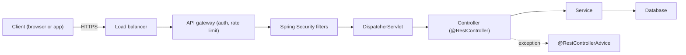

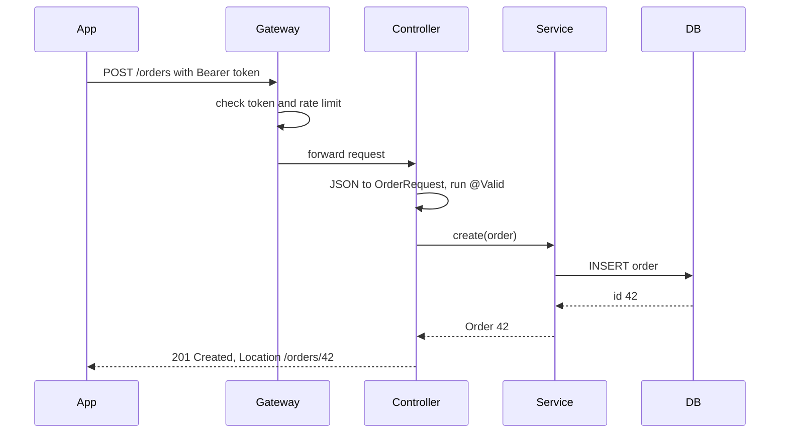

**Say this in the interview:**

> "A request goes through DNS and TLS, then a load balancer and an API gateway for auth and rate limits. In Spring, the security filter chain runs first. Then DispatcherServlet calls my controller, Jackson maps the JSON, and validation runs. The service does the work. Any exception goes to one `@RestControllerAdvice` that returns Problem Details."

**They may ask next:**
- **Where do you put the timeout?** Everywhere there is a network call: gateway, HTTP clients, database pool. See [Timeouts](microservices.md#timeouts).
- **Where do you check auth, gateway or service?** Both. The gateway rejects bad tokens early. The service still checks, because inside traffic can skip the gateway.

## REST principles

**In one line:** REST is a style where everything is a *resource* (a thing with a URL), and you use standard HTTP methods to read and change it.

**Story:** A library.
Every book has a fixed shelf number (the URL).
You do a small set of actions on any book: look at it, add a new one, replace it, fix a page, remove it (the HTTP methods).
The librarian does not remember you between visits. Each time you show your library card (stateless, token in every request).

**How it works (the main rules):**
1. **Resources have URLs.** `/orders/42` is order 42. Use nouns, not verbs.
2. **Standard methods.** `GET` reads, `POST` creates, `PUT` replaces, `PATCH` changes part, `DELETE` removes.
3. **Representations.** The resource is sent as JSON (or XML). The same order can have many representations.
4. **Stateless.** Each request carries everything needed (token, ids). The server keeps no session for it. So any server can answer, and scaling is easy.
5. **Cacheable.** Responses say if they can be cached (`Cache-Control`, `ETag`).
6. **Uniform interface and layers.** Client does not know if there is a gateway, a cache or a CDN in between.
7. **HATEOAS** (links in the response) is part of the original idea. Most real APIs skip it. See [HATEOAS](#hateoas).

Roy Fielding described REST in his PhD thesis in 2000. Most "REST APIs" today are really "JSON over HTTP with good URLs". That is fine; interviewers mostly want clean resources, right methods and right status codes.

**Richardson maturity model** (a simple scale for "how RESTful"):

| Level | What it means | Example |
|---|---|---|
| 0 | One URL, everything is POST | `POST /api` with `{"action":"getOrder"}` |
| 1 | Resources | `POST /orders/42/get` |
| 2 | Resources + HTTP methods + status codes | `GET /orders/42` returns 200 or 404 |
| 3 | Level 2 + links (HATEOAS) | response has `_links` |

Most good APIs are level 2.

**Good and bad:**

| Good | Bad |
|---|---|
| `GET /orders/42` | `GET /getOrderById?id=42` |
| `POST /orders` returns 201 | `POST /createOrder` returns 200 with `"status":"ok"` |
| Token in every request | Server-side session that pins a user to one server |

**Say this in the interview:**

> "REST treats every thing as a resource with a URL. I use HTTP methods for the action and status codes for the result. Requests are stateless, so any server can handle any request and I can scale out. Most good APIs are level 2 of the Richardson model: resources, methods and status codes. Level 3, HATEOAS, is rare in practice."

**They may ask next:**
- **Is REST a protocol?** No. It is an architecture style. HTTP is the protocol it usually runs on.
- **Why stateless?** Any server can answer any request. No sticky sessions. A crashed server loses nothing. See [Stateless services](system-design.md#stateless-services).
- **What if an action is not CRUD, like "cancel order"?** Model it as a state change (`PATCH /orders/42 {"status":"CANCELLED"}`) or a sub-resource (`POST /orders/42/cancellation`). A small verb like `POST /orders/42:cancel` is also used (Google style). Pick one style and stay with it.

## HTTP methods: safe and idempotent

**In one line:** *Safe* means the method does not change data. *Idempotent* means calling it many times has the same effect as calling it once.

**Story:** A light switch with two buttons: "ON" and "toggle".
Pressing "ON" five times: light is on. That is idempotent.
Pressing "toggle" five times: you do not know. That is not idempotent.
Looking at the light is safe: you change nothing.

**How it works:**

| Method | Use | Safe | Idempotent | Body |
|---|---|---|---|---|
| `GET` | Read | Yes | Yes | No |
| `HEAD` | Read headers only | Yes | Yes | No |
| `OPTIONS` | Ask what is allowed (CORS preflight) | Yes | Yes | No |
| `POST` | Create, or run an action | No | **No** | Yes |
| `PUT` | Replace the whole resource | No | Yes | Yes |
| `PATCH` | Change some fields | No | Not by rule | Yes |
| `DELETE` | Remove | No | Yes | Usually no |

These rules come from RFC 9110 (HTTP Semantics, 2022).

- `DELETE /orders/42` twice: the order is gone after both. The second call may return 404, but the server **state** is the same. Idempotent is about state, not the response.
- `PATCH {"quantity": 3}` is idempotent. `PATCH {"op":"increment"}` is not. So the rule says "not guaranteed".
- Why it matters: proxies, browsers and retry libraries retry idempotent calls on their own. They must never auto-retry `POST`. For POST you need an [idempotency key](#idempotency-keys-for-post).

**Diagram:**

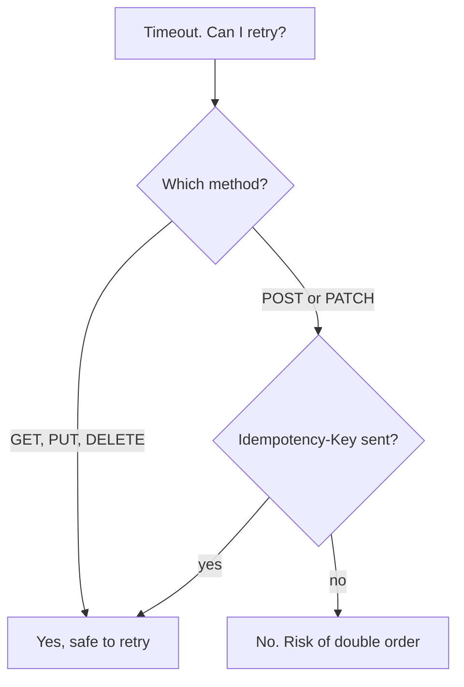

**Example:**

```http
PUT /users/7/address        # idempotent: sets the full address
{"city":"Pune","pin":"411001"}

PATCH /users/7              # changes one field only
{"phone":"+91-98000-00000"}
```

**Good and bad:**

| Good | Bad |
|---|---|
| `GET` never changes data | `GET /orders/42/delete` (a crawler or prefetch deletes your data) |
| `PUT` sends the full object | `PUT` with only some fields, and the others get set to null by accident |
| Retry only idempotent calls | Retry `POST /payments` in a loop |

**Say this in the interview:**

> "GET, HEAD and OPTIONS are safe: they do not change data. GET, PUT and DELETE are idempotent: calling twice leaves the same state. POST is neither, and PATCH depends on the body. This matters for retries. Clients and proxies may retry idempotent calls on their own, but for POST I need an Idempotency-Key."

**They may ask next:**
- **PUT vs PATCH?** PUT replaces the whole thing. PATCH changes some fields. PATCH bodies often use JSON Merge Patch (RFC 7396) or JSON Patch (RFC 6902).
- **Can PUT create?** Yes, if the client picks the id: `PUT /files/report.pdf`. Return 201 if new, 200 or 204 if replaced.
- **Can GET have a body?** The spec gives it no meaning. Many servers and proxies drop it. Use query params, or `POST /orders/search` for very large filters.

## Status codes that matter

**In one line:** The status code tells the client what happened in 3 digits, before it reads any body.

**Story:** A courier gives you a slip.
2xx: "Delivered." 3xx: "They moved, go to this address." 4xx: "Your mistake: wrong address or no ID." 5xx: "Our van broke down, try later."
The first digit tells you who should fix it.

**How it works:**

| Code | Name | When to use |
|---|---|---|
| 200 | OK | Normal success with a body |
| 201 | Created | POST created something. Add a `Location` header |
| 202 | Accepted | Work started but is not done. See [long-running operations](#long-running-operations) |
| 204 | No Content | Success, no body (DELETE, some PUT) |
| 301 | Moved Permanently | URL changed for good (308 if the method must stay the same) |
| 304 | Not Modified | Client cache is still good (with `ETag`) |
| 400 | Bad Request | Broken JSON, missing field, wrong type |
| 401 | Unauthorized | Not logged in: no token or bad token |
| 403 | Forbidden | Logged in, but not allowed |
| 404 | Not Found | Resource does not exist (or you hide it) |
| 409 | Conflict | Clashes with current state: duplicate email, already cancelled |
| 412 | Precondition Failed | `If-Match` version is old. See [If-Match](#concurrency-with-if-match) |
| 422 | Unprocessable Content | JSON is fine, but a business rule fails |
| 429 | Too Many Requests | Rate limit hit. Add `Retry-After` |
| 500 | Internal Server Error | Bug on our side |
| 502 | Bad Gateway | Gateway got a bad answer from the service behind it |
| 503 | Service Unavailable | Overloaded or in maintenance. Add `Retry-After` |
| 504 | Gateway Timeout | Gateway waited too long for the service |

**Diagram:**

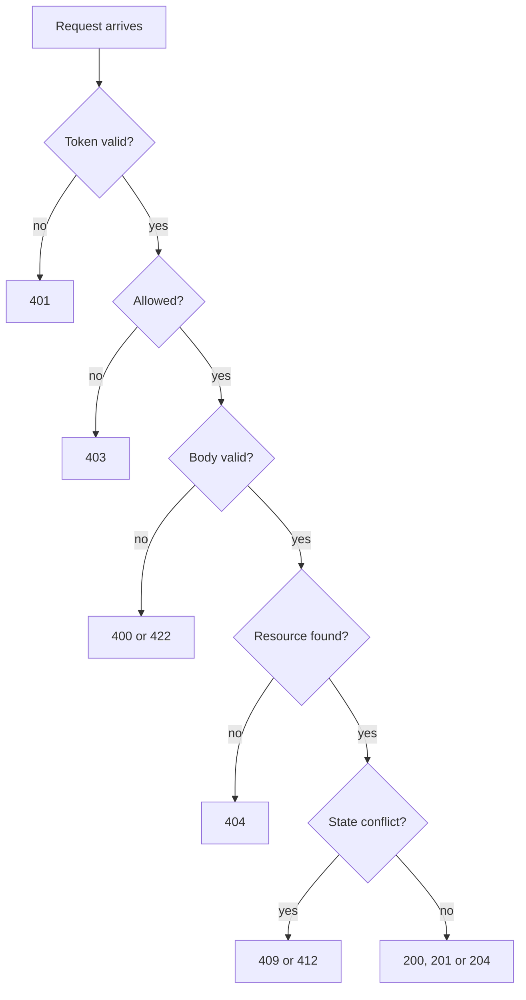

**Good and bad:**

| Good | Bad |
|---|---|
| 201 + `Location: /orders/42` | 200 for everything, error inside the body |
| 401 vs 403 used correctly | 403 when the token is simply missing |
| 429 with `Retry-After: 30` | 500 when the client sent bad input |
| 503 when you shed load on purpose | Stack trace in a 500 body |

**Say this in the interview:**

> "I use the first digit as a contract: 2xx success, 4xx client mistake, 5xx our problem. The ones I use most are 200, 201 with Location, 204, 400, 401, 403, 404, 409, 422 and 429. On the gateway side, 502 means the service gave a bad answer and 504 means it was too slow. Clients retry 429, 502, 503 and 504 with backoff, but not other 4xx codes."

**They may ask next:**
- **400 or 422 for validation?** Both are used. Spring returns 400 by default for `@Valid` errors. I use 400 for bad shape and 422 for business rules. The key is to be consistent.
- **404 or 403 for a resource the user cannot see?** Often 404, so you do not leak that it exists (for example, another user's order).
- **Which codes should a client retry?** 429, 502, 503, 504, and network errors. With backoff. See [Retry with backoff](microservices.md#retry-with-exponential-backoff-and-jitter).

## API design: naming, nesting, filtering, sorting

**In one line:** Good APIs use plural nouns, shallow nesting, query parameters for filters, and the same rules everywhere.

**Story:** A well-run supermarket.
Every aisle has a clear board: "Rice", "Oil", "Soap". Not "Go-Get-Rice".
You can ask: "Show me rice, under 100 rupees, cheapest first" (filter and sort).
Every aisle uses the same kind of board, so you learn it once.

**How it works:**
1. **Plural nouns:** `/orders`, `/orders/42`, `/customers/7`.
2. **Lowercase with hyphens** in paths: `/order-items`. Pick camelCase or snake_case for JSON fields, and keep it everywhere.
3. **Nesting only for real ownership, one level deep:** `/customers/7/orders`. Not `/customers/7/orders/42/items/3/taxes`. After one level, use the item's own URL: `/order-items/3`.
4. **Filter with query params:** `GET /orders?status=PAID&createdAfter=2026-11-01`.
5. **Sort:** `?sort=-createdAt,total` (minus means descending). Spring Data style: `?sort=createdAt,desc`.
6. **Pick fields** (optional): `?fields=id,total,status` to keep responses small.
7. **Search with a big body:** `POST /orders/search` is fine when the filter is too big for a URL.
8. **Dates** in ISO 8601 UTC: `2026-11-16T10:15:00Z`. **Money** as a string or integer paise/cents with a currency, never a float.
9. **IDs:** do not expose database auto-increment ids in public APIs if guessing them is a risk. Use UUIDs or random ids.

**Diagram:**

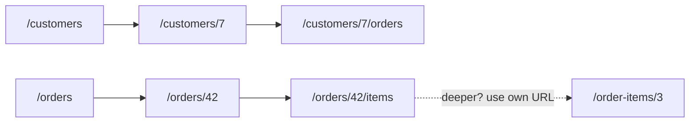

**Example:**

```http
GET /orders?status=PAID&minTotal=500&sort=-createdAt&limit=20
Accept: application/json

200 OK
{
  "data": [ { "id": "ord_42", "status": "PAID", "total": { "amount": "1250.00", "currency": "INR" } } ],
  "nextCursor": "eyJpZCI6NDJ9"
}
```

**Good and bad:**

| Good | Bad |
|---|---|
| `GET /orders?status=PAID` | `GET /getPaidOrders` |
| `POST /orders/42/refunds` | `POST /refundOrder?id=42` |
| Same error format, paging and naming in every service | Each team picks its own style |
| `"total": "1250.00"` + currency | `"total": 1250.0000001` as a float |

**Say this in the interview:**

> "I design URLs as plural nouns and keep nesting to one level. Filters, sorting and paging go in query parameters. I keep the same naming, error format and paging style across all services, ideally written down in an API style guide. I never use floats for money, and I use ISO dates in UTC."

**They may ask next:**
- **How do you return a list: bare array or wrapped?** Wrapped: `{"data": [...], "nextCursor": "..."}`. You can add fields later without breaking clients.
- **Should the API mirror the database tables?** No. Design for what the client needs. The database can change; the API is a contract.
- **Trailing slash?** Pick one and redirect the other. Spring 6+ no longer matches a trailing slash by default.

## Pagination: offset vs cursor

**In one line:** Offset paging says "skip 1,000 rows, give me 20". Cursor paging says "give me 20 after this item". Cursor is faster and stable for big or changing data.

**Story:** Reading a long book.
Offset: "Go to page 500." To find it, you count 500 pages from the start every time.
Cursor: you put a bookmark. Next time you open the book at the bookmark. No counting.
If someone adds pages at the front, the offset reader lands on the wrong page. The bookmark reader does not.

**How it works:**

| | Offset (`?page=3&size=20`) | Cursor (`?after=abc&limit=20`) |
|---|---|---|
| SQL | `LIMIT 20 OFFSET 40` | `WHERE (created_at, id) < (?, ?) ORDER BY created_at DESC, id DESC LIMIT 20` |
| Speed on deep pages | Slow. DB still reads and drops all skipped rows | Fast. Uses the index |
| New rows during paging | Items repeat or get skipped | Stable |
| Jump to page 50 | Yes | No, only next / previous |
| Total count | Easy (but `COUNT(*)` is slow on big tables) | Usually not given |
| Good for | Admin tables, small data | Feeds, mobile infinite scroll, APIs, exports |

The cursor is an opaque string (often base64 of the last item's sort key and id). The client must not build it.

**Diagram:**

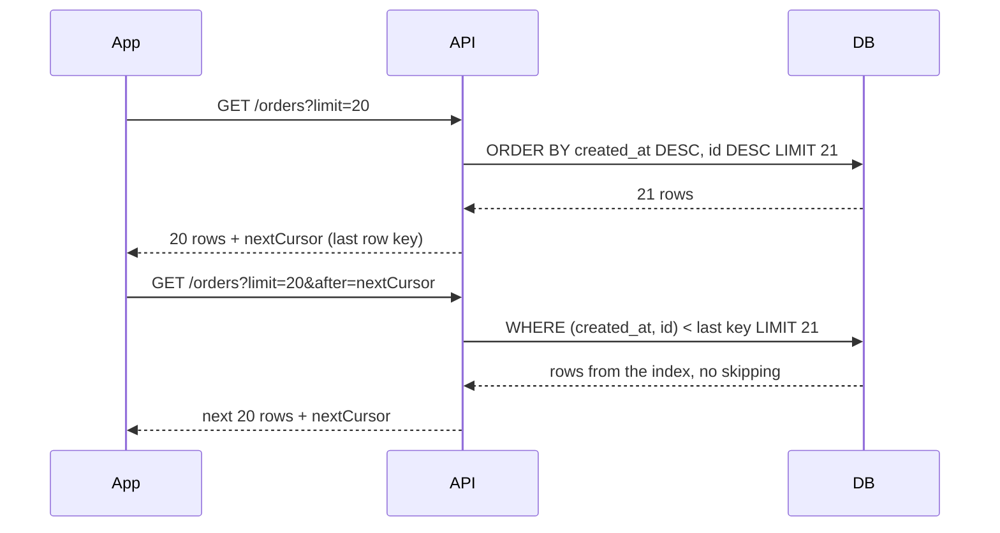

Fetching 21 rows tells you if there is a next page, without a count query.

**Example:**

```java
// Spring Data: Slice skips the COUNT query that Page needs
Slice<Order> findByCustomerId(long customerId, Pageable pageable);

// Keyset (cursor) with Spring Data JPA 3.1+ (Boot 3.1+)
Window<Order> findFirst20ByStatusOrderByCreatedAtDescIdDesc(
        String status, ScrollPosition position);  // ScrollPosition.keyset() for the first page
```

**Good and bad:**

| Good | Bad |
|---|---|
| Index on the sort columns (`created_at, id`) | Sort by a column with no index |
| Add `id` as a tie-breaker in the sort | Sort only by `created_at`; two rows with the same time get lost |
| Cap `limit` (for example 100) | Let the client ask for `size=100000` |

**Say this in the interview:**

> "For small admin screens, offset paging is fine. For big or fast-changing data I use cursor (keyset) paging. The cursor holds the last row's sort key plus id. The query uses `WHERE key < cursor ORDER BY key LIMIT n`, which hits the index. Deep offset pages are slow because the database reads and throws away all the skipped rows. I always cap the page size."

**They may ask next:**
- **Why is `OFFSET 1000000` slow?** The DB must walk a million rows to skip them. Time grows with the page number.
- **How do you go back with a cursor?** Return a `prevCursor` too and flip the comparison and sort.
- **Where do paging links go?** In the body (`nextCursor`) or a `Link` header (RFC 8288). Body is easier for clients.

## API versioning

**In one line:** Versioning lets you make a breaking change without breaking clients who still use the old shape.

**Story:** A train timetable.
The railway prints a new timetable, but keeps the old one at the counter for a few months.
Passengers move when they are ready. Then the old one is removed, with notice on the board first.

**How it works:**
1. First, **avoid breaking changes.** Adding a new optional field or a new endpoint is not breaking. Clients must ignore unknown fields.
2. Breaking changes: removing or renaming a field, changing a type, making a field required, changing what a status code means.
3. When you must break, pick a versioning style:

| Style | Example | Good | Bad |
|---|---|---|---|
| URI path | `/v1/orders` | Easy to see, test, route, cache | URL changes; "same resource, two URLs" |
| Header | `API-Version: 2` | Clean URLs | Hidden; caches need `Vary: API-Version` |
| Media type | `Accept: application/vnd.shop.v2+json` | Most "pure" REST | Hard to test in a browser, more work |
| Query param | `/orders?version=2` | Simple | Easy to forget, messy with caching |

Most public APIs use the URI path (`/v1/`). Stripe uses a date-based header (`Stripe-Version: 2024-06-20`).

4. Tell clients when the old version will be removed. The `Deprecation` header (RFC 9745) and `Sunset` header (RFC 8594) say this in a standard way.

**Diagram:**

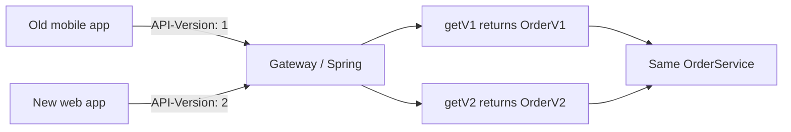

**Example (Spring Boot 4 / Spring Framework 7 has built-in versioning):**

```java
@RestController
@RequestMapping("/orders")
class OrderController {
    @GetMapping(path = "/{id}", version = "1")   // matched by the version, not the URL
    OrderV1 getV1(@PathVariable long id) { return mapper.v1(service.find(id)); }

    @GetMapping(path = "/{id}", version = "2")
    OrderV2 getV2(@PathVariable long id) { return mapper.v2(service.find(id)); }
}
```

```properties
# read the version from this header
spring.mvc.apiversion.use.header=API-Version
# used when the client sends none
spring.mvc.apiversion.default=1
```

(In a `.properties` file a `#` starts a comment only at the start of a line. A `#` after a value becomes part of the value.)

In Boot 3 you do it by hand: `/v1/...` and `/v2/...` mappings, or `headers = "API-Version=2"` on the mapping.

**Good and bad:**

| Good | Bad |
|---|---|
| Add fields instead of versioning | New version for every small change |
| Version the whole API (`v1`, `v2`), rarely | A different version per endpoint |
| Keep business logic shared; only DTOs differ | Copy the whole service for v2 |
| OpenAPI diff in CI catches breaking changes | Find out from an angry client |

**Say this in the interview:**

> "First I try not to break: I only add optional fields, and clients ignore unknown ones. When I must break, I use a major version. URI versioning like `/v1` is the most common because it is easy to route and test. Header or media-type versioning keeps URLs clean. Spring Framework 7 now has built-in API versioning with `version` on the mapping. I share the service code and only change the DTOs, and I announce the removal date with Deprecation and Sunset headers."

**They may ask next:**
- **How long do you keep v1?** Publish a policy: for example 6–12 months after v2, and watch metrics for who still calls v1.
- **What about internal services?** Use consumer-driven contract tests (Spring Cloud Contract, Pact) so you know who breaks before you deploy.

## Error format: Problem Details

**In one line:** Return every error in one standard JSON shape, RFC 9457 Problem Details, so clients can handle errors the same way everywhere.

**Story:** A hospital where every department uses the same complaint form.
Same boxes: what type of problem, short title, details, which room.
Patients and staff learn the form once.

**How it works:**
1. RFC 9457 (2023) defines `application/problem+json`. It replaced RFC 7807.
2. Standard fields: `type` (a URL that names the error kind), `title`, `status`, `detail`, `instance` (this request's path).
3. Add your own fields: `errors` for field problems, `traceId`, `code`.
4. In Spring 6+, return `ProblemDetail` from a `@RestControllerAdvice`. Set `spring.mvc.problemdetails.enabled=true` so Spring's own errors use it too.

The full Spring code is in [Global error handling with ProblemDetail](spring-ecosystem.md#global-error-handling-with-restcontrolleradvice-and-problemdetail). Here is the response shape:

```json
{
  "type": "https://api.shop.com/problems/insufficient-stock",
  "title": "Not enough stock",
  "status": 409,
  "detail": "Only 2 units of SKU-77 are left, you asked for 5.",
  "instance": "/orders",
  "code": "INSUFFICIENT_STOCK",
  "traceId": "4bf92f3577b34da6a3ce929d0e0e4736"
}
```

**Diagram:**

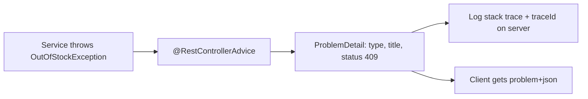

**Good and bad:**

| Good | Bad |
|---|---|
| Stable `type` or `code` the client can switch on | Client parses the English `detail` text |
| `traceId` in the body to find logs fast | Stack trace, SQL or class names in the body |
| Same shape for 400, 404, 409, 500 | `{"success": false}` with HTTP 200 |

**Say this in the interview:**

> "All my APIs return errors as RFC 9457 Problem Details: type, title, status, detail, instance, plus extra fields like a field-errors list and a traceId. In Spring I return `ProblemDetail` from one `@RestControllerAdvice`. Clients switch on the type or code, never on the message text. Stack traces stay in the server logs."

**They may ask next:**
- **What is `type: about:blank`?** The default when you have no special error kind. Then `title` should be the HTTP status text.
- **Should messages be translated?** `detail` can be. `type` and `code` must stay fixed.

## Idempotency keys for POST

**In one line:** The client sends a unique `Idempotency-Key` with a POST, so a retry returns the first result instead of doing the work twice.

**Story:** You press "Pay" and the network drops. You press again.
The shop sees the same request number and says "Already paid, here is your receipt."
You are charged once.

The full pattern (table, unique constraint, Kafka consumers) is in [Idempotency](microservices.md#idempotency). Short recap:

**How it works:**
1. The client makes one UUID per *intended action* (not per click) and sends `Idempotency-Key: <uuid>`.
2. The server inserts the key into a table with a unique constraint, in the same transaction as the work.
3. Same key again: return the saved response. Same key with a different body: return 422 or 409.
4. Keys expire after 24 hours to a few days.

The `Idempotency-Key` header is an IETF draft (not yet an RFC in Nov 2026), but Stripe, Adyen and many payment APIs already use it.

**Diagram:**

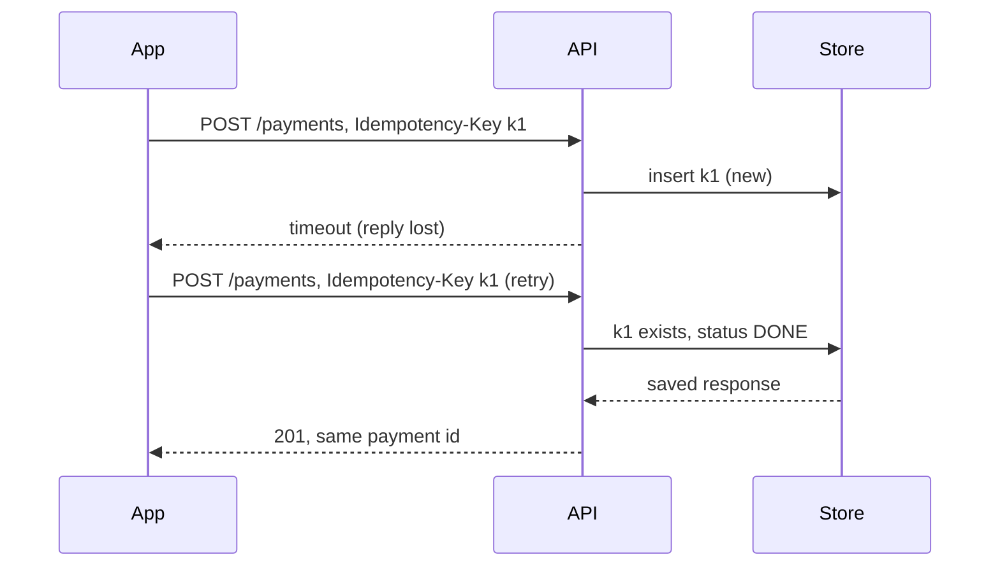

**Say this in the interview:**

> "POST is not idempotent, so for payments and orders the client sends an Idempotency-Key. I store the key with a unique constraint, together with the result. A retry with the same key gets the saved response, so there is no double charge. A second request that arrives while the first is still running gets 409, try again later."

**They may ask next:**
- **Why not just check if the order exists?** Two retries can check at the same moment. Only a unique constraint stops both from winning.
- **Who makes the key, client or server?** The client. Only the client knows that two requests are the same intent.

## Caching with ETag and Cache-Control

**In one line:** `Cache-Control` says how long a response can be reused. `ETag` is a fingerprint, so the client can ask "has it changed?" and get a tiny 304 if not.

**Story:** Your morning newspaper.
`Cache-Control: max-age` is like "this paper is good for today". You do not ask again until tomorrow.
`ETag` is the edition number. You call the shop: "I have edition 512, is there a newer one?" The shop says "No, same" (304) and sends nothing.

**How it works:**
1. **`Cache-Control`** on the response:
   - `max-age=60`: anyone may reuse it for 60 seconds.
   - `private`: only the browser may cache it (user data). `public`: CDNs may cache too.
   - `no-cache`: you may store it, but must check with the server first (ETag) every time.
   - `no-store`: never store it (bank details, tokens).
2. **`ETag`** is a hash or version of the body, for example `"v7"`.
3. Next time the client sends `If-None-Match: "v7"`.
4. Same version: server returns **304 Not Modified** with no body. The client uses its copy.
5. `Last-Modified` + `If-Modified-Since` is the older, time-based version of the same idea.
6. `Vary: Accept, Authorization` tells caches that different headers mean different responses.

**Diagram:**

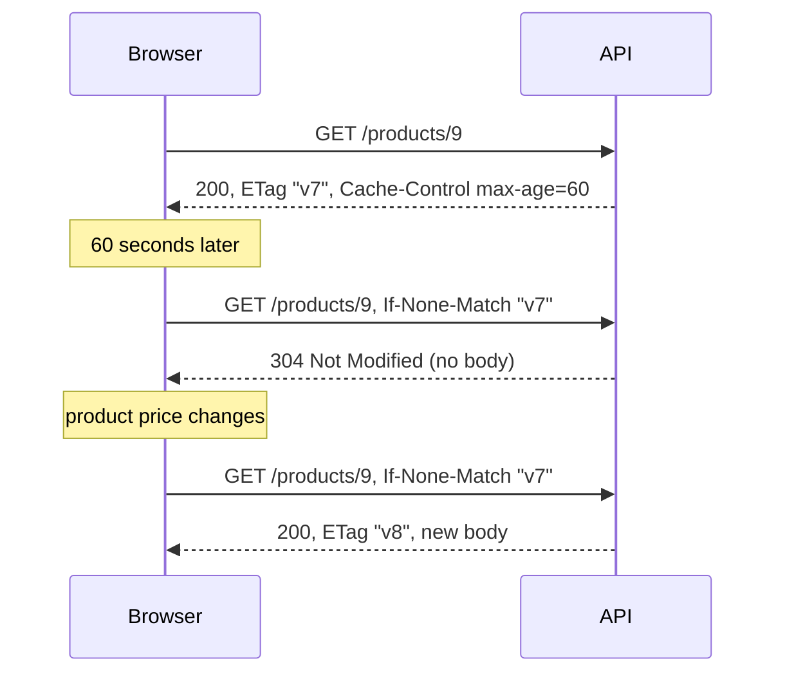

**Example (Spring):**

```java
@GetMapping("/products/{id}")
ResponseEntity<ProductDto> get(@PathVariable long id) {
    Product p = service.find(id);
    return ResponseEntity.ok()
        .cacheControl(CacheControl.maxAge(Duration.ofSeconds(60)).cachePrivate())
        .eTag(String.valueOf(p.getVersion()))   // version column from JPA @Version
        .body(ProductDto.from(p));
}
```

Spring compares `If-None-Match` with the ETag and returns 304 for you. For a quick win, `ShallowEtagHeaderFilter` hashes every response. It saves network, not server work, because the body is still built.

**Good and bad:**

| Good | Bad |
|---|---|
| ETag from a version column (cheap) | Hash a 5 MB body on every call |
| `private` for user data | `public` on `/me` (a CDN serves your profile to someone else) |
| `no-store` for secrets | No cache headers at all, so every call hits the DB |

**Say this in the interview:**

> "I use Cache-Control to say how long a response is fresh and who may cache it, private or public. I add an ETag, usually from the entity version. The client sends If-None-Match and gets a 304 with no body when nothing changed. That saves bandwidth and, with a cheap version check, database work too. For user data I use private, and for secrets no-store."

**They may ask next:**
- **Strong vs weak ETag?** Strong (`"v7"`) means byte-for-byte same. Weak (`W/"v7"`) means "same meaning", for example gzip or not.
- **Can you cache POST?** Practically no. Cache GET. For a CDN, see [CDN](system-design.md#cdn).

## Concurrency with If-Match

**In one line:** The client sends the version it read in `If-Match`; the server updates only if the version is still the same, else it returns 412. This stops "lost updates".

**Story:** Two clerks edit the same paper file.
Clerk A reads it, goes for tea. Clerk B reads it, changes the address, saves.
Clerk A comes back and saves the old copy with a new phone number. B's address change is lost.
With a version stamp: A's save is rejected, "file changed since you read it". A reloads and tries again.

**How it works:**
1. `GET /orders/42` returns `ETag: "5"` (the row version).
2. The client sends `PUT /orders/42` with `If-Match: "5"`.
3. Server checks: current version still 5? Update, version becomes 6, return 200 with `ETag: "6"`.
4. Version is now 6 because someone else saved? Return **412 Precondition Failed**.
5. The client reloads, shows the new data, and tries again.
6. If the client sends no `If-Match` at all, the server can require it and return **428 Precondition Required**.

This is optimistic locking (no locks held, check at save time) over HTTP. In the database it is JPA `@Version`.

**Diagram:**

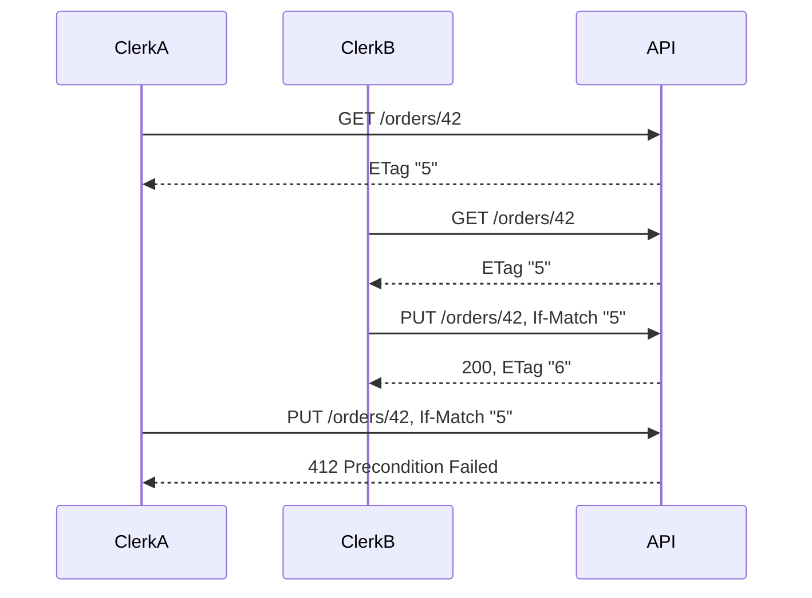

**Example:**

```java
@PutMapping("/orders/{id}")
ResponseEntity<OrderDto> update(@PathVariable long id,
                                @RequestHeader("If-Match") String ifMatch,
                                @Valid @RequestBody UpdateOrder body) {
    long expected = Long.parseLong(ifMatch.replace("\"", ""));
    Order saved = service.update(id, expected, body); // throws if version differs
    return ResponseEntity.ok().eTag(String.valueOf(saved.getVersion()))
                         .body(OrderDto.from(saved));
}
// In the advice: OptimisticLockingFailureException -> 412 Precondition Failed
```

In the service, compare `expected` with the entity version before you change it. JPA `@Version` then also catches a race between the check and the commit.

**Good and bad:**

| Good | Bad |
|---|---|
| ETag = version column | Last write wins silently |
| 412 and the client reloads | Lock the row while a user looks at a form for 10 minutes |
| Require `If-Match` on important updates | Trust a version number sent inside the body without checking |

**Say this in the interview:**

> "To stop lost updates I use optimistic concurrency over HTTP. GET returns an ETag from the entity's version. The client sends it back in If-Match on PUT or PATCH. If the version changed, I return 412 Precondition Failed and the client reloads. In the database the same idea is JPA `@Version`. No locks are held while the user thinks."

**They may ask next:**
- **409 or 412?** 412 when an `If-Match` precondition fails. 409 for other state clashes, like "already cancelled".
- **Optimistic vs pessimistic locking?** Optimistic checks at save, good when conflicts are rare. Pessimistic (`SELECT ... FOR UPDATE`) locks first, good for hot rows like a ticket seat. See [Databases](databases.md).

## Long-running operations

**In one line:** If work takes more than a few seconds, return **202 Accepted** with a status URL at once. The client polls it, or gets a webhook when it is done.

**Story:** Dropping clothes at a dry cleaner.
They do not make you stand there for 2 days. They give you a token: "Come back, or we will SMS you."
The token is the status URL. The SMS is the webhook.

**How it works:**
1. Client: `POST /reports` with the request.
2. Server saves a job (status `PENDING`), puts it on a queue, and returns **202 Accepted** with `Location: /reports/jobs/77`.
3. A worker picks the job, runs it, and updates the status: `RUNNING`, then `SUCCEEDED` or `FAILED`.
4. Client polls `GET /reports/jobs/77`. The server can send `Retry-After: 5` to say how often.
5. When done, the job response has a link to the result: `"resultUrl": "/reports/991"`.
6. Better: the client gives a callback URL, and the server sends a [webhook](#webhooks-design) when done. Or push it with SSE or WebSocket to a browser.

**Diagram:**

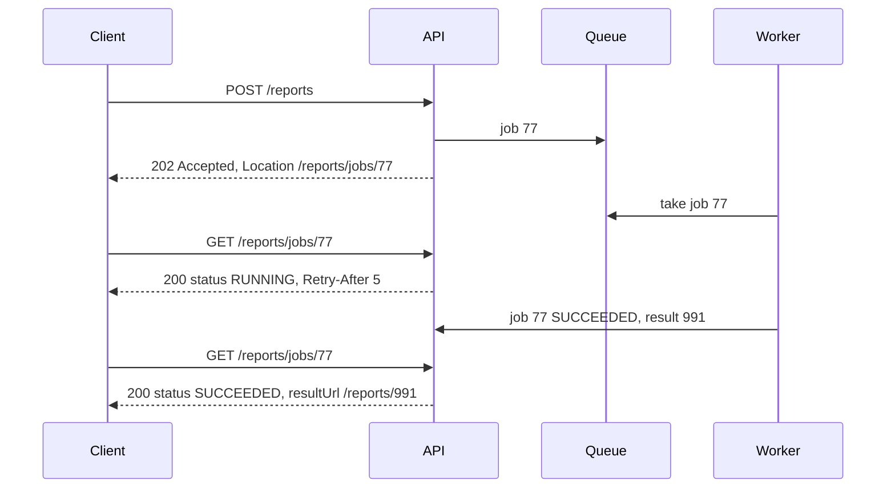

**Example (status response):**

```json
{
  "id": "77",
  "status": "RUNNING",
  "progress": 40,
  "createdAt": "2026-11-16T10:00:00Z",
  "resultUrl": null
}
```

**Good and bad:**

| Good | Bad |
|---|---|
| 202 + status URL in under 100 ms | Keep the HTTP call open for 3 minutes until the gateway times out (504) |
| Job stored in a DB, so a restart does not lose it | Job only in memory |
| Idempotency key on the POST | Retry of the POST starts a second report |
| Webhook or SSE to avoid heavy polling | Client polls every 100 ms |

**Say this in the interview:**

> "For anything slower than a few seconds I return 202 Accepted with a Location header that points to a job resource. The job is saved in the database and processed by a worker from a queue. The client polls the status URL, with Retry-After to slow it down, or I push the result by webhook or SSE. The job resource ends with a link to the final result."

**They may ask next:**
- **How do you cancel?** `DELETE /reports/jobs/77` or `POST /reports/jobs/77/cancel`. The worker checks a cancel flag between steps.
- **What if the worker crashes?** The job stays `RUNNING` too long. A sweeper marks stuck jobs and retries them. See [Job scheduler](system-design/job-scheduler.md).

## API security

**In one line:** Use HTTPS always, OAuth2 bearer tokens (JWT) for users and services, API keys only for simple partner access, strict CORS, and rate limits.

**Story:** An office building.
HTTPS is the closed van that carries letters, so no one reads them on the way.
The JWT is a visitor badge with your name, floor and expiry time printed on it, signed by reception.
An API key is a fixed door code: easy, but if it leaks, anyone can enter until you change it.
The rate limit is the guard who says "only 10 visits per minute".

**How it works:**
1. **HTTPS (TLS) everywhere.** Also between services when you can (mTLS in a service mesh).
2. **OAuth2 + JWT bearer tokens.** An auth server (Keycloak, Okta, Auth0, Spring Authorization Server) gives an access token. The client sends `Authorization: Bearer <token>`. The API checks the signature with the auth server's public keys (JWKS), the expiry, the audience and the scopes. Details: [JWT and OAuth2 resource server](spring-ecosystem.md#jwt-and-oauth2-resource-server).
3. **Short tokens.** Access token 5–15 minutes. Refresh token to get a new one.
4. **API keys** for server-to-server partners. Send in a header (`X-API-Key`), never in the URL (URLs end up in logs). Store only a hash. Allow rotation.
5. **CORS** is a browser rule. It decides which other websites' JavaScript may call your API. Allow your own front-end origins only. See [CORS and CSRF](spring-ecosystem.md#cors-and-csrf).
6. **Rate limiting** per user, key or IP, usually in the gateway. Return 429 with `Retry-After`. See [Rate limiter design](system-design/rate-limiter.md).
7. **Check object access** in every call: is order 42 really this user's order? Missing this is BOLA (Broken Object Level Authorization), the top item in the OWASP API Security Top 10.
8. **Validate input** and cap sizes: body size, page size, string length.

**Diagram:**

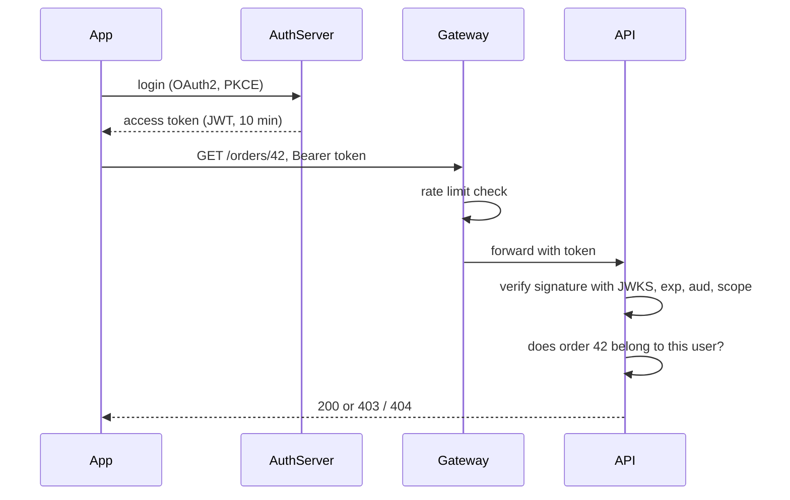

**Example (Spring Boot resource server):**

```java
@Bean
SecurityFilterChain api(HttpSecurity http) throws Exception {
    return http
        .authorizeHttpRequests(a -> a
            .requestMatchers(HttpMethod.GET, "/products/**").permitAll()
            .requestMatchers("/admin/**").hasAuthority("SCOPE_admin") // scope from JWT
            .anyRequest().authenticated())
        .oauth2ResourceServer(o -> o.jwt(Customizer.withDefaults())) // check JWT signature
        .csrf(c -> c.disable())   // OK for stateless token APIs, not for cookie sessions
        .build();
}
```

```properties
spring.security.oauth2.resourceserver.jwt.issuer-uri=https://auth.shop.com
```

**Good and bad:**

| Good | Bad |
|---|---|
| Short-lived JWT, verified on each service | Long-lived token that never expires |
| Check ownership of every object | Trust the id in the URL |
| CORS allow-list of exact origins | `Access-Control-Allow-Origin: *` with credentials |
| API key in a header, hashed in the DB | API key in the query string |

**Say this in the interview:**

> "Everything goes over HTTPS. Users and services get OAuth2 access tokens, usually JWTs, sent as Bearer tokens. Each service checks the signature, expiry, audience and scopes, which in Spring is the oauth2ResourceServer setup. I also check that the user owns the object, because broken object-level authorization is the top API risk. API keys are only for simple partner access. CORS is an allow-list, and the gateway rate-limits with 429."

**They may ask next:**
- **JWT vs opaque token?** A JWT can be checked locally, with no call to the auth server, but you cannot revoke it before it expires. An opaque token needs a call to the auth server (introspection), but you can revoke it at once.
- **Does CORS protect my API?** No. It only stops browsers. curl or a server can still call you. Auth protects the API.
- **Where to store tokens in a browser?** Best: an HttpOnly cookie through a BFF (backend for frontend). See [API gateway and BFF](microservices.md#api-gateway-and-bff).

## OpenAPI: contract-first vs code-first

**In one line:** OpenAPI is a YAML or JSON file that describes your API. You either write it first and generate code (contract-first), or write code and generate it (code-first).

**Story:** Building a house.
Contract-first: the architect draws the plan, the owner signs it, then builders start. Two teams (front and back end) can work at the same time from the same plan.
Code-first: you build the room, then draw the plan from what you built. Faster, but the owner sees it late.

**How it works:**
1. **OpenAPI 3.x** (3.1 is common in 2026) lists paths, methods, parameters, request and response schemas, errors and security.
2. **Code-first with springdoc-openapi:** add the starter. Springdoc reads your controllers. You get `/v3/api-docs` (the JSON) and `/swagger-ui.html` (a page to try calls). Use springdoc 3.x for Boot 4, 2.x for Boot 3. More: [API documentation with springdoc-openapi](spring-ecosystem.md#api-documentation-with-springdoc-openapi).
3. **Contract-first with OpenAPI Generator:** write `openapi.yaml`, review it in a pull request, then the Maven or Gradle plugin generates Java interfaces and DTOs. You implement the interface. The front end generates a TypeScript client from the same file.
4. **CI checks:** lint the spec, and run an OpenAPI diff to fail the build on breaking changes.

**Diagram:**

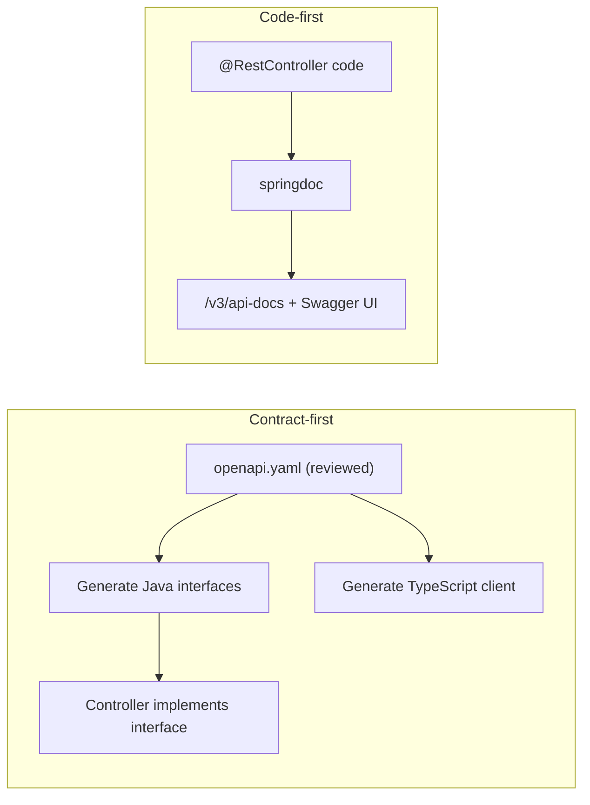

**Example (contract-first generator plugin, Maven):**

```xml
<plugin>
  <groupId>org.openapitools</groupId>
  <artifactId>openapi-generator-maven-plugin</artifactId>
  <executions><execution><goals><goal>generate</goal></goals>
    <configuration>
      <inputSpec>${project.basedir}/src/main/resources/openapi.yaml</inputSpec>
      <generatorName>spring</generatorName>
      <configOptions>
        <interfaceOnly>true</interfaceOnly>  <!-- we write the controller -->
        <useSpringBoot4>true</useSpringBoot4>  <!-- Boot 4; use useSpringBoot3 for Boot 3 -->
      </configOptions>
    </configuration>
  </execution></executions>
</plugin>
```

`useSpringBoot4` exists in recent OpenAPI Generator 7.x releases. Add `useJackson3` too if you want Jackson 3 models (it works only together with `useSpringBoot4`).

**Good and bad:**

| Contract-first | Code-first |
|---|---|
| API reviewed before code | Very fast to start |
| Front end and back end work in parallel | Docs always match code |
| Good for public and partner APIs | Easy to break the API by renaming a field |
| Generated code can be ugly | Annotations clutter controllers |

**Say this in the interview:**

> "For internal APIs I often go code-first with springdoc, which generates OpenAPI and Swagger UI from the controllers. For public or partner APIs, or when front end and back end start together, I go contract-first. We review the openapi.yaml in a pull request, then generate Java interfaces and a TypeScript client. Either way, an OpenAPI diff in CI blocks breaking changes."

**They may ask next:**
- **Swagger vs OpenAPI?** Swagger was the old name of the spec. Since version 3 the spec is called OpenAPI. "Swagger" now means the tools (Swagger UI, Swagger Editor).
- **Should Swagger UI be open in production?** Usually not for internal APIs. Turn it off or put it behind auth.

## HATEOAS

**In one line:** HATEOAS (Hypermedia As The Engine Of Application State) means each response includes links to the next allowed actions. It is the "pure" REST idea, but few real APIs use it.

**Story:** An ATM screen.
After you insert your card, the screen shows only the buttons you can press now: "Withdraw", "Balance". If your account is blocked, "Withdraw" is not shown.
The links in a HATEOAS response are those buttons.

**How it works:**
1. The response has a `_links` section (HAL format is the most common).
2. The client follows links by name (`cancel`, `pay`), not by building URLs.
3. The server shows or hides links based on state: a `PAID` order has no `pay` link.

```json
{
  "id": 42,
  "status": "CREATED",
  "_links": {
    "self":   { "href": "/orders/42" },
    "pay":    { "href": "/orders/42/payment" },
    "cancel": { "href": "/orders/42/cancellation" }
  }
}
```

**Being honest:** most teams skip it. Front ends are written for one API and know the URLs already. OpenAPI and generated clients solve discovery in a different way. You see HATEOAS in some banking (Open Banking) APIs, Spring Data REST, and paging links. The Spring code is in the [README answer below](#how-do-we-implement-it-using-spring).

**Say this in the interview:**

> "HATEOAS means the response carries links to the next valid actions, like pay or cancel, so the client does not hard-code URLs or state rules. Spring HATEOAS supports it with EntityModel and linkTo. In practice it is rare: most clients are built for one API and use OpenAPI instead. I would use it for a public API where the allowed actions change a lot by state."

**They may ask next:**
- **Is an API without HATEOAS still REST?** Strictly, Fielding says no. In practice everyone calls level 2 APIs REST.

## REST vs GraphQL vs gRPC vs WebSocket vs SSE

**In one line:** REST for normal public and CRUD APIs, GraphQL when many clients need different shapes of data, gRPC for fast service-to-service calls, WebSocket for two-way live chat, SSE for one-way live updates.

**Story:** Ways to order food.
REST: a fixed menu. Each dish is a number.
GraphQL: a buffet. You take exactly what you want on one plate.
gRPC: the kitchen intercom between cooks. Fast, short, a fixed format, not for customers.
WebSocket: a phone call that stays open. Both sides talk any time.
SSE: a radio. The station talks, you only listen.

**How it works:**

| | REST | GraphQL | gRPC | WebSocket | SSE |
|---|---|---|---|---|---|
| Transport | HTTP/1.1 or 2 | HTTP, one endpoint (`POST /graphql`) | HTTP/2 | Upgraded TCP connection | HTTP, kept open |
| Data format | JSON | JSON | Protobuf (binary) | Any (text or binary) | Text events |
| Direction | Request-response | Request-response (+ subscriptions) | Request-response + streaming both ways | Two-way | Server to client only |
| Contract | OpenAPI | Schema (SDL) | `.proto` file | None built in | None built in |
| HTTP caching | Easy | Hard (all POST) | No | No | No |
| Browser support | Yes | Yes | Needs a proxy (gRPC-Web) | Yes | Yes, auto-reconnect |
| Best for | Public APIs, CRUD | Many screens with different needs (mobile + web) | Internal microservice calls, low latency | Chat, games, collaborative editing | Notifications, live scores, LLM token streaming |

**Diagram:**

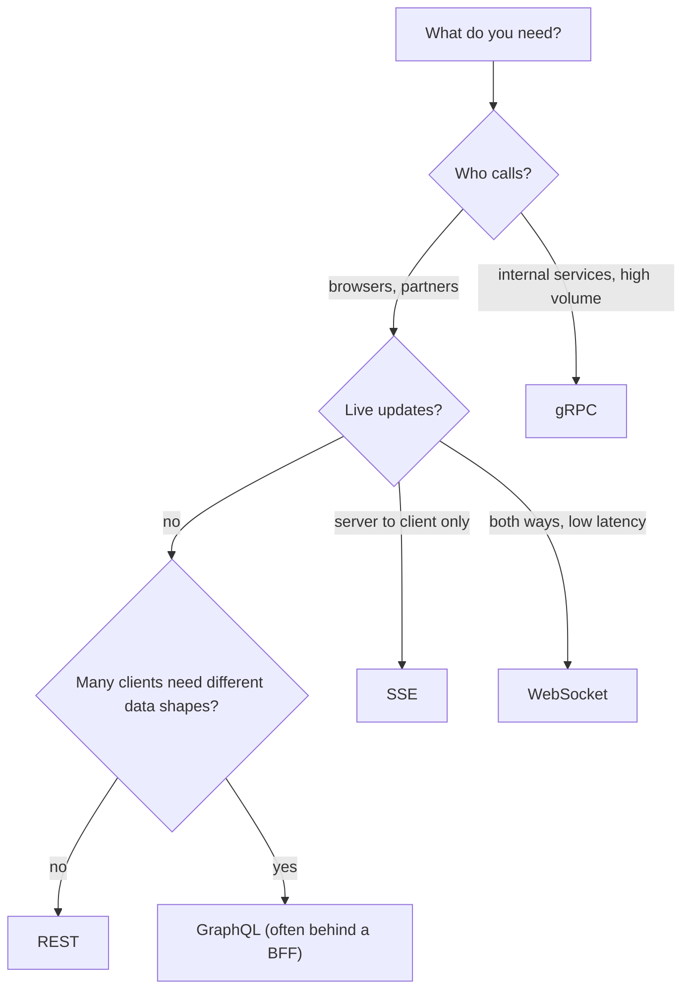

**Good and bad:**

| Choice | Watch out for |
|---|---|
| GraphQL | N+1 queries (use DataLoader / `@BatchMapping`), query depth limits, no HTTP caching |
| gRPC | Hard to debug with curl, needs HTTP/2 everywhere, browsers need gRPC-Web |
| WebSocket | Sticky connections, scaling needs a pub/sub (Redis, Kafka) to reach the right server |
| SSE | Text only, one way; HTTP/1.1 browsers allow about 6 connections per domain (HTTP/2 fixes this) |

**Say this in the interview:**

> "REST is my default for public and CRUD APIs: simple, cacheable, everyone knows it. GraphQL fits when web and mobile need different shapes of the same data, usually as a BFF. gRPC with Protobuf is for fast internal calls and streaming between services. For live data to browsers, SSE if only the server talks, like notifications or LLM token streams. WebSocket when both sides talk, like chat."

**They may ask next:**
- **How does GraphQL work in Spring?** Spring for GraphQL with `@QueryMapping` and `@BatchMapping`. See [Spring GraphQL](spring-ecosystem.md#spring-graphql).
- **SSE in Spring?** `SseEmitter` in MVC or `Flux<ServerSentEvent>` in WebFlux. See [Streaming and SSE](spring.md#streaming-and-server-sent-events-with-webflux).
- **Long polling?** The old trick before SSE and WebSocket. See [Long polling vs WebSockets vs SSE](system-design.md#long-polling-vs-websockets-vs-server-sent-events).

## Webhooks design

**In one line:** A webhook is an HTTP POST that your system sends to a customer's URL when something happens. Sign it, retry it, and expect duplicates.

**Story:** A courier company sends you an SMS: "Your parcel is delivered."
You did not ask every minute. They told you.
To trust the SMS, it has a code only the courier knows (the signature).
If your phone is off, they try again later (retries).

**How it works:**
1. The customer registers a URL and picks event types (`payment.succeeded`).
2. You get a secret per customer (shown once).
3. When an event happens, save it to an outbox table, and a sender worker POSTs it.
4. **Sign** the body: `HMAC-SHA256(secret, id + "." + timestamp + "." + body)`. Send it in a header with the timestamp and a unique event id.
5. Receiver: check the signature (constant-time compare). Reject old timestamps, for example older than 5 minutes, to stop replays. Save the event id to skip duplicates.
6. Receiver replies **2xx fast** (in a few seconds) and does the real work later from a queue.
7. **Retries** with exponential backoff for about 1–3 days. After that, mark the endpoint as failing and alert the customer. Give a "resend" button and an events API so they can catch up.

The [Standard Webhooks](https://www.standardwebhooks.com/) spec uses `webhook-id`, `webhook-timestamp` and `webhook-signature` headers. Stripe and GitHub use the same idea with their own header names.

**Diagram:**

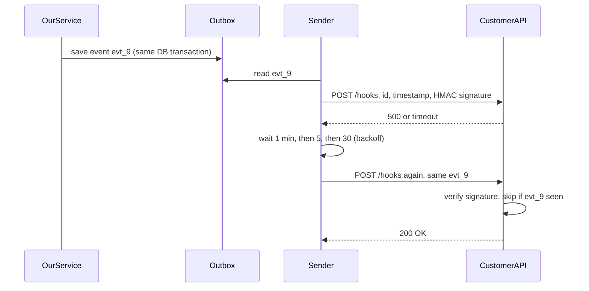

**Example (receiver checks the signature):**

```java
boolean valid(String id, String ts, String body, String sigBase64, byte[] secret) throws Exception {
    long age = Instant.now().getEpochSecond() - Long.parseLong(ts);
    if (Math.abs(age) > 300) return false;                       // stop replays
    Mac mac = Mac.getInstance("HmacSHA256");
    mac.init(new SecretKeySpec(secret, "HmacSHA256"));
    byte[] expected = mac.doFinal((id + "." + ts + "." + body).getBytes(UTF_8));
    byte[] given = Base64.getDecoder().decode(sigBase64); // base64 part of the header
    return MessageDigest.isEqual(expected, given);                // constant-time compare
}
```

Sign the **raw body bytes** as received. If you parse the JSON and print it again, the bytes change and the check fails.

**Good and bad:**

| Good | Bad |
|---|---|
| Event id + receiver dedup | Assume each event comes exactly once |
| Small payload with id; receiver GETs fresh data | Huge payload with stale data |
| Outbox, so no event is lost if the app crashes | Send the HTTP call inside the DB transaction |
| Timeout of a few seconds on the sender | Let one slow customer block all other deliveries |

**Say this in the interview:**

> "Webhooks are at-least-once, so I give every event an id and the receiver dedups on it. I sign the raw body with HMAC-SHA256 and a per-customer secret, and include a timestamp to stop replays. Events go through an outbox, and a sender retries with exponential backoff for a day or two. The receiver should return 2xx quickly and process from a queue. Events can come out of order, so receivers check the current state."

**They may ask next:**
- **How do you stop one slow customer from hurting others?** A queue per customer or per endpoint, and short timeouts. See [Bulkhead](microservices.md#bulkhead).
- **Out of order events?** Include a timestamp or version. Or send only the id, and the receiver fetches the latest state.
- **What is the outbox?** See [Transactional outbox](microservices.md#transactional-outbox-pattern).

## SOAP in 2026

**In one line:** SOAP is an older XML protocol for web services with a strict contract (WSDL). New APIs do not use it, but banks, insurance, telecom and government systems still do.

**Story:** A government office.
Every request must be on the official form (XSD), inside an official envelope (SOAP envelope), with a stamp (WS-Security signature).
It is slow and strict, but nobody argues about what the form means. That is why old banking and tax systems still like it.

**How it works:**
1. **Envelope:** every message is XML: `Envelope` > optional `Header` > `Body`. Errors come back as a `Fault` in the body.
2. **WSDL** (Web Services Description Language): an XML contract. It lists operations, messages, the address and the binding (SOAP over HTTP).
3. **XSD** (XML Schema): defines the exact XML types of each request and response.
4. **WS-Security:** standards for putting a username token, a signature or encryption inside the SOAP header. Plus WS-ReliableMessaging, WS-AtomicTransaction, and others ("WS-*").
5. Almost always over HTTP POST, and usually returns HTTP 200, or 500 for a fault.

**Where you still meet it (2026):**
- Banks and payment networks, older core banking systems.
- Government: tax filing, customs, health insurance gateways.
- Telecom, airline (some GDS systems), insurance, big ERP systems (SAP, older Oracle).
- Usually as a **client**: your modern Spring service calls their SOAP service.

**Java options:**

| Library | Style | Note |
|---|---|---|
| Spring Web Services 5.x | Contract-first, `@Endpoint` | Comes with Boot 4 (`spring-boot-starter-webservices`) |
| Jakarta XML Web Services (JAX-WS) | Code-first or WSDL-first, `@WebService` | Package `jakarta.xml.ws`. Removed from the JDK in Java 11, now a separate library |
| Apache CXF 4.x | JAX-WS implementation | Good WS-Security support, common in banks |
| Eclipse Metro | JAX-WS reference implementation | |

**Diagram:**

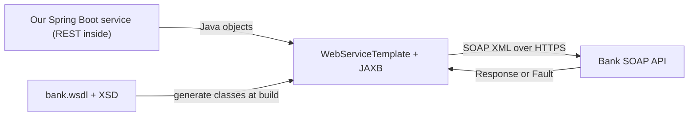

**SOAP vs REST:**

| | SOAP | REST |
|---|---|---|
| Format | XML only | Usually JSON, any |
| Contract | WSDL, strict | OpenAPI, optional |
| Transport | Mostly HTTP POST, can be JMS or SMTP | HTTP methods |
| Errors | SOAP Fault | HTTP status + Problem Details |
| Security | WS-Security (message-level) | TLS + OAuth2 (transport + token) |
| Caching | No | HTTP caching |
| Today | Legacy and regulated systems | Default for new APIs |

**Say this in the interview:**

> "SOAP is an XML protocol with an envelope, header and body, and a WSDL contract built on XSD types. Security is message-level with WS-Security. I would not choose it for a new API; REST or gRPC is simpler. But I still meet it when we integrate with banks or government systems. Then I generate JAXB classes from their WSDL and call it with Spring Web Services' WebServiceTemplate, or Apache CXF when we need heavy WS-Security."

**They may ask next:**
- **Is SOAP faster than REST?** Usually not. XML is bigger and slower to parse than JSON.
- **Why do banks keep it?** Old systems work, contracts are strict, and WS-Security signs each message, which auditors like.
- **How do you hide SOAP from the rest of your system?** Put it behind one adapter service (an anti-corruption layer) that exposes REST or events inside.

## A Spring Boot REST example

**In one line:** A clean Spring Boot API has record DTOs, Bean Validation, a thin controller, a service, one `@RestControllerAdvice`, and `RestClient` or HTTP interface clients to call others.

**Story:** A restaurant.
The waiter (controller) takes the order and checks it is complete (validation).
The chef (service) cooks. The complaint desk (advice) handles every problem the same way.
When the chef needs bread from the bakery next door, he uses the phone with a speed-dial card (HTTP interface client).

**How it works:**
1. **Records for DTOs:** short, immutable, Jackson reads and writes them.
2. **Validation:** `@Valid` on the body. Annotations on record fields. More: [Bean Validation](spring-ecosystem.md#bean-validation-valid).
3. **Controller:** maps HTTP to service calls. No business logic.
4. **Errors:** throw domain exceptions, map them in `@RestControllerAdvice` to `ProblemDetail`.
5. **Calling others:** `RestClient` (blocking, the modern choice) or an HTTP interface client with `@HttpExchange`. In Boot 4, `@ImportHttpServices` sets them up from properties. More: [OpenFeign vs HTTP interface clients](spring-ecosystem.md#openfeign-vs-http-interface-clients).

**Diagram:**

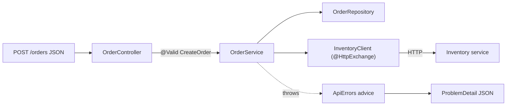

**Example: DTOs and controller.**

```java
record CreateOrder(@NotBlank String customerId,
                   @NotEmpty List<@Valid Line> lines) { }
record Line(@NotBlank String sku, @Positive int quantity) { }
record OrderDto(String id, String status, BigDecimal total) { }

@RestController
@RequestMapping("/orders")
class OrderController {
    private final OrderService service;
    OrderController(OrderService service) { this.service = service; }

    @PostMapping
    ResponseEntity<OrderDto> create(@Valid @RequestBody CreateOrder req) {
        OrderDto created = service.create(req);
        URI location = URI.create("/orders/" + created.id());
        return ResponseEntity.created(location).body(created);   // 201 + Location
    }

    @GetMapping("/{id}")
    OrderDto get(@PathVariable String id) { return service.find(id); } // 200
}
```

**Example: errors.**

```java
@RestControllerAdvice
class ApiErrors {
    @ExceptionHandler(OrderNotFound.class)
    ProblemDetail notFound(OrderNotFound ex) {
        return ProblemDetail.forStatusAndDetail(HttpStatus.NOT_FOUND, ex.getMessage());
    }

    @ExceptionHandler(OutOfStock.class)
    ProblemDetail outOfStock(OutOfStock ex) {
        ProblemDetail pd = ProblemDetail.forStatusAndDetail(HttpStatus.CONFLICT, ex.getMessage());
        pd.setType(URI.create("https://api.shop.com/problems/out-of-stock"));
        pd.setProperty("sku", ex.sku());                          // extra field
        return pd;
    }
}
```

`@Valid` failures throw `MethodArgumentNotValidException`. Spring turns it into a 400 Problem Details when `spring.mvc.problemdetails.enabled=true`, or you add your own handler with a field-errors list.

**Example: calling another service (Boot 4).**

```java
@HttpExchange("/stock")
interface InventoryClient {
    @GetExchange("/{sku}")
    Stock stock(@PathVariable String sku);
}

@Configuration
@ImportHttpServices(group = "inventory", types = InventoryClient.class)
class ClientsConfig { }
// application.yml: spring.http.serviceclient.inventory.base-url, connect-timeout, read-timeout

// Or plain RestClient, built from the auto-configured builder:
Stock s = restClient.get().uri("/stock/{sku}", sku)
        .retrieve()
        .body(Stock.class);   // 4xx/5xx throw RestClientResponseException
```

**Test it (MockMvc slice):**

```java
@WebMvcTest(OrderController.class)
class OrderControllerTest {
    @Autowired MockMvc mvc;
    @MockitoBean OrderService service;

    @Test
    void rejectsZeroQuantity() throws Exception {
        mvc.perform(post("/orders").contentType(APPLICATION_JSON)
                .content("""
                    {"customerId":"c1","lines":[{"sku":"A","quantity":0}]}"""))
           .andExpect(status().isBadRequest());                     // @Positive fails
    }
}
```

**Good and bad:**

| Good | Bad |
|---|---|
| Records as DTOs, entities stay inside | Return JPA entities (lazy loading errors, leaks fields) |
| Validation on the DTO | `if (req.qty() <= 0)` checks spread across services |
| Thin controller | Business logic and SQL in the controller |
| `RestClient` / HTTP interfaces with timeouts | New `RestTemplate` code, or no timeouts |

**Say this in the interview:**

> "I use records for request and response DTOs, with Bean Validation annotations and `@Valid` in the controller. The controller is thin: it maps HTTP to the service and returns 201 with a Location on create. Errors are domain exceptions mapped in one `@RestControllerAdvice` to ProblemDetail. To call other services I use RestClient or, in Boot 4, HTTP interface clients set up with `@ImportHttpServices`, always with timeouts. I test the web layer with `@WebMvcTest`."

**They may ask next:**
- **Why not return the entity?** It couples the API to the table, can trigger lazy loading, and may leak fields like password hashes.
- **RestTemplate?** Still works in 7.0. Spring Framework 7.1 (release candidates out in Nov 2026) marks it deprecated for removal, and it is planned to go in 8.0. Use `RestClient`. See [WebClient, RestClient and RestTemplate](spring.md#webclient-restclient-and-resttemplate).
- **MVC or WebFlux?** MVC with virtual threads for most APIs. See [Spring MVC vs WebFlux](spring.md#spring-mvc-vs-webflux).

## SOAP questions from the README list

Short answers to the older question list in the README. Each links to the deeper section above when there is one.
Most of this is legacy tech. Today: new APIs use REST, gRPC or events; you mostly meet SOAP when you call a bank or government system.

### What is a Web Service?

A web service is a program that other programs call over a network, using standard formats like XML or JSON over HTTP.
It lets a Java app talk to a .NET or Python app without sharing code.
The two big styles are SOAP (XML, strict contract) and REST (resources, usually JSON).
More: [REST principles](#rest-principles), [SOAP in 2026](#soap-in-2026).

### What is SOAP Web Service?

A SOAP web service is a web service where every request and response is a SOAP XML message, described by a WSDL contract.
The client sends an XML envelope (usually HTTP POST) and gets an XML envelope back.
Today: used mainly for integration with banks, insurance and government. More: [SOAP in 2026](#soap-in-2026).

### What is SOAP?

SOAP (it once meant Simple Object Access Protocol) is an XML-based messaging protocol, now a W3C standard (SOAP 1.1 and 1.2).
It defines the message shape (envelope, header, body, fault), not the business data.
It can run over HTTP, JMS or even email, but HTTP is the normal case.
More: [SOAP in 2026](#soap-in-2026).

### Waht is a SOAP Envelope?

The envelope is the root XML element of every SOAP message. It wraps an optional `Header` and a required `Body`.
Its namespace tells the version: SOAP 1.1 uses `http://schemas.xmlsoap.org/soap/envelope/`, SOAP 1.2 uses `http://www.w3.org/2003/05/soap-envelope`.
Think of it as the postal envelope: the address info goes in the header, the letter goes in the body.

### What is SOAP Header and SOAP Body?

The **header** is optional and carries extra info about the message: security tokens, transaction ids, routing, correlation ids.
The **body** is required and carries the real request or response data, or a `Fault` when something failed.
Rule of thumb: business data in the body, technical "envelope" data in the header (like HTTP headers vs HTTP body in REST).

### Can you give an example of SOAP Request and SOAP Response?

A request to get a country and its response:

```xml
<soapenv:Envelope xmlns:soapenv="http://schemas.xmlsoap.org/soap/envelope/"
                  xmlns:c="https://shop.com/countries">
  <soapenv:Header/>
  <soapenv:Body>
    <c:getCountryRequest><c:name>India</c:name></c:getCountryRequest>
  </soapenv:Body>
</soapenv:Envelope>
<!-- response body -->
<c:getCountryResponse>
  <c:country><c:name>India</c:name><c:capital>New Delhi</c:capital><c:currency>INR</c:currency></c:country>
</c:getCountryResponse>
```

The response also comes inside an `Envelope` and `Body`; only the body part is shown here.

### What is a SOAP Header? What kind of information is sent in a SOAP Header?

The SOAP header is the optional first child of the envelope. It holds data *about* the message, not business data.
Common content: WS-Security tokens and signatures, a username token, a correlation or transaction id, WS-Addressing info (reply-to, message id), locale.
A header block can have `mustUnderstand="1"`: the server must process it or return a fault.

### Can you give an example of a SOAP Header with Authentication information?

A WS-Security UsernameToken header:

```xml
<soapenv:Header>
  <wsse:Security soapenv:mustUnderstand="1"
      xmlns:wsse="http://docs.oasis-open.org/wss/2004/01/oasis-200401-wss-wssecurity-secext-1.0.xsd">
    <wsse:UsernameToken>
      <wsse:Username>shop-client</wsse:Username>
      <wsse:Password Type="...#PasswordDigest">base64digest==</wsse:Password>
      <wsse:Nonce>random==</wsse:Nonce> <!-- stops replay -->
    </wsse:UsernameToken>
  </wsse:Security>
</soapenv:Header>
```

The `...` stands for the long OASIS profile URL. Plain text passwords must only go over HTTPS. Banks often use X.509 certificate signatures instead.

### What is WSDL (Web Service Definition Language)?

WSDL (officially Web Services Description Language) is an XML file that describes a SOAP service.
It lists the operations, the input and output messages, the data types (via XSD), and the URL.
Clients generate Java classes from it (JAXB, `wsimport`, CXF `wsdl2java`), so they never write XML by hand.
It is the SOAP version of an OpenAPI file. More: [OpenAPI](#openapi-contract-first-vs-code-first).

### What are the different parts of a WSDL?

WSDL 1.1 (the one you will meet) has five main parts:
- `types`: the XSD schema for the data.
- `message`: the input and output messages, built from those types.
- `portType`: the operations (like an interface), each with input, output and fault.
- `binding`: how the operations go on the wire (SOAP 1.1 or 1.2, document/literal style).
- `service` with `port`: the actual URL of the service.

### What is Contract First Approach?

You write the contract first (XSD/WSDL for SOAP, OpenAPI for REST), agree on it with the other team, then generate code from it.
The opposite is code-first: write Java, generate the contract.
Spring Web Services supports only contract-first, because a stable XML contract matters more than easy Java.
Today: the same choice exists for REST. More: [OpenAPI: contract-first vs code-first](#openapi-contract-first-vs-code-first).

### What is an XSD?

XSD (XML Schema Definition) is an XML file that defines the allowed structure of other XML: element names, types, order, required or optional, min and max.
SOAP services use XSD to define their request and response types. A validator can reject bad XML before your code runs.
It is like JSON Schema for XML.

### Can you give an example of an XSD?

```xml
<xs:schema xmlns:xs="http://www.w3.org/2001/XMLSchema"
           targetNamespace="https://shop.com/countries" elementFormDefault="qualified">
  <xs:element name="getCountryRequest">
    <xs:complexType><xs:sequence>
      <xs:element name="name" type="xs:string"/>          <!-- required -->
    </xs:sequence></xs:complexType>
  </xs:element>
  <xs:complexType name="country">
    <xs:sequence>
      <xs:element name="name" type="xs:string"/>
      <xs:element name="population" type="xs:int"/>
      <xs:element name="capital" type="xs:string" minOccurs="0"/> <!-- optional -->
    </xs:sequence>
  </xs:complexType>
</xs:schema>
```

### What is JAXB?

JAXB (Jakarta XML Binding) maps Java classes to XML and back, like Jackson does for JSON.
You can generate Java classes from an XSD (`xjc`) and then marshal (Java to XML) and unmarshal (XML to Java).
It was removed from the JDK in Java 11. Today it is a separate library with the `jakarta.xml.bind` package (Glassfish JAXB runtime).

### How do you configure a JAXB Plugin?

Add a Maven plugin that runs `xjc` on your XSD at build time and puts the generated classes in `target/generated-sources`.
The Spring guide uses the Codehaus plugin (version 4.x for Jakarta and Boot 4):

```xml
<plugin>
  <groupId>org.codehaus.mojo</groupId>
  <artifactId>jaxb2-maven-plugin</artifactId>
  <version>4.0.0</version>
  <executions><execution><id>xjc</id><goals><goal>xjc</goal></goals></execution></executions>
  <configuration>
    <sources><source>${project.basedir}/src/main/resources/countries.xsd</source></sources>
  </configuration>
</plugin>
```

Gradle users add an `xjc` task or a JAXB plugin. Do not edit generated classes; change the XSD.

### What is an Endpoint?

In Spring Web Services, an endpoint is a class marked `@Endpoint` that handles incoming SOAP messages.
Methods inside it are mapped to messages by `@PayloadRoot` (the namespace and root element name of the body).
It is the SOAP version of a `@RestController`.

### Can you show an example endpoint written with Spring Web Services?

```java
@Endpoint
public class CountryEndpoint {
    private static final String NS = "https://shop.com/countries";
    private final CountryRepository repo;
    public CountryEndpoint(CountryRepository repo) { this.repo = repo; }

    @PayloadRoot(namespace = NS, localPart = "getCountryRequest") // matches body root element
    @ResponsePayload
    public GetCountryResponse getCountry(@RequestPayload GetCountryRequest request) {
        GetCountryResponse response = new GetCountryResponse();     // JAXB class from the XSD
        response.setCountry(repo.findCountry(request.getName()));
        return response;
    }
}
```

`@RequestPayload` unmarshals the body into the JAXB object. `@ResponsePayload` marshals the return value into the response body.

### What is a MessageDispatcherServlet?

It is the front servlet of Spring Web Services, like `DispatcherServlet` for Spring MVC.
It receives SOAP HTTP requests, finds the right `@Endpoint` method, and writes the SOAP response.
It can also serve the WSDL file.

### How do you configure a MessageDispatcherServlet?

With Spring Boot you usually do nothing: add `spring-boot-starter-webservices` and Boot registers it for you.
The URL path is set by `spring.webservices.path` (default `/services`).
Without Boot, you register it yourself:

```java
@Bean
ServletRegistrationBean<MessageDispatcherServlet> ws(ApplicationContext ctx) {
    MessageDispatcherServlet servlet = new MessageDispatcherServlet();
    servlet.setApplicationContext(ctx);
    servlet.setTransformWsdlLocations(true);   // WSDL address follows the host name
    return new ServletRegistrationBean<>(servlet, "/ws/*");
}
```

### How do you generate a WSDL using Spring Web Services?

Spring WS can build the WSDL from your XSD with a `DefaultWsdl11Definition` bean. The bean name becomes the URL: `/services/countries.wsdl`.

```java
@Bean(name = "countries")
DefaultWsdl11Definition countries(XsdSchema countriesSchema) {
    DefaultWsdl11Definition wsdl = new DefaultWsdl11Definition();
    wsdl.setPortTypeName("CountriesPort");
    wsdl.setLocationUri("/services");
    wsdl.setTargetNamespace("https://shop.com/countries");
    wsdl.setSchema(countriesSchema);   // operations come from *Request / *Response elements
    return wsdl;
}
@Bean XsdSchema countriesSchema() { return new SimpleXsdSchema(new ClassPathResource("countries.xsd")); }
```

If you already have a WSDL file, put it in `classpath:/wsdl` and set `spring.webservices.wsdl-locations=classpath:/wsdl`. Boot exposes it as is.

### How do you implement error handling for SOAP Web Services?

Throw an exception from the endpoint, and Spring WS turns it into a SOAP Fault.
- Simple: annotate your exception with `@SoapFault(faultCode = FaultCode.CLIENT)`. The message becomes the fault string.
- Central: a `SoapFaultMappingExceptionResolver` bean maps exception classes to fault codes, like a `@RestControllerAdvice` for SOAP.
- Custom details: extend `SoapFaultAnnotationExceptionResolver` or write your own resolver to add a `detail` element with an error code.

```java
@SoapFault(faultCode = FaultCode.CLIENT)  // client's fault, like a 4xx
public class CountryNotFoundException extends RuntimeException {
    public CountryNotFoundException(String name) { super("No country: " + name); }
}
```

Never put stack traces in the fault. More: [Error format](#error-format-problem-details) for the REST version.

### What is a SOAP Fault?

A SOAP Fault is the standard error element inside the SOAP body. It is SOAP's version of an HTTP error status plus Problem Details.
SOAP 1.1 fields: `faultcode` (`Client` or `Server`), `faultstring`, optional `faultactor` and `detail`.
SOAP 1.2 uses `Code`, `Reason` and `Detail`, with `Sender` and `Receiver` instead of `Client` and `Server`.
Over HTTP a fault usually comes with status 500.

## REST questions from the README list

Short answers to the older question list in the README. Each links to the deeper section above when there is one.

### What is REST?

REST (Representational State Transfer) is an architecture style for APIs. Everything is a resource with a URL, and you use HTTP methods (GET, POST, PUT, PATCH, DELETE) on it.
Requests are stateless and responses can be cached.
More: [REST principles](#rest-principles).

### What are the key concepts in designing RESTful API?

Resources with noun URLs, the right HTTP method, the right status code, statelessness, and representations (JSON).
Then the senior parts: paging, versioning, a standard error format, idempotency, caching and security.
More: [API design](#api-design-naming-nesting-filtering-sorting), [HTTP methods](#http-methods-safe-and-idempotent), [Status codes](#status-codes-that-matter).

### What are the Best Practices of RESTful Services?

- Plural nouns, one level of nesting, filters and sort in query params.
- Correct methods and status codes (201 + Location, 204, 400, 404, 409, 429).
- One error format (RFC 9457 Problem Details), cursor paging for big lists, versioning only for breaking changes.
- Idempotency keys for POST, ETags for caching and concurrency, HTTPS + OAuth2, rate limits, OpenAPI docs.

More: [API design](#api-design-naming-nesting-filtering-sorting).

### Can you show the code for an example Get Resource method with Spring REST?

```java
@RestController
@RequestMapping("/orders")
class OrderController {
    @GetMapping("/{id}")
    OrderDto get(@PathVariable String id) {   // 200 + JSON; throw OrderNotFound for 404
        return service.find(id);
    }
}
```

More: [A Spring Boot REST example](#a-spring-boot-rest-example).

### What happens when we return a bean from a Request Mapping Method?

Spring takes the return value and writes it to the response body with an `HttpMessageConverter`.
`@RestController` = `@Controller` + `@ResponseBody`, so this is the default.
The converter is picked by the `Accept` header and by what is on the classpath. Jackson writes JSON (Jackson 3 in Boot 4); Jackson XML or JAXB writes XML. Status is 200 unless you change it.

### What is GetMapping and what are the related methods available in Spring MVC?

`@GetMapping` is a short form of `@RequestMapping(method = RequestMethod.GET)`.
The others: `@PostMapping`, `@PutMapping`, `@PatchMapping`, `@DeleteMapping`.
In Spring Framework 7 they also take a `version` attribute for API versioning. For clients, the matching annotations are `@GetExchange`, `@PostExchange` and so on.

### Can you show the code for an example Post Resource method with Spring REST?

```java
@PostMapping
ResponseEntity<OrderDto> create(@Valid @RequestBody CreateOrder req) {
    OrderDto created = service.create(req);
    return ResponseEntity
        .created(URI.create("/orders/" + created.id()))  // 201 + Location header
        .body(created);
}
```

More: [A Spring Boot REST example](#a-spring-boot-rest-example).

### What is the appropriate HTTP Response Status for successful execution of a Resource Creation?

**201 Created**, with a `Location` header that points to the new resource, and usually the new resource in the body.
If the work is only queued and not done yet, use **202 Accepted** with a status URL.
More: [Status codes](#status-codes-that-matter).

### Why do we use ResponseEntity in a RESTful Service?

`ResponseEntity` lets you control the whole response: status code, headers and body.
Use it for 201 + Location, ETag and Cache-Control headers, or 204 with no body.
If you only return 200 + body, return the object directly; it is shorter. For a fixed status, `@ResponseStatus` also works.

### What is HATEOAS?

Hypermedia As The Engine Of Application State: each response has links to related resources and to the next allowed actions.
The client follows links instead of building URLs. Rarely used in practice.
More: [HATEOAS](#hateoas).

### Can you give an Example Response for HATEOAS?

HAL format, the default in Spring HATEOAS:

```json
{
  "id": 42,
  "status": "CREATED",
  "_links": {
    "self":   { "href": "http://api.shop.com/orders/42" },
    "orders": { "href": "http://api.shop.com/orders" },
    "cancel": { "href": "http://api.shop.com/orders/42/cancellation" }
  }
}
```

### How do we implement it using Spring?

Add `spring-boot-starter-hateoas`. Wrap your DTO in `EntityModel` and add links with `WebMvcLinkBuilder`:

```java
@GetMapping("/{id}")
EntityModel<OrderDto> get(@PathVariable long id) {
    OrderDto o = service.find(id);
    EntityModel<OrderDto> model = EntityModel.of(o,
        linkTo(methodOn(OrderController.class).get(id)).withSelfRel(),
        linkTo(methodOn(OrderController.class).all()).withRel("orders"));
    if (o.status().equals("CREATED"))   // only show cancel when allowed
        model.add(linkTo(methodOn(OrderController.class).cancel(id)).withRel("cancel"));
    return model;
}
```

Use `CollectionModel` for lists and `PagedModel` for pages.

### How do you document RESTful web services?

With an OpenAPI document, plus a Swagger UI page to read and try it.
In Spring Boot, springdoc-openapi generates it from the controllers (code-first), or you write `openapi.yaml` first (contract-first).
Add examples, error responses and auth info. More: [OpenAPI](#openapi-contract-first-vs-code-first).

### Can you give a brief idea about Swagger Documentation?

Swagger was the original name of the API description format; since version 3 the spec is called OpenAPI.
"Swagger" now means the tools: Swagger UI (a web page that shows the API and lets you call it), Swagger Editor, and Swagger Codegen.
The document lists paths, parameters, request and response schemas, status codes and security.

### How do you automate generation of Swagger Documentation from RESTful Web Services?

Add springdoc-openapi (version 3.x for Boot 4, 2.x for Boot 3). It scans your controllers at startup.

```xml
<dependency>
  <groupId>org.springdoc</groupId>
  <artifactId>springdoc-openapi-starter-webmvc-ui</artifactId>
  <version>${springdoc.version}</version>
</dependency>
```

Open `/v3/api-docs` for the JSON and `/swagger-ui.html` for the page.
Today: the old Springfox library is dead (no Boot 3 support). Use springdoc. More: [springdoc-openapi](spring-ecosystem.md#api-documentation-with-springdoc-openapi).

### How do you add custom information to Swagger Documentation generated from RESTful Web Services?

Use annotations on code and an `OpenAPI` bean for global info:

```java
@Bean
OpenAPI api() {
    return new OpenAPI().info(new Info()
        .title("Order API").version("1.0").description("Orders for the shop"));
}

@Operation(summary = "Get one order")
@ApiResponse(responseCode = "404", description = "Order not found")
@GetMapping("/{id}") OrderDto get(@PathVariable String id) { ... }
```

`@Schema(description = "...", example = "...")` on DTO fields adds field docs. Bean Validation annotations show up as rules.

### What is Swagger-UI?

A web page that reads an OpenAPI document and shows every endpoint, with a "Try it out" button to send real requests.
springdoc serves it at `/swagger-ui.html`. Turn it off or protect it in production: `springdoc.swagger-ui.enabled=false`.

### What is "Representation" of a Resource?

A representation is the data format you send for a resource at a moment in time: JSON, XML, CSV, PDF.
The resource is the idea ("order 42"). The representation is one view of it.
The same `/orders/42` can return JSON to an app and a PDF to a printer. That is the "R" in REST.

### What is Content Negotiation?

The client says which formats it can accept, and the server picks the best one it supports.
Example: `Accept: application/xml` gets XML, `Accept: application/json` gets JSON, from the same URL.
If the server supports none of them, it returns **406 Not Acceptable**. If the request body type is not supported, **415 Unsupported Media Type**.

### Which HTTP Header is used for Content Negotiation?

`Accept` for the response format (also `Accept-Language` and `Accept-Encoding`).
`Content-Type` says the format of the body that is being sent.
The server adds `Vary: Accept` so caches keep the JSON and XML versions apart.

### How do we implement it using Spring Boot?

It works out of the box: Spring picks the `HttpMessageConverter` that matches the `Accept` header.
To limit formats on one method, use `produces`: `@GetMapping(value = "/{id}", produces = {APPLICATION_JSON_VALUE, APPLICATION_XML_VALUE})`.
To allow `?format=xml` instead of the header: `spring.mvc.contentnegotiation.favor-parameter=true`.

### How do you add XML support to your RESTful Services built with Spring Boot?

Add the Jackson XML module. Spring MVC finds it and registers an XML converter.

```xml
<dependency>
  <!-- Boot 4 (Jackson 3): tools.jackson.dataformat. Boot 3: com.fasterxml.jackson.dataformat -->
  <groupId>tools.jackson.dataformat</groupId>
  <artifactId>jackson-dataformat-xml</artifactId>
</dependency>
```

Now `Accept: application/xml` returns XML. Without Jackson XML, Spring can use JAXB if the classes have JAXB annotations.

### How do you implement Exception Handling for RESTFul Web Services?

Throw domain exceptions in services. Handle them in one `@RestControllerAdvice` with `@ExceptionHandler` methods that return `ProblemDetail` (RFC 9457).
Set `spring.mvc.problemdetails.enabled=true` so Spring's own errors use the same format.
More: [Error format](#error-format-problem-details), [Global error handling](spring-ecosystem.md#global-error-handling-with-restcontrolleradvice-and-problemdetail).

### What are the best practices related to Exception Handling with respect to RESTful Web Services?

- One error shape everywhere (Problem Details), with a stable `type` or `code`.
- The right status code; never 200 with `"error"` in the body.
- No stack traces, SQL or class names to clients. Log them with a `traceId`, and return the `traceId`.
- A catch-all handler for `Exception` that returns 500 and logs.
- Field-level validation errors in a list.

More: [Error format](#error-format-problem-details).

### What are the different error status that you would return in RESTful Web Services?

400 (bad input), 401 (not logged in), 403 (not allowed), 404 (not found), 405 (wrong method), 409 (conflict), 412 (stale `If-Match`), 415 (wrong content type), 422 (business rule failed), 429 (rate limit), 500 (bug), 502/503/504 (upstream or overload problems).
More: [Status codes](#status-codes-that-matter).

### How would you implement them using Spring Boot?

- Map custom exceptions in `@RestControllerAdvice` to `ProblemDetail.forStatusAndDetail(HttpStatus.CONFLICT, msg)`.
- Or throw `ResponseStatusException(HttpStatus.NOT_FOUND, "Order not found")` for simple cases.
- Or extend `ErrorResponseException` so the exception carries its own status.
- Spring already returns 400, 405, 406 and 415 for framework errors.

For 422 in Spring 7 use `HttpStatus.UNPROCESSABLE_CONTENT`; the old name `UNPROCESSABLE_ENTITY` is deprecated. More: [Spring Boot REST example](#a-spring-boot-rest-example).

### What HTTP Response Status do you return for validation errors?

**400 Bad Request** is the common choice, and Spring's default for `@Valid` failures.
Some teams use **422 Unprocessable Content** when the JSON is well-formed but breaks a rule. Either is fine if you are consistent and return the field errors in the body.

### How do you handle Validation Errors with RESTful Web Services?

Put Bean Validation annotations (`@NotBlank`, `@Positive`, `@Email`) on the DTO, and `@Valid` on the `@RequestBody`.
Spring throws `MethodArgumentNotValidException`. Handle it in the advice and return Problem Details with a list of field errors:

```java
@ExceptionHandler(MethodArgumentNotValidException.class)
ProblemDetail invalid(MethodArgumentNotValidException ex) {
    ProblemDetail pd = ProblemDetail.forStatusAndDetail(HttpStatus.BAD_REQUEST, "Invalid request");
    pd.setProperty("errors", ex.getBindingResult().getFieldErrors().stream()
        .map(e -> Map.of("field", e.getField(),
                         "message", String.valueOf(e.getDefaultMessage()))).toList());
    return pd;
}
```

More: [Bean Validation](spring-ecosystem.md#bean-validation-valid).

### Why do we need Versioning for RESTful Web Services?

Clients (mobile apps, partners) do not update at the same time as your server.
When you must make a breaking change (remove or rename a field, change a type), versioning lets old clients keep working while new clients move.
First try to avoid breaking: add optional fields instead. More: [API versioning](#api-versioning).

### What are the versioning options that are available?

- URI: `/v1/orders` (most common).
- Header: `API-Version: 2` (or a date, like Stripe).
- Media type: `Accept: application/vnd.shop.v2+json`.
- Query param: `/orders?version=2`.

More: [API versioning](#api-versioning).

### How do you implement Versioning for RESTful Web Services?

Spring Framework 7 / Boot 4 has built-in versioning. Put `version = "2"` on the mapping and tell Boot where to read it:

```properties
spring.mvc.apiversion.use.header=API-Version
# or: spring.mvc.apiversion.use.path-segment=0   for /v1/orders
```

With the path-segment option, the mapping also needs the version in the path, for example `/{version}/orders`.

In Boot 3, use separate mappings (`/v1/orders`, `/v2/orders`) or `headers = "API-Version=2"` / `produces = "application/vnd.shop.v2+json"`.
Keep one service; only the DTOs and mappers differ per version. More: [API versioning](#api-versioning).

## Interview questions

**1. What makes an API RESTful?**
Resources with URLs, standard HTTP methods, status codes, stateless requests, and cacheable responses.
Most real APIs stop at Richardson level 2 and skip HATEOAS. [More](#rest-principles)

**2. What is the difference between safe and idempotent?**
Safe: no change to data (GET, HEAD, OPTIONS). Idempotent: many calls leave the same state as one (GET, PUT, DELETE).
POST is neither. [More](#http-methods-safe-and-idempotent)

**3. PUT vs PATCH vs POST?**
POST creates or runs an action. PUT replaces the whole resource, idempotent. PATCH changes some fields.
[More](#http-methods-safe-and-idempotent)

**4. 401 vs 403?**
401: we do not know who you are (no or bad token). 403: we know you, but you are not allowed.
[More](#status-codes-that-matter)

**5. 400 vs 409 vs 422?**
400: bad shape (broken JSON, wrong type). 409: clashes with current state (duplicate, already cancelled). 422: valid shape, but a business rule fails.
[More](#status-codes-that-matter)

**6. 502 vs 503 vs 504?**
502: the gateway got a bad answer from the service. 503: the service is overloaded or down for maintenance. 504: the gateway waited too long.
[More](#status-codes-that-matter)

**7. Offset vs cursor pagination?**
Offset is simple and allows "page 50", but is slow on deep pages and skips or repeats items when data changes.
Cursor uses the index (`WHERE key < last`), is fast and stable, but only goes next or previous. [More](#pagination-offset-vs-cursor)

**8. How do you version an API?**
Avoid breaking changes first. Then URI (`/v1`), header, or media type. Spring 7 has `version` on mappings.
Announce removal with Deprecation and Sunset headers. [More](#api-versioning)

**9. What is RFC 9457?**
Problem Details for HTTP APIs: a standard JSON error shape with type, title, status, detail, instance.
Spring's `ProblemDetail` implements it. [More](#error-format-problem-details)

**10. How do you make POST safe to retry?**
The client sends an `Idempotency-Key`. The server stores it with a unique constraint and returns the saved result on a repeat.
[More](#idempotency-keys-for-post)

**11. How does an ETag save bandwidth?**
The client sends `If-None-Match` with the ETag it has. If nothing changed, the server returns 304 with no body.
[More](#caching-with-etag-and-cache-control)

**12. How do you stop two users overwriting each other's changes?**
Optimistic concurrency: GET returns an ETag (the version). PUT sends `If-Match`. If the version changed, return 412.
[More](#concurrency-with-if-match)

**13. An export takes 5 minutes. How do you design the API?**
`POST` returns 202 with a job URL. A worker does the job from a queue. The client polls with `Retry-After`, or gets a webhook.
[More](#long-running-operations)

**14. JWT vs opaque token?**
JWT is checked locally with the public key, fast, but cannot be revoked before expiry. Opaque needs introspection, but can be revoked at once.
Keep JWTs short-lived. [More](#api-security)

**15. Does CORS protect your API?**
No. It only controls which websites' JavaScript in a browser may call you. Tokens and authorization protect the API.
[More](#api-security)

**16. What is the top API security risk?**
Broken object-level authorization: the API does not check that order 42 belongs to the caller.
Check ownership on every object. [More](#api-security)

**17. Contract-first or code-first?**
Code-first (springdoc) is fast for internal APIs. Contract-first (OpenAPI Generator) is better for public APIs and parallel teams.
Add an OpenAPI diff in CI. [More](#openapi-contract-first-vs-code-first)

**18. Do you use HATEOAS?**
Rarely. It adds links for next actions, but most clients are built for one API and use OpenAPI.
Useful for public APIs with many state-based actions. [More](#hateoas)

**19. When would you choose gRPC over REST?**
Internal, high-volume service-to-service calls, or streaming. Protobuf is small and fast, and the `.proto` file is a strict contract.
Not for browsers without a proxy. [More](#rest-vs-graphql-vs-grpc-vs-websocket-vs-sse)

**20. SSE or WebSocket for live notifications?**
SSE: server to client only, plain HTTP, auto-reconnect. WebSocket: two-way, for chat or games.
Notifications and LLM streaming fit SSE. [More](#rest-vs-graphql-vs-grpc-vs-websocket-vs-sse)

**21. How do you make webhooks reliable and secure?**
Outbox plus retries with backoff, an event id for dedup, and an HMAC signature with a timestamp to stop replays.
The receiver replies 2xx fast and works from a queue. [More](#webhooks-design)

**22. When do you still use SOAP?**
When integrating with banks, insurance or government systems that only offer SOAP.
Generate JAXB classes from their WSDL and call them with `WebServiceTemplate` or CXF, behind one adapter. [More](#soap-in-2026)

**23. Why not return JPA entities from a controller?**
It ties the API to the table, can trigger lazy loading errors, and can leak fields. Use record DTOs.
[More](#a-spring-boot-rest-example)

**24. RestTemplate, RestClient or WebClient?**
RestClient for blocking code (RestTemplate is deprecated for removal from Spring 7.1). WebClient for reactive code. HTTP interface clients on top of either.
[More](#a-spring-boot-rest-example)
